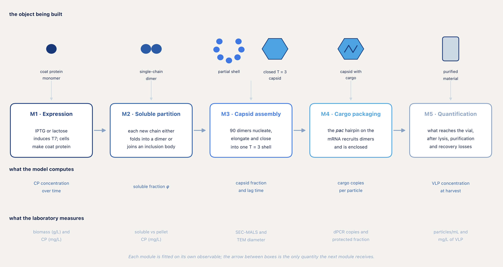

------------------------------------------------------------------------

## 0. Conventions, notation and units

### 0.1 The coat-protein pool and the single-chain dimer

Throughout, the coat-protein pool $P$ is defined as

$$P \equiv \frac{\text{mass concentration of coat protein}}{13.7\ \text{kDa}} \qquad\qquad (0.1)$$

irrespective of construct architecture. Our construct is a single-chain dimer: two coat-protein coding sequences in tandem, joined by a linker and expressed as one polypeptide of roughly 28 kDa, an arrangement first used to rescue RNA-binding mutants as heterodimers [1]. Under Equation (0.1) that one polypeptide contributes 2 to $P$, even though densitometry resolves a single band at 28 kDa. Three things follow. $P/P_{ref}$ is a proteome *mass* fraction, which is the quantity the resource-allocation literature constrains [2]. $N = 90$ assembly units remains the correct stoichiometry with no construct-dependent correction. And the handoff Sol/2 from M2 to M3 is correct as written. The alternative convention, in which $P$ counts 28 kDa polypeptides, is internally consistent but forces $\varphi_{crit}$ to be reinterpreted and doubles every reported mass yield.

Because the per-gel scale factor is a free parameter (Section 2.15), the factor of two is not identifiable from densitometry. It has to be declared rather than inferred. This is the most consequential clerical decision in the framework, and it is stated first for that reason.

### 0.2 Symbols, constants and units

One list. The "determined by" column is the link between the model and the bench: *measured* means the value is set or read directly, *fitted* means it comes out of our own data, *literature* means it is taken from a published measurement with the source given, and *fixed* means it is a structural constant.

| Symbol | Meaning | Unit | Module | Determined by |
|---|---|---|---|---|
| $X$ | biomass concentration | gDCW L⁻¹ | M1 | measured |
| $\mu$, $\mu_{max}$ | specific and maximum growth rate | min⁻¹ | M1 | fitted |
| $X_{max}$ | carrying capacity | gDCW L⁻¹ | M1 | fitted |
| $K_{DCW}$, $f_{dry}$ | OD₆₀₀-to-biomass slope; dry fraction of wet pellet | gDCW L⁻¹ OD⁻¹; — | M1 | measured (calibration) |
| $P$ | coat-protein concentration | mg L⁻¹ (µM internally) | M1 | measured |
| $P_{ref}$ | reference proteome in CP-mass equivalents | 18 000 µM | M1 | literature |
| $\varphi_h$, $\varphi_{crit}$, $\psi$ | heterologous mass fraction, its critical value, capacity factor | — | M1 | fitted / derived |
| $I$, $L_e$, $L_i$, $Al$, Glc | IPTG, external and internal lactose, allolactose, glucose | µM, mM, mM, µM, mM | M1 | measured / fitted |
| $B$, $Y_p$ | β-galactosidase and LacY levels | normalised | M1 | fitted |
| $K_I$, $h$ | half-maximal inducer concentration, Hill exponent | µM, — | M1 | fitted |
| $\tilde R$, $\tilde m$ | scaled T7 polymerase and transcript pools | — | M1 | latent |
| $k_R$, $k_m$ | polymerase and transcript relaxation rates | min⁻¹ | M1 | fitted (ordered pair) |
| $G$, $\varepsilon$, $k_{deg}$ | lumped synthesis gain, basal leak, first-order CP loss | µM min⁻¹, —, min⁻¹ | M1 | fitted |
| $\kappa_g$ | per-gel standard-curve slope (band intensity → mg L⁻¹) | — | M1, M2 | fitted |
| $s$, $s_{50}$ | synthesis flux, its half-partition value | nM s⁻¹ | M1→M2 | derived / fitted |
| $n$ | aggregation order | — | M2 | fixed at 2 |
| $\Delta E/R$ | Arrhenius coefficient of $s_{50}$ | K | M2 | fitted; 20 000 K measured |
| $\phi$, $\varphi$ | escaping (soluble) fraction | — | M2 | computed |
| Sol, Agg, Cap | soluble, aggregated and encapsidated pools | µM | M2 | measured |
| $\delta$ | band detection limit, as a fraction of lane intensity | 0.01 | M2 | measured |
| $N$, $C_{tot}$ | dimers per capsid, total dimer–dimer contacts | 90, 180 | M3 | fixed (geometry) |
| $c_i$, $f_i$ | contact schedule, addition degeneracies | — | M3 | **placeholder — enumerate from structure** |
| $\Delta G_{contact}$ | dimer–dimer contact free energy | kcal mol⁻¹ | M3 | literature; −3.82 from $T_m$ |
| $c^{\star}$ | pseudo-critical concentration | µM dimer | M3 | computed; 3.60 µM |
| $k_{on}$ | association rate constant | µM⁻¹ min⁻¹ | M3 | literature |
| $f_{correct}$ | TEM-correct fraction, diameter within 27 ± 2 nm | — | M3, M5 | measured |
| $\Delta G_{nuc}$ | nucleation aid from the *pac* hairpin | kcal mol⁻¹ | M4 | to be fitted |
| $\alpha$, $\beta$, $\sigma_c$ | MM/PB(GB)SA calibration slope, intercept, residual scale | — | M4 | to be fitted |
| CPP, $f_{loaded}$ | cargo copies per particle, loaded fraction | copies, — | M5 | measured |
| $\epsilon_{ext}$, $\epsilon_{rel}$ | extraction and capsid-disruption recovery | — | M5 | **measured by the recovery controls** |
| $\lambda$ | mean dPCR occupancy | copies per partition | M5 | measured |

Working units are µM and minutes inside the expression module, mM for extracellular sugars, nM s⁻¹ for the flux at the M1/M2 interface, kcal mol⁻¹ against a 1 M standard state for free energies, and µM of dimer for assembly concentrations, which requires the $10^{6}$ conversion of Section 4.3.
The partition function $\phi(s)$ of Module M2 is defined against a half-saturation flux $s_{50}$ whose literature-adjacent scale is per second, whereas the expression module works naturally in per minute over a twenty-four-hour horizon. The conversion, applied at one place only, is $1\ \text{µM}\,\text{min}^{-1} = 16.67\ \text{nM}\,\text{s}^{-1}$. Free energies are negative for favourable association. Logarithms are natural unless a base is given. $RT = 0.5924$ kcal mol⁻¹ at 298.15 K and 0.6163 kcal mol⁻¹ at 310.15 K; the temperature in use is stated at every point of use.

### 0.3 Evidence classes and confidence tiers

Two orthogonal labels are attached to statements in this document, and both are used in the accompanying notebooks. Neither is decoration: the point of carrying them is that a reader can tell, without re-deriving anything, how much weight a given sentence is entitled to.

The **evidence class** describes where a model term came from.

| Class | Meaning |
|---|---|
| Direct | The cited work reports this functional form or this numerical value |
| Adapted | The literature establishes the mechanism; the specific functional form is ours |
| Assumption | A modelling choice with no literature claim behind it, to be defended by reasoning rather than by citation |
| Reparam. | A mathematical restatement carrying no empirical content |

Labelling a term as an assumption is not an admission of weakness. Labelling an assumption as *Direct* would be.

The **confidence tier** describes how a stated result was obtained.

| Tier | Meaning |
|---|---|
| A | Analytic. Derived in closed form and checkable with pen and paper |
| B | Literature-anchored. A number or bound taken from published measurement, with the source given |
| C | Computational. Produced by the notebooks at the stated parameter values, and therefore conditional on them |

Tier C results move if the parameters move. Where a Tier C number is quoted below, the notebook and section that produced it can be found in Appendix A.

------------------------------------------------------------------------

------------------------------------------------------------------------

# PART I — SCIENTIFIC BACKGROUND AND ARCHITECTURE

## 1. The structural problem

### 1.1 The deliverable and its factorisation

Interaction with stakeholders during our integrated human practices work settled what the framework had to deliver: not a protein yield, but the concentration of correctly assembled, cargo-loaded particles in the harvested culture. That quantity factorises:

$$[\text{VLP}]_{harvest}\ \left(\text{mg}\,\text{L}^{-1}\right) = [CP]\,\left(\text{mg}\,\text{L}^{-1}\right)\, f_{sol}\, f_{cap}\, f_{correct}\, f_{loaded}\,\eta_{purif} \qquad\qquad (1.1)$$

with $[CP]$ the total coat protein synthesised, $f_{sol}$ the fraction that folds rather than aggregating, $f_{cap}$ the fraction of folded protein that closes into shells, $f_{correct}$ the fraction of particles within the accepted size window, $f_{loaded}$ the fraction of shells carrying cargo, and $\eta_{purif}$ the recovery through purification. Each factor is governed by different physics and each is reported by a different assay. The whole architecture of the framework follows from that one fact.

Dividing by an antigen mass per dose $d_{mg}$ gives a dose count per litre, and we report it because a deployment plan needs one. It is a derived planning figure rather than a modelling result: it inherits every uncertainty in Equation (1.1) and adds a dose size that no experiment of ours constrains. An earlier version of this document made the dose count the headline quantity. That was a mistake of emphasis, corrected here: bioprocess work is organised around a titre, and a titre is what the framework predicts and what an experiment can falsify.

### 1.2 Why one model with one parameter vector could not work

Our first attempt was the obvious one: write a single model with one parameter vector $\theta$, predict the titre, and fit $\theta$ to measured titre. Structural degeneracy makes that objective unreachable, and the argument is short enough to give in full.

> **Proposition 1.1.** Let the predicted titre be $T(\theta) = \prod_{i=1}^{k} g_i(\theta_i)$, where the $g_i$ are the $k$ factors of Equation (1.1), each depending on a disjoint block $\theta_i$ of parameters and each strictly positive. Suppose the only observable is $T$. Then the Jacobian of the observation map has rank at most one, and for any observed value $T_0$ the preimage $\{\theta : T(\theta) = T_0\}$ contains a manifold of dimension $k-1$ along which the likelihood is exactly constant.

*Proof.* Work in logarithmic coordinates, $u_i = \ln g_i$. Then $\ln T = \sum_i u_i$, so $\partial \ln T/\partial u_i = 1$ for every $i$. The sensitivity vector of the single observable with respect to $(u_1,\ldots,u_k)$ is therefore $(1,1,\ldots,1)$, and the Jacobian $J = \partial \ln T/\partial u$ is the $1 \times k$ matrix of ones, of rank one. Its null space is the $(k-1)$-dimensional hyperplane $\{\delta u : \sum_i \delta u_i = 0\}$. Displacement in that hyperplane leaves $\ln T$, and hence the likelihood, exactly unchanged. Each $g_i$ is strictly positive and continuous, so the corresponding displacement in $\theta$ is realisable. $\square$

With $k = 6$ factors this leaves a five-dimensional flat direction, and no quantity of titre data removes it, because the degeneracy lives in the observation map rather than in the noise. A tenfold underestimate of the soluble fraction compensated by a tenfold overestimate of the synthesis gain is not merely hard to tell apart from the truth. It is indistinguishable in principle. Structural identifiability of this kind is the first thing to check in any multi-stage model, and the standard remedy is more independent observables rather than better priors [3].

Three corollaries followed, and each became a design rule.

> **Corollary 1.** Each additional independent observable can add at most one to the rank of the Jacobian. Identifying $k$ multiplicative factors therefore requires at least $k$ independent observables. Priors can regularise a rank-deficient problem but cannot make it identifiable; in the flat directions the posterior simply *is* the prior, which is a statement about the modeller and not about the cell.

> **Corollary 2.** Since rank is supplied by assays, the natural partition of the model is by assay. A module boundary drawn anywhere else would create an interface across which no measurement passes.

> **Corollary 3.** If modules are fitted separately, the correctness of the whole rests on whether the quantities crossing the interfaces are conserved and correctly transformed.

### 1.3 The Bayesian cut, and the conditions under which it is legitimate

Partitioning the model raises an immediate objection. Fitting modules in sequence is not the same as fitting them jointly, and the sequential posterior is in general not the marginal of the joint posterior. We handle this with an explicit cut: information flows from the expression module into the partitioning module, and not back. Cuts of this form have a literature and a known failure mode — the cut distribution is not a conditional distribution of any joint model, and Markov chain samplers that ignore this can converge to something other than the intended target [4, 5].

A cut is defensible here when two conditions hold. First, the downstream module must not carry information about the upstream parameters that the upstream data lack; otherwise the cut throws that information away. Second, the upstream fit must not be biased by the omission of downstream structure. Section 3.7 proves the second condition holds exactly for the M1/M2 interface, and Section 3.14 puts a number on what the first condition costs.

### 1.4 The object being modelled

MS2 is a single-stranded RNA bacteriophage whose capsid has been characterised to high resolution and is a standard system for studying quasi-equivalent assembly [6, 7]. The coat protein is an obligate dimer; 90 such dimers close a $T = 3$ shell of 180 chains and roughly 27 nm diameter. Assembly is nucleated by a specific RNA hairpin, the translational operator or *pac* site, which binds an A/B dimer and switches its FG loop between conformers [8, 9]. Coat protein expressed recombinantly without genomic RNA still assembles, and will encapsidate heterologous RNA carrying the operator sequence [10], which is what makes the particle usable as a delivery vehicle. Those properties have been exploited to package functional heterologous mRNA [11] and to deliver diverse cargo to mammalian cells [12]; the wider mechanism of packaging-signal-mediated assembly is reviewed in [13].

The framework models that system as it behaves inside an induced *E. coli* BL21(DE3) culture, which is a different problem from *in vitro* reassembly. Section 4.9 is about exactly that difference, and it changes one of our experimental recommendations.

### 1.5 Module decomposition

**Table 1.** Module decomposition of the CAPSID framework, with state dimension and identifiability status.

| Module | Process | Primary observable | States | Identifiability |
|---|---|---|---|---|
| M1 | inducer transport, *lac* regulation, CP synthesis | biomass (gDCW L⁻¹); CP (mg L⁻¹) | 8–9 | $G$ confounded with $\varepsilon$ and $k_{cat}$; dose ladder near-collinear |
| M2 | folding / aggregation / proteolysis partition | soluble and pellet CP (mg L⁻¹ each) | 3 | $\varepsilon$ fixed by design; $s_{50}$ to 20% only |
| M3 | $T = 3$ capsid self-assembly | SEC-MALS; TEM $f_{correct}$ at 27 ± 2 nm; $T_m$ | 90 | contact schedule unresolved; dominates predictive variance |
| M4 | CP–*pac* and CP–CP energetics | dPCR enrichment across a *pac* variant ladder | — | $\alpha$ not identified by the current panel (posterior = prior) |
| M5 | absolute quantification; harvest titre | dPCR copies ÷ particle count; mg L⁻¹ and particles mL⁻¹ | — | recovery controls dominate; counting does not |

Each module is implemented as a self-contained notebook with its own swap point for real data. Appendix A maps the sections of this document onto notebook sections and lists the files each one writes.

------------------------------------------------------------------------

# PART II — THE MODULES

## 2. Module M1: Expression

### 2.1 Scope and observables

M1 answers one question: how much coat protein exists, per unit culture volume, as a function of time and induction condition? It does not say whether that protein is soluble, assembled or loaded. Its outputs are a gross synthesis flux and a total protein trajectory; its observables are optical density and total band volume on a denaturing gel.

### 2.2 State vector and the two induction formulations

In the lactose formulation the state vector is

$$x = \left( X,\ L_i,\ Al,\ B,\ Y_p,\ \widetilde{R},\ \widetilde{m},\ P,\ Glc \right) \qquad\qquad (2.1)$$

with $X$ biomass in OD₆₀₀ units, $L_i$ intracellular lactose, $Al$ allolactose, $B$ β-galactosidase activity, $Y_p$ LacY permease level, $\widetilde{R}$ a scaled T7 RNA polymerase pool, $\widetilde{m}$ a scaled transcript pool, $P$ coat protein in monomer equivalents, and Glc extracellular glucose. The IPTG formulation replaces $(L_i, Al, B, Y_p)$ with a single intracellular inducer state $I$, taking the dimension from nine to six.

The two are kept as separate models rather than one model with a switch, and the reason is mechanistic. IPTG is gratuitous, enters without a carrier at the concentrations used, and is not metabolised [14]. Lactose enters only through a permease that is itself under *lac* control, is converted to the true effector by an enzyme that is itself under *lac* control [15], and is gated by catabolite repression until glucose is exhausted [16]. The second system is autocatalytic and lagged; a single parameterisation covering both would not transfer correctly between them.

### 2.3 Host biomass and the burden-coupled growth law

Biomass accumulates as

$$\frac{dX}{dt} = \mu(t)\, X \qquad\qquad (2.2)$$

but the specific growth rate is not a constant. Strong T7 expression arrests growth in BL21(DE3) [17], and a model that keeps diluting protein at the exponential-phase rate long after the culture has stopped growing will systematically overestimate yield. The growth rate is therefore written as an explicit function of expression burden:

$$\mu(t) = \mu_{\max}\underset{\text{nutrient surrogate}}{\underbrace{\max\left( 0,\ 1 - \frac{X}{X_{\max}} \right)}}\underset{\psi}{\underbrace{\max\left( 0,\ 1 - \frac{\varphi_{h}}{\varphi_{crit}} \right)}},\qquad \varphi_{h} = \frac{P}{P_{ref}} \qquad\qquad (2.3)$$

The linear burden term is not a convenient guess. It is the exact consequence of two standard assumptions from bacterial resource-allocation theory. Partition the proteome by mass fraction into four sectors that sum to unity,

$$\varphi_{Q} + \varphi_{R} + \varphi_{P} + \varphi_{h} = 1, \qquad\qquad (2.4)$$

where $Q$ is the growth-rate-independent housekeeping sector, $R$ the ribosome-affiliated sector, $P$ the catabolic and metabolic sector, and $h$ the heterologous protein. The first bacterial growth law states that growth rate is proportional to actively translating ribosome content above an offset [2],

$$\mu = \kappa_{t}\left( \varphi_{R} - \varphi_{R}^{0} \right), \qquad\qquad (2.5)$$

with $\kappa_t$ the translational capacity and $\varphi_R^0$ the inactive ribosome fraction. The second assumption is that heterologous expression draws on the non-housekeeping budget proportionally, leaving the R:P split unchanged [18]:

$$\varphi_{R} = \widehat{\varphi}_{R}\left( 1 - \frac{\varphi_{h}}{1 - \varphi_{Q}} \right), \qquad\qquad (2.6)$$

where $\widehat{\varphi}_R$ is the ribosomal fraction at zero burden. Substituting (2.6) into (2.5),

$$\mu = \kappa_{t}\widehat{\varphi}_{R} - \kappa_{t}\varphi_{R}^{0} - \frac{\kappa_{t}\widehat{\varphi}_{R}}{1 - \varphi_{Q}}\,\varphi_{h} = \mu_{\max}\left( 1 - \frac{\varphi_{h}}{\varphi_{crit}} \right), \qquad\qquad (2.7)$$

with $\mu_{\max} = \kappa_t(\widehat{\varphi}_R - \varphi_R^0)$ and $\varphi_{crit} = (1-\varphi_Q)(\widehat{\varphi}_R - \varphi_R^0)/\widehat{\varphi}_R$. Tier A. Three things are gained by the derivation rather than the assertion: the linear form is exact rather than empirical, $\varphi_{crit}$ acquires a physiological bound through displacement of the metabolic sector, and the burden channel closes a feedback loop that runs the length of the cascade,

$$\text{CP synthesis} \uparrow \Rightarrow \varphi_{h} \uparrow \Rightarrow \mu \downarrow \Rightarrow \text{dilution} \downarrow \Rightarrow \widetilde{R},\widetilde{m} \uparrow \Rightarrow \text{CP synthesis} \uparrow$$

The factor $(1 - X/X_{\max})$ stands in for unmodelled nutrient depletion. A substrate-explicit Monod alternative with an accompanying substrate balance [19] was considered and rejected on identifiability grounds rather than on grounds of realism: it introduces a state variable $S$ and two parameters, $K_S$ and a yield coefficient, that no available observable constrains, since the experiment measures OD₆₀₀ and band volume and neither reports on residual carbon. By Corollary 1, adding unobserved states to a model whose observable is already rank-deficient enlarges the unidentified subspace without improving the fit. $X_{\max}$ absorbs medium composition, so it must be refitted for any change of medium and cannot be transferred between the IPTG and lactose arms. Glucose is the one exception and is tracked explicitly, because it gates induction through Equation (2.20) and because its exhaustion time is an independently predictable held-out observable.

### 2.4 The shared capacity factor, and the parameter it hides

The factor $\psi$ defined in Equation (2.3) reappears in the protein synthesis equation (Section 2.11) as a multiplier on translation flux. The justification is that heterologous translation draws on the same ribosomal sector: synthesis flux is proportional to $\varphi_R$, and by Equation (2.6) $\varphi_R \propto (1 - \varphi_Q - \varphi_h)$, which vanishes at $\varphi_h = 1-\varphi_Q$. Whole-cell models built on the same trade-off reach the same coupling [20], though the shared-factor form used here is ours (Adapted).

Reusing $\psi$ for both purposes forces the synthesis threshold to coincide with the growth threshold $\varphi_{crit}$, whereas the derivation places it at $1-\varphi_Q$, which is larger by $\varphi_R^0/\rho$. Shared $\psi$ therefore switches off heterologous synthesis earlier than it should. For typical values ($\varphi_R^0 \approx 0.05$, $\rho \approx 0.4$) the two thresholds differ by roughly 0.12 in mass fraction, which is not negligible against a $\varphi_{crit}$ of order 0.25. The correct repair would be a second parameter $\varphi_{stop} = 1-\varphi_Q$ with $\varphi_{stop} > \varphi_{crit}$. We did not implement it, because the two thresholds are not separately identifiable from a protein trajectory: both control the same saturation level, and the data constrain only where saturation occurs, not which of the two mechanisms placed it there. The single-$\psi$ form is retained and declared. This is an instance of a general policy — where two mechanistically distinct parameters are provably confounded by the available observable, the framework carries one and names the other, rather than carrying both and reporting a ridge.

### 2.5 The reference proteome

The reference proteome concentration is set to

$$P_{ref} = 18\,000\ \text{µM} \qquad\qquad (2.8)$$

defined as total cytoplasmic protein expressed in CP monomer-mass equivalents, since

$$18\,000\ \text{µM} \times 13.7\ \text{kDa} = 1.8 \times 10^{-2}\ \text{mol}\,\text{L}^{-1} \times 1.37 \times 10^{4}\ \text{g}\,\text{mol}^{-1} = 247\ \text{mg}\,\text{mL}^{-1}, \qquad\qquad (2.9)$$

which falls inside the measured range of *E. coli* cytoplasmic protein concentration, 200–300 mg mL⁻¹ [21, 22]. Tier B.

The definition matters more than the number. Because $P_{ref}$ is expressed in monomer-mass equivalents, the ratio $P/P_{ref}$ is a true mass fraction, which is what Equations (2.4)–(2.7) constrain; those equations are statements about mass fractions and are false for number fractions whenever the heterologous protein differs in mass from the proteome average. Had $P$ been defined as a molar count of polypeptides and $P_{ref}$ as a molar count of average proteins (≈ 30–40 kDa), the ratio would have been a number fraction and the burden law would have been misapplied by a factor of two to three. The construct convention is therefore fixed as

$$P \equiv \frac{\text{CP mass concentration}}{13.7\ \text{kDa}}\quad\text{(monomer-mass equivalents)} \qquad\qquad (2.10)$$

Under this convention one single-chain polypeptide contributes 2 to $P$; $\varphi_h$ remains a mass fraction; the mass-yield conversion is unchanged; and the dimer count reaching M3 is Sol/2, unchanged, because one polypeptide is one assembly unit.

### 2.6 IPTG transport

$$\frac{dI}{dt} = P_{d}\left( I_{e} - I \right) - \mu I \qquad\qquad (2.11)$$

The dilution term is not optional and not empirical. For any intracellular species with total amount $n$ in a cell population of total volume $V$, the concentration is $C = n/V$ and

$$\frac{dC}{dt} = \frac{1}{V}\frac{dn}{dt} - \frac{n}{V^{2}}\frac{dV}{dt} = \underset{\text{net production}}{\underbrace{\frac{1}{V}\frac{dn}{dt}}} - C\,\frac{1}{V}\frac{dV}{dt}. \qquad\qquad (2.12)$$

At balanced growth $V^{-1}dV/dt = \mu$, which gives the $-\mu C$ term. This is the mass balance for a population whose volume is expanding, and it applies to every intracellular species in the model (Reparam.).

Two assumptions sit behind the passive form. Membrane passage is taken to be carrier-independent: at the concentrations employed, above roughly 0.1 mM, IPTG crosses the membrane substantially independently of LacY, so the LacY term is dropped [14]. That omission is valid only in a *lacY*⁻ background, or where the LacY contribution is negligible. In *lacY*⁺ strains the saturable carrier reintroduces positive feedback — more permease, more inducer, more permease — and with it the bimodal, all-or-none induction documented at low inducer concentration [23, 24]. The external pool is also taken to be undepleted: IPTG is gratuitous and not metabolised, so $I_e$ is constant. That fails only at very high cell density, where partitioning into the biomass becomes appreciable.

### 2.7 Lactose entry and β-galactosidase

Lactose autoinduction was adopted after the same stakeholder work that fixed the deliverable, on cost grounds: it removes a purified synthetic inducer from a process intended to be cheap at scale, and it is the established basis of autoinduction media [25]. Mathematically, the price is that a single transport term expands into a five-state subsystem with internal feedback.

Lactose enters through LacY with saturable carrier kinetics:

$$v_{up} = V_{Y}\, Y_{p}\,\frac{L_{e}}{K_{Y} + L_{e}}\,\xi(Glc) \qquad\qquad (2.13)$$

The Michaelis form is the carrier analogue of an enzyme mechanism: the carrier cycles $E + L_e \rightleftharpoons EL \rightarrow E + L_i$, and applying the quasi-steady-state approximation to $[EL]$ with total carrier $E_T \propto Y_p$ gives $v = V_Y Y_p L_e/(K_Y + L_e)$ with $K_Y = (k_{-1}+k_2)/k_1$. Reported $K_Y$ is of order 0.4 mM [26, 14]. Tier B.

β-galactosidase is both a hydrolase and a transgalactosylase [27], so intracellular lactose is consumed along two branches:

$$s_{L} = k_{cat}B\frac{L_{i}}{K_{ML} + L_{i}},\qquad v_{tg} = f_{tg}\, s_{L},\qquad v_{hyd} = \left( 1 - f_{tg} \right)\, s_{L} \qquad\qquad (2.14)$$

The physiologically relevant point is that the transgalactosylation product, allolactose, is the LacI effector [28, 15]. The branch fraction $f_{tg}$ is held constant, which is a simplification with a specific consequence: $f_{tg}$ is acceptor-dependent and therefore glucose-dependent, so fixing it introduces an unmodelled glucose coupling partially confounded with $K_{cat}$ and $K_{ie}$. A fitted $f_{tg}$ must accordingly not be reported as a measured branch ratio.

### 2.8 Allolactose turnover, and the bistability it damps

Allolactose is itself a β-galactosidase substrate, with $K_M \approx 1.2$ mM and $V \approx 49.6$ U mg⁻¹, which makes it as good a substrate as lactose [29]. Tier B. Hence

$$v_{ah} = k_{cat}B\frac{Al}{K_{MA} + Al},\qquad \frac{d\, Al}{dt} = v_{tg} - v_{ah} - \mu\, Al \qquad\qquad (2.15)$$

Dropping $v_{ah}$ looks harmless and is not. With $v_{ah} = 0$ the allolactose balance reduces to $dAl/dt = v_{tg} - \mu Al$, and during growth arrest ($\mu \rightarrow 0$) $Al$ grows without bound as long as any lactose remains. Since $Al$ enters the promoter through a saturating Hill function, unbounded $Al$ pins induction at maximum for every dose, and the dose response vanishes.

Retaining $v_{ah}$ also damps the positive loop LacY → $L_i$ → $Al$ → LacY. The loop gain is structurally

$$\Gamma = \frac{\partial LacY}{\partial Al} \cdot \frac{\partial Al}{\partial L_{i}} \cdot \frac{\partial L_{i}}{\partial LacY}, \qquad\qquad (2.16)$$

and $v_{ah}$ appears in the denominator of the middle factor; removing it raises $\Gamma$ and pushes the system toward the bistable regime that the *lac* network is known to occupy under some conditions [24].

That raises a question the notebook answers by computation rather than by assertion. Starting the lactose model from a fully induced history and from an uninduced history at the same dose, both trajectories converge to the same 24 h endpoint, and the dose response is graded rather than switch-like. Tier C. The mechanism is Equation (2.15): allolactose is consumed by the enzyme its own accumulation induces, and that negative loop suppresses the bistable region. Under a deterministic model this is a genuine advantage of lactose over IPTG, since the escape route that the IPTG arm obtains only by choosing a *lacY*⁻ strain comes free here.

The result should not be reported as settled. Bistability is parameter-dependent, and the test above uses the nominal parameters. Re-run with draws from the fitted posterior, and if an appreciable fraction of draws shows a gap between the two histories, report that fraction rather than a yes or no.

### 2.9 De-repression: derivation of the Hill form

De-repression is written as

$$f(Al) = \varepsilon + (1 - \varepsilon)\frac{Al^{h}}{K_{A}^{h} + Al^{h}} \qquad\qquad (2.17)$$

which follows from a Monod–Wyman–Changeux repressor [30]. Let LacI exist in a repressing state $R$ and a non-repressing state $R^*$, with allosteric constant $L_0 = [R]/[R^*]$ in the absence of inducer, and let each of $h$ equivalent sites bind allolactose with dissociation constants $K_R$ in the repressing state and $K_A^{int}$ in the non-repressing state, with $K_R \gg K_A^{int}$. The fraction of repressor in the non-repressing state is a ratio of two binomial expansions:

$$\bar{f} = \frac{\left( 1 + Al/K_{A}^{int} \right)^{h}}{\left( 1 + Al/K_{A}^{int} \right)^{h} + L_{0}\left( 1 + Al/K_{R} \right)^{h}} \qquad\qquad (2.18)$$

Taking the limit $K_R \rightarrow \infty$, so that inducer does not bind the repressing state, and $Al \gg K_A^{int}$,

$$\bar{f} \rightarrow \frac{\left( Al/K_{A}^{int} \right)^{h}}{\left( Al/K_{A}^{int} \right)^{h} + L_{0}} = \frac{Al^{h}}{Al^{h} + K_{A}^{h}},\qquad K_{A} = K_{A}^{int}\, L_{0}^{1/h} \qquad\qquad (2.19)$$

Tier A. The $K_A$ that appears is therefore not the intrinsic allolactose dissociation constant of LacI. It is that constant scaled by the $h$-th root of the allosteric constant, and since $L_0$ is large for LacI — the repressor sits predominantly in the DNA-binding state without inducer [31] — $K_A \gg K_A^{int}$. Two consequences: literature values of the intrinsic dissociation constant cannot be used as priors for $K_A$, and the parameter should instead be centred on an apparent half-maximal induction concentration.

The value $h \approx 2$ reflects the two inducer-binding sites per LacI dimer [31, 32]. The functional repressor *in vivo* is a tetramer capable of DNA looping between O1 and the auxiliary operators [33], which lets measured apparent Hill coefficients for *lac* exceed 2 with no change in inducer binding at all. $h$ is therefore an effective exponent absorbing both effects, and should be reported as such.

$\varepsilon$ is the basal transcriptional leak of *lacUV5* in the DE3 lysogen. Because T7 polymerase amplifies its own promoter's output, a leak of $10^{-3}$ at the *lacUV5* level can produce visible uninduced coat protein [17, 34], which is why $\varepsilon$ ends up strongly correlated with the lumped gain $G$ (Section 2.18).

### 2.10 Catabolite repression and the *lacUV5* asymmetry

Glucose acts through two hyperbolic terms,

$$C(Glc) = \frac{1}{1 + Glc/K_{cat}},\qquad \xi(Glc) = \frac{1}{1 + Glc/K_{ie}}, \qquad\qquad (2.20)$$

representing cAMP–CRP-dependent repression of the *lac* promoter and phosphotransferase-mediated inducer exclusion on the permease respectively [16, 35]. For inducer exclusion, dephospho-EIIAGlc binds LacY and inhibits it; if that binding is at rapid equilibrium and the free dephospho-EIIAGlc concentration tracks glucose flux, non-competitive inhibition gives $1/(1+Glc/K_{ie})$. For CRP activation, [cAMP] falls with glucose and promoter activity rises with CRP occupancy, and $1/(1+Glc/K_{cat})$ approximates the composition of two hyperbolae as one (Adapted). The form drives $\xi \rightarrow 0$ at high glucose, whereas the physical mechanism saturates at some $\xi_\infty > 0$; the model therefore biases the predicted induction lag at high glucose, and that bias is declared rather than fitted away.

$C$ multiplies the *lacZ* and *lacY* branches but not the T7 RNA polymerase branch:

$$\frac{dB}{dt} = k_{lac}(Cf - B),\qquad \frac{dY_{p}}{dt} = k_{lac}\left( Cf - Y_{p} \right),\qquad \frac{d\widetilde{R}}{dt} = k_{R}\left( f - \widetilde{R} \right) \qquad\qquad (2.21)$$

The asymmetry is deliberate and it is the single most easily mis-implemented term in the module. *lacUV5* was isolated as a catabolite-insensitive promoter mutant [36], and it is *lacUV5*, not the wild-type *lac* promoter, that drives T7 gene 1 in DE3 lysogens [17]. Applying $C$ to the T7 branch would introduce a repression the promoter was selected not to have, and would predict that glucose suppresses T7 polymerase directly. Glucose still delays induction, but by a different route: $\xi$ throttles LacY, LacY is the sole route of lactose entry, so glucose starves the allolactose supply, and allolactose is what de-represses *lacUV5*. Glucose is included in the medium precisely to suppress induction during early growth, with induction beginning as it is exhausted [25]. The model reproduces autoinduction only because the asymmetry is applied correctly.

$B$ and $Y_p$ share one relaxation constant $k_{lac}$ and equal amplitude because *lacZ* and *lacY* are co-transcribed [26]. Equal amplitude is the simplification: LacY is sub-stoichiometric to LacZ *in vivo* by roughly three- to fivefold, through differential translation initiation and membrane insertion capacity. Folding that ratio into $V_Y$ and $k_{cat}$ is acceptable for fitting and wrong for quoting either as a physical rate, and which of the two is being done should be said explicitly.

### 2.11 Transcription, translation and the lumped gain

$$\frac{d\widetilde{m}}{dt} = k_{m}\left( \widetilde{R} - \widetilde{m} \right),\qquad \frac{dP}{dt} = G\,\widetilde{m}\,\psi - \left( \mu + k_{\deg} \right)P \qquad\qquad (2.22)$$

Transcript turnover is represented as first-order relaxation, consistent with a median *E. coli* mRNA half-life near 5 min [37, 38], giving $k_m = \ln 2/5 \approx 0.139$ min⁻¹. Transcript elongation is not modelled at all. T7 RNA polymerase elongates at roughly 230 nt s⁻¹ at 37 °C [39], about fivefold faster than the host enzyme [40], and the single-chain dimer cassette is roughly 780 nt, so completion takes 780/230 ≈ 3.4 s. That is 1.1% of the transcript half-life and of order $10^{-3}$ of the induction timescale, well below any observable time in CAPSID.

Competition between multiple T7 cassettes for a shared polymerase pool is recognised and not implemented [41]. It matters more here than in a single-cassette system, because the pJUMP49A-based construct carries two T7 cassettes — cargo in TU1 and coat protein in TUS2 — drawing on the same pool. Two consequences follow: the model cannot predict how changing cargo transcription would perturb CP yield, and $G$ absorbs whatever constant competitive penalty applies at the operating point.

$G$ is a lumped gain (Reparam.): the product of polymerase level, plasmid copy number, transcription rate, translation initiation rate and elongation rate, together with that competitive penalty. No literature value applies, because none of those factors is separable from protein-level data when the observable is band volume. The audit in Section 2.18 quantifies the cost — $G$ is strongly correlated with $\varepsilon$ through the product $G\varepsilon$ at zero inducer, and with $k_{cat}$ through the product controlling allolactose supply.

### 2.12 The loss term and what it does to the plateau

The loss term $(\mu + k_{deg})P$ contains two sinks whose relative importance inverts between the two experimental horizons. Over an 8 h IPTG run the culture is growing for most of the window, dilution dominates, and $k_{deg}$ may be set to zero without material error. Over a 24 h lactose run the model predicts complete growth arrest well before harvest, and then the following holds.

> **Proposition 2.1.** Suppose $k_{deg} = 0$ and the culture reaches growth arrest, so $\mu \rightarrow 0$. Suppose further that $G\widetilde{m}(t) \geq g > 0$ for all $t$ beyond some $t_0$. Then $P(t) \rightarrow \varphi_{crit}P_{ref}$ as $t \rightarrow \infty$, for every inducer dose.

*Proof.* With $k_{deg} = 0$ and $\mu = 0$, Equation (2.22) reads $\dot P = G\widetilde{m}\psi$ with $\psi = \max(0, 1 - P/(\varphi_{crit}P_{ref})) \geq 0$, so $P$ is non-decreasing. It is bounded above by $\varphi_{crit}P_{ref}$: if $P$ ever reached that value then $\psi = 0$ and $\dot P = 0$, so the value is absorbing. A non-decreasing bounded quantity converges, to some $P_\infty \leq \varphi_{crit}P_{ref}$. If $P_\infty < \varphi_{crit}P_{ref}$ then $\psi(P_\infty) = \delta > 0$ and $\dot P \geq g\delta > 0$ for all large $t$, contradicting convergence. Therefore $P_\infty = \varphi_{crit}P_{ref}$, a limit independent of dose. $\square$

The practical form of this is severe and easy to miss: in the long-horizon prior predictive, 289 of 300 draws sit within 0.5% of that ceiling at 1 mM inducer. Tier C. Over 5 h the clamp is invisible; over 24 h it is the entire answer, and any dose response reported from such a run is an artefact of the grid rather than a property of the cell.

With $k_{deg} > 0$ and $\mu \rightarrow 0$, the steady state satisfies, writing $Q = \varphi_{crit}P_{ref}$,

$$P^{*} = \frac{Q}{1 + k_{\deg}Q/\left( G\widetilde{m} \right)} \qquad\qquad (2.23)$$

a saturating response in synthesis flux. Taking $k_{deg} \rightarrow 0$ recovers $P^* \rightarrow Q$ for every value of $G\widetilde{m}$, as it must. With $k_{deg} > 0$ the dose enters, and the elasticity of the plateau with respect to synthesis flux is

$$\frac{\partial \ln P^{*}}{\partial \ln\left( G\widetilde{m} \right)} = \frac{1}{1 + G\widetilde{m}/\left( k_{\deg}Q \right)} \qquad\qquad (2.24)$$

Tier A. The amplitude of the observable dose response at long horizon is thus controlled by the dimensionless group $k_{deg}Q/(G\widetilde{m})$. If proteolysis is slow relative to synthesis, the dose response is compressed however carefully the ladder is designed; a dose ladder carries information at 24 h only if the achieved synthesis fluxes straddle the half-saturation point.

No MS2-CP-specific degradation rate exists. Generic ClpP and Lon turnover ranges span more than an order of magnitude [42] and do not substitute for one, because substrate recognition is sequence-specific — particularly for a protein that is partly sequestered in protease-resistant inclusion bodies and partly locked inside capsids. Direct measurement by translation-halt chase would be required, and until it is done $k_{deg}$ should be treated as the weakest link in any long-horizon forecast.

### 2.13 Priors and the pre-experimental forecast

Priors are set deliberately wider than literature point estimates would suggest. A prior that is too tight fights the data and pushes the conflict into whatever term is left free to absorb it. The eleven-parameter IPTG arm is summarised below; the lactose arm adds $V_Y$, $k_{cat}$, $K_A$ and $K_{cat}$ on the same basis.

| Parameter | Distribution | Centre | Basis | Evidence |
|---|---|---|---|---|
| $\mu_{\max}$ | truncated normal | 0.021 min⁻¹ | doubling ≈ 33 min, rich medium, 37 °C [21] | Direct |
| $X_{\max}$ | truncated normal | 6.0 OD | shake-flask carrying capacity, our own negative control | Assumption |
| $\varphi_{crit}$ | truncated normal | 0.25 | strong T7 reaches 20–30% of proteome [17, 2] | Direct |
| $P_d$ | log-normal | 0.35 min⁻¹ | passive IPTG entry, equilibrates in minutes [14] | Adapted |
| $K_I$ | log-normal | 30 µM | half-maximal IPTG, *lacY*⁻ background [14] | Direct |
| $h$ | truncated normal | 2.0 | two inducer sites per LacI dimer [31, 32] | Adapted |
| $\varepsilon$ | log-normal | 0.004 | *lacUV5* basal leak in DE3 [17, 34] | Adapted |
| $k_R$ | log-normal | 0.07 min⁻¹ | T7 polymerase accumulation, ≈ 15 min time constant | Assumption |
| $k_m$ | log-normal | 0.30 min⁻¹ | median mRNA half-life ≈ 5 min [37, 38] | Direct |
| $G$ | log-normal | 95 | lumped gain; centred to give ≈ 20% proteome fraction at saturation | Reparam. |
| $k_{deg}$ | log-normal | 0.0035 min⁻¹ | ClpP/Lon ranges only [42]; no MS2-CP value exists | Assumption |

Sampling from these priors and integrating gives a yield forecast that exists before any experiment has been run, which is the first thing the framework produces that a wet-lab planner can use. Two properties of the forecast are worth extracting, and they are design results rather than predictions.

First, the calibration ladder must straddle $K_I$. Doses in the millimolar range are all effectively one condition: above roughly 1 mM the predicted endpoint varies by a few per cent across a twentyfold change in dose. Tier C. Calibrating only there returns the prior on $K_I$ and $h$ with a healthy-looking effective sample size and no shrinkage, and nothing in the diagnostics flags it, because the sampler is not broken — the experiment simply contains no information about those parameters. Forecasting at millimolar doses is fine, and is what the wet lab actually runs. Calibrating only at millimolar doses is not.

Second, the saturation audit of Section 2.12 has to be run at the prior stage rather than discovered at the posterior stage. Both failure modes are silent: the code runs, the plots look clean, the numbers are wrong.

### 2.14 A non-monotonic yield optimum, and the harvest time it implies

The prior predictive contains one result we did not put in by hand. Volumetric yield, in mg of coat protein per litre of culture, is not monotonic in inducer dose. It peaks at intermediate induction and then declines, because past a threshold the burden term suppresses biomass faster than per-cell expression rises. Protein per cell keeps climbing; protein per litre does not. Tier C.

Two things make this worth stating on the wiki. It is a testable claim about a quantity the team measures anyway, and it is reinforced by an independent mechanism downstream: Module M2 introduces a partition that worsens with synthesis flux, so the *soluble* yield optimum sits at a still lower dose than the total-protein optimum. Two mechanisms pushing the same direction give a coherent design claim rather than a curiosity.

The same machinery answers a question the 5 h IPTG horizon could not even pose. Propagating the posterior through the long-horizon model gives volumetric yield as a function of harvest time with credible intervals, and hence an optimal harvest time with an interval attached. Under lactose induction that optimum lands late, which is a scheduling constraint rather than a modelling detail; Section 2.19 gives the numbers.

### 2.15 Observation model

Two quantities are observed and both are concentrations, which is a correction to an earlier version of this section. It previously took OD₆₀₀ and raw integrated band volume as the primary observables. Neither is a quantity: OD₆₀₀ is an optical density that depends on strain and instrument, and band volume depends on loading, transfer and exposure, so a model fitted to band volume is fitted to a gel rather than to a culture. The reviewer of our wiki made the point in the sharper form — band volume cannot be quantified — and it is correct.

The model therefore consumes **biomass concentration in gDCW L⁻¹** and **coat-protein concentration in mg L⁻¹**. Instrument readings enter through calibrations that are stated rather than implied: $X = K_{DCW}\,\mathrm{OD}_{600}$ with $K_{DCW} \approx 0.40$ gDCW L⁻¹ per unit, or $X = f_{dry}\,w_{wet}$ with $f_{dry} \approx 0.25$ when biomass is weighed as a wet pellet, which is the minimum a team without a dry-weight oven can do. Both constants are strain- and medium-specific and must be calibrated once before the third digit of either is trusted.

Coat-protein concentration is read from densitometry **against a purified standard curve**, and this is where the per-gel scale factor earns its place. Band intensity error is multiplicative at high signal and additive at low signal, following the two-component intensity error model of [43]:

$$V_{obs} = \kappa_{g}\, m\, e^{\eta} + \delta,\qquad \eta \sim \mathcal{N}\left( 0,\sigma_{\eta}^{2} \right),\qquad \delta \sim \mathcal{N}\left( 0,\sigma_{\delta}^{2} \right) \qquad\qquad (2.25)$$

whose variance is $\mathrm{Var}(V_{obs}) = \kappa_g^2m^2 e^{\sigma_\eta^2}(e^{\sigma_\eta^2}-1) + \sigma_\delta^2 \approx \sigma_\eta^2\mu_V^2 + \sigma_\delta^2$ for small $\sigma_\eta$. The standard deviation is constant at low signal and proportional at high signal, which is what densitometry does.

The slope $\kappa_g$ is the standard-curve slope of gel $g$: the factor that converts intensity into mg L⁻¹. It is not a nuisance parameter to be tolerated but the calibration itself, and writing it that way is what makes the gel a measurement. It is given a hierarchical prior across gels so that a gel with few lanes borrows strength from the others [44], and the slope of one reference gel is pinned at unity to resolve the residual degeneracy with $G$. Raw integrated volumes and the standard-curve lanes should both be handed over; pre-normalised densitometry destroys exactly the information $\kappa_g$ is there to model.

Biomass error is relative, with a positive floor: $\sigma(X) = \sigma_X X + 0.008$ gDCW L⁻¹. The floor matters because the absolute error of a biomass measurement does not vanish as the culture thins out.

### 2.16 Inference

The forward model is a `scipy` ODE solve wrapped in a `pytensor` operator, so gradients are unavailable and Hamiltonian samplers cannot be used. Calibration is by sequential Monte Carlo [45], which is gradient-free, tempers through the likelihood rather than random-walking across it, handles the residual multimodality of the *lac* subsystem, and returns a marginal likelihood estimate as a by-product. Thirteen fitted parameters in the lactose arm against ten in the IPTG arm, so run times scale roughly in proportion.

Three checks gate the use of any posterior. Convergence: $\hat R \leq 1.01$ and bulk effective sample size above 200 for every fitted parameter. Recovery: on synthetic data, at least ten of thirteen parameters inside the 94% credible interval. Integrity: a mass-balance residual comparing coat protein synthesised against coat protein accumulated plus dilution and degradation losses, which should sit at solver tolerance. The last of these is the one that catches coding errors rather than statistical ones, and it is cheap enough to run on every fit.

### 2.17 An exact posterior symmetry

> **Proposition 2.2.** The likelihood of Module M1 is exactly invariant under the exchange $k_R \leftrightarrow k_m$.

*Proof.* The polymerase and transcript equations form a linear cascade driven by $f(t)$. Taking Laplace transforms with zero initial conditions, $\widetilde{R}(z) = \frac{k_R}{z+k_R}f(z)$ and $\widetilde{m}(z) = \frac{k_m}{z+k_m}\widetilde{R}(z)$, hence

$$\widetilde{m}(z) = \frac{k_{R}k_{m}}{\left( z + k_{R} \right)\left( z + k_{m} \right)}\, f(z) \qquad\qquad (2.26)$$

The transfer function is symmetric under $k_R \leftrightarrow k_m$; equivalently, the impulse response is symmetric. Since $\widetilde{m}(t)$ is identical under the exchange and every downstream state depends on the parameters only through $\widetilde{m}$, the predicted observables and hence the likelihood are identical. $\square$

Numerically the two trajectories agree to a relative difference of order $10^{-6}$, which is solver tolerance. Tier C. The symmetry is not a defect to be fixed but a labelling ambiguity to be broken by convention: sample an ordered pair, $k_{slow}$ and a ratio $\rho \in (0,1)$ with $k_{fast} = k_{slow}/\rho$, assign the slower constant to $\widetilde{R}$, and report the unordered pair. Reporting a marginal for "$k_R$" without doing this reports a mixture of two modes and calls it uncertainty. Note that $k_{lac}$ sits in a different branch and is not exchangeable with either.

### 2.18 Identifiability audit

Define the local sensitivity matrix in logarithmic coordinates, $S_{ij} = \partial \ln y_i/\partial \ln \theta_j$, evaluated at the posterior mode. Two derived quantities are used. The collinearity index of a parameter subset, computed from the column-normalised $\widetilde{S}$, flags a practically unidentifiable subset at values above roughly 20 [46]. The cosine similarity between two experimental arms, the inner product of their normalised aggregate sensitivity directions, approaches unity when the second arm asks the model the same question as the first.

**Tested degeneracies.** Four candidate degeneracies were checked by direct computation rather than assumed, and the results did not all go the way we expected. Tier C.

| Group | Result | Resolution |
|---|---|---|
| $k_R \leftrightarrow k_m$ | exact symmetry, relative difference ≈ $10^{-6}$ | ordered pair; report the unordered pair |
| $V_Y \times k_{cat}$ | not degenerate: co-scaling moves the trajectory by ≈ 70% | both fitted |
| $f_{tg} \times k_{cat}$ | not degenerate: $k_{cat}$ also drives hydrolysis and $v_{ah}$ | $f_{tg}$ fixed for parsimony, not for identifiability |
| $K_{cat}$ vs $K_{ie}$ | both gate on glucose through one variable | $K_{ie}$ fixed, $K_{cat}$ fitted |
| $k_{deg}$ | identifiable only because the horizon is long | unidentifiable at 300 min |

We expected $f_{tg}$ and $k_{cat}$ to be near-degenerate, and they are not, because $k_{cat}$ sets hydrolysis and allolactose destruction as well as allolactose production: one rate constant, three fluxes. The test is three lines of code and it changed the answer, which is the argument for running such tests rather than reasoning about them.

**The real ridge is elsewhere.** After fitting, the strongest posterior correlations are between the basal leak $\varepsilon$ and the gain $G$ ($r \approx -0.98$), and between $k_{cat}$ and $G$ ($r \approx +0.87$). Tier C. Leak and gain trade off almost exactly: a leakier promoter with a smaller gain produces nearly the same protein trajectory as a tighter promoter with a larger gain. The remedy is an experimental arm rather than a reparameterisation — an uninduced culture carried the full 24 h separates them, because at zero inducer the trajectory is governed by $G\varepsilon$ alone.

**The lactose dose ladder is close to collinear.** All four doses (0.5, 1.5, 5.5 and 15 mM) exceed $K_Y = 0.4$ mM, so the LacY Michaelis term $L_e/(K_Y+L_e)$ takes the values 0.556, 0.789, 0.932 and 0.974, spanning a factor of only 1.75. Cosine similarity between the parameter-sensitivity directions of the four arms is 0.96–1.000, with the 5.5 and 15 mM arms identical to three decimal places, and peak synthesis flux spans a factor of only 2.6 across the entire panel. Tier C. A held-out validation on the 5.5 mM arm, mean cosine 0.988, is therefore close to interpolation between its neighbours, and an incorrect model would pass it.

The least redundant arm is 0.5 mM (mean cosine 0.973), and the informative addition is a sub-$K_Y$ dose at 0.1–0.2 mM. The reason is quantitative rather than aesthetic. The sensitivity of uptake flux to $K_Y$ is

$$\frac{\partial \ln v_{up}}{\partial \ln K_{Y}} = - \frac{K_{Y}}{K_{Y} + L_{e}} \qquad\qquad (2.27)$$

which takes the values −0.444, −0.211, −0.068 and −0.026 across the existing panel, but −0.800 at 0.1 mM and −0.667 at 0.2 mM. Tier A. A single sub-$K_Y$ point nearly doubles the lever arm on $K_Y$, and since $K_Y$ sets the induction lag, it propagates directly into the quantity the framework is used to design.

**Parameter recovery on self-generated data is not a test of the model.** Recovering parameters from data generated by the model under test evaluates the sampler, the parameterisation and the numerics, all of which are worth evaluating, but it cannot detect a misspecified equation, because the misspecification is present identically in the generator and in the fit. Tests capable of detecting structural error are of three kinds: held-out arms; independent prediction of a quantity not used in calibration, such as glucose exhaustion time; and extrapolation across regime, for instance a different initial glucose concentration, which shifts the induction lag sharply and which the dose ladder cannot access because every arm shares the same glucose trajectory. The second and third carry the evidential weight. A discrepancy term in the sense of [47] was named as the natural next addition if held-out coverage failed, and deliberately left unimplemented so that the failure, if it came, would be diagnostic rather than absorbed.

It came. Refitting without one dose arm and predicting it places 4 of 8 timepoints inside the 94% posterior-predictive interval in the IPTG arm and 6 of 10 in the lactose arm, against a nominal 94%, and both results survive a full-length run at 2000 draws over four chains with $\hat{R} \leq 1.01$ throughout, so neither is a sampling artefact. The model interpolates among the doses it was fitted to and is overconfident at a dose it has not seen. The term is therefore no longer optional: no predictive interval this framework produces at an unseen condition should be quoted until it is implemented, and the minimal version is a condition-level additive offset on the log observable, $\delta_d \sim \mathcal{N}(0, \sigma_\delta^2)$ with $\sigma_\delta$ estimated from the fitted arms, so that a forecast at an unseen dose draws a fresh offset.

### 2.19 Horizon selection

Under IPTG the inducer reaches full intracellular concentration within minutes, with $P_d$ of order $10^{-1}$ min⁻¹. Under lactose it does not: LacY must be expressed to import lactose, β-galactosidase must be expressed to convert it, both are under *lac* control, and catabolite repression gates the system until glucose is exhausted.

The model puts numbers on the consequence. At the calibrated parameters, 300 min captures only 1.3–2.3% of the protein present at 24 h, and half-maximal accumulation occurs between 650 and 780 min. Tier C. A 300 min experiment under lactose induction does not measure a partially completed induction. It measures the lag. Fitting such data would estimate $K_Y$, $k_{lac}$ and the glucose parameters reasonably well, and would estimate $G$, $\varphi_{crit}$ and $k_{deg}$ hardly at all, because the trajectory never enters the regime in which those parameters act.

The horizon was extended to 24 h on that basis, and the cost was accepted: proteolysis becomes non-negligible, which requires $k_{deg}$ and hence the translation-halt chase experiment. Half-maximal accumulation near 11–13 h also has a scheduling implication that is easy to discover too late. A run started at 09:00 needs sampling points around 20:00 and 22:00, and who is taking them should be settled before the culture is inoculated.

### 2.20 What M1 hands downstream

Three quantities cross the M1/M2 interface: the gross synthesis flux $s = G\widetilde{m}\psi$ in µM min⁻¹, the shared loss rate $L = \mu(t) + k_{deg}$ in min⁻¹, and the total pool $P(t)$ in µM. The conversion to nM s⁻¹ is applied only where $\phi$ is evaluated.

What is exported is the *joint* posterior in full, as draws, not a table of marginals. Marginals discard exactly the correlation structure documented in Section 2.18, and propagating marginals independently would understate some intervals and overstate others without any indication of which. The downstream module loops over stage-one draws and averages the likelihood, which is how stage-one uncertainty enters stage two under the cut of Section 1.3.

------------------------------------------------------------------------

## 3. Module M2: Soluble partition

### 3.1 The gap this module closes

M1 yields $P(t)$, cumulative coat protein. M3 consumes assembly-competent dimer. With nothing in between, the pipeline implicitly assumes that every translated chain folds and is available for assembly, which is not tenable at T7 flux in BL21(DE3): nascent chains partition between folding, aggregation into inclusion bodies and proteolysis, and the split depends on the synthesis flux itself [48, 49].

The module therefore has two jobs. It must partition the synthesis flux between native protein, inclusion bodies and proteolysis; and it must do so in a way that leaves the upstream calibration untouched, since that calibration was performed against a total which includes all three.

### 3.2 Kinetic scheme and quasi-steady state

A nascent chain $U$ folds at rate $k_f$, is degraded at rate $k_d$, and nucleates aggregation of order $n$ at rate $k_a$ — the kinetic competition formalised by [50]. Under a synthesis flux $s$,

$$\frac{dU}{dt} = s - k_{1}U - n\, k_{a}U^{n},\qquad k_{1} \equiv k_{f} + k_{d} \qquad\qquad (3.1)$$

An aggregation event of order $n$ consumes $n$ chains, so the chain consumption rate is $n$ times the event rate $k_aU^n$; writing it without the factor $n$ is the common error and it breaks mass conservation at the next step.

Folding, aggregation and proteolysis of a small cytoplasmic protein operate on $10^0$–$10^2$ s. The expression system operates on $10^3$–$10^4$ s: transcript half-life ≈ 300 s, doubling time ≈ 1800–3600 s, run length 86 400 s. The separation is at least one and typically two to three orders of magnitude, so setting $dU/dt = 0$ incurs a relative error of order (fast timescale)/(slow timescale) — below $10^{-1}$ during the sharpest transient and below $10^{-2}$ elsewhere. At quasi-steady state,

$$s = k_{1}U + n\, k_{a}U^{n} \qquad\qquad (3.2)$$

### 3.3 Partition definition

Define

$$\phi \equiv \frac{k_{1}U}{s}\quad\text{(fraction of flux escaping aggregation)},\qquad \varepsilon \equiv \frac{k_{f}}{k_{1}}\quad\text{(fraction of escapers that fold)} \qquad\qquad (3.3)$$

so that the three fates carry exactly

$$\underset{\text{native}}{\underbrace{\varepsilon\phi s}} + \underset{\text{proteolysis}}{\underbrace{(1 - \varepsilon)\phi s}} + \underset{\text{inclusion bodies}}{\underbrace{(1 - \phi)s}} = s \qquad\qquad (3.4)$$

since $\varepsilon\phi + (1-\varepsilon)\phi + (1-\phi) = 1$ identically. Tier A. Mass conservation in the split is therefore structural rather than enforced numerically, and any conservation failure detected downstream must originate in the coupling and not in the partition.

### 3.4 Closed form for $n = 2$

Calibrating the partition means fixing $k_a$ by a condition rather than measuring it. Setting $\phi = 1/2$ at $s = s_{50}$ does that: the escaping flux $k_1U_{50} = s_{50}/2$ gives $U_{50} = s_{50}/(2k_1)$, and the aggregating flux $nk_aU_{50}^n = s_{50}/2$ gives

$$k_{a} = \frac{s_{50}}{2n\, U_{50}^{n}} = \frac{2^{\,n-1}k_{1}^{\,n}}{n\, s_{50}^{\,n-1}} \qquad\qquad (3.5)$$

For $n = 2$ this is $k_a = k_1^2/s_{50}$, equivalently $s_{50} = k_1^2/k_a$, which with $\varepsilon = 1$ (so $k_1 = k_f$) is the relation $s_{50} = k_f^2/k_a$ used in Section 3.6. Substituting $U = \phi s/k_1$ into (3.2) and dividing by $s$ gives, with $r \equiv s/s_{50}$,

$$\phi + 2^{\,n-1}r^{\,n-1}\phi^{\,n} = 1 \qquad\qquad (3.6)$$

Note what has happened: $k_f$, $k_d$ and $k_a$ have been absorbed entirely into $s_{50}$, so the partition depends on two parameters, $s_{50}$ and $n$. The calibration condition is satisfied automatically for every $n$, since at $r = 1$ Equation (3.6) gives $\phi = 1/2$ by construction.

For $n = 2$, Equation (3.6) reads $2r\phi^2 + \phi - 1 = 0$, whose positive root is $\phi = (-1+\sqrt{1+8r})/(4r)$. Defining $\sigma \equiv 8r = 8s/s_{50}$ and substituting $4r = \sigma/2$,

$$\phi(s) = \frac{2\left( \sqrt{1 + \sigma} - 1 \right)}{\sigma},\qquad \sigma = \frac{8s}{s_{50}} \qquad\qquad (3.7)$$

One dimensionless group, one parameter. The structure parallels the closed-form dose response of the expression module, which is not a coincidence: both come from a quasi-steady state on a fast variable.

A consistency check on $\sigma_{50}$ is worth doing by hand, because it catches sign and factor errors immediately. Imposing $\phi = 1/2$ on (3.7) gives $4(\sqrt{1+\sigma}-1) = \sigma$. Put $x = \sqrt{1+\sigma}$, so $\sigma = x^2-1$; then $4(x-1) = (x-1)(x+1)$, giving $x = 1$ (the trivial root $\sigma = 0$) or $x = 3$, that is $\sigma_{50} = 8$. Tier A.

### 3.5 Asymptotics, and reading $n$ off a slope

Expanding (3.7) for small $\sigma$ using $\sqrt{1+\sigma} = 1 + \sigma/2 - \sigma^2/8 + O(\sigma^3)$:

$$\phi = 1 - \frac{\sigma}{4} + O\left( \sigma^{2} \right) = 1 - \frac{2s}{s_{50}} + O\left( \frac{s^{2}}{s_{50}^{2}} \right) \qquad\qquad (3.8)$$

At large $\sigma$, $\sqrt{1+\sigma} \approx \sqrt{\sigma}$ and

$$\phi \rightarrow \frac{2}{\sqrt{\sigma}} = \sqrt{\frac{s_{50}}{2s}} \qquad\qquad (3.9)$$

More generally, at large $r$ the escaping fraction obeys $2^{n-1}r^{n-1}\phi^n \rightarrow 1$, hence

$$\phi \sim \left( 2^{\,n-1} \right)^{-1/n}r^{-(n-1)/n} \qquad\qquad (3.10)$$

Tier A. The log–log slope of soluble fraction against synthesis flux at high flux is therefore $-(n-1)/n$, and $n$ is recovered from a measured slope $m$ as $n = 1/(1+m)$. This is the one place where the aggregation order is directly readable from data, and it requires a flux range wide enough to reach the asymptote — another reason the sub-$K_Y$ dose of Section 2.18 earns its place.

### 3.6 Temperature dependence

Since $s_{50} = k_1^2/k_a$, its logarithm is a difference of Arrhenius terms. Writing $k_1 = A_1\exp(-E_{a,fold}/RT)$ and $k_a = A_a\exp(-E_{a,agg}/RT)$,

$$\ln s_{50}(T) = 2\ln A_{1} - \ln A_{a} - \frac{2E_{a,fold} - E_{a,agg}}{RT} \qquad\qquad (3.11)$$

so that, referenced to $T_{ref}$,

$$\ln s_{50}(T) = \ln s_{50}^{ref} + \frac{\Delta E}{R}\left( \frac{1}{T} - \frac{1}{T_{ref}} \right),\qquad \Delta E \equiv E_{a,agg} - 2E_{a,fold} \qquad\qquad (3.12)$$

If $\Delta E > 0$, so that aggregation is more strongly activated than folding, then lowering $T$ below $T_{ref}$ raises $s_{50}$, meaning a higher synthesis flux can be tolerated before the partition collapses. That is the quantitative version of a rule every recombinant protein lab already follows [51].

The closure costs one parameter and buys a genuine prediction. Two calibration temperatures determine $\Delta E/R$ completely, and a third temperature is then predicted with nothing free: calibration at 37 °C and 25 °C predicts 18 °C outright.

**What measured data say about $\Delta E/R$.** Published solubility of a recombinant protein expressed in BL21(DE3) at two induction temperatures, with replicate standard deviations, supplies the first external test of this closure [52a]. Had $s_{50}$ been temperature-independent, the measured 1.47-fold rise in total target protein between 30 and 37 °C would have moved the soluble fraction from 0.686 to 0.621; the measurement is 0.341, which is 11.6 measurement standard deviations away. Equation (3.12) is therefore not a convenience. Fitting both parameters to those two points returns $\Delta E/R = 20\,000$ K with a 94% credible interval of 13 500 to 26 900 K, and the ratio-based closed-form inversion, which uses the instantaneous partition function rather than the history-weighted observable, gives 23 600 K. Both exceed the 12 000 K this document previously carried as a working value, and the $\mathcal{N}(10\,000, 6000)$ K prior used in the notebooks puts the measured value 2.3 standard deviations into its upper tail, where it visibly pulls the posterior. That prior should be re-centred near 20 000 K before any fit to our own gels, or the first real dataset will be fought by the prior rather than informed by it.

Section 3.14 reports the synthetic-data version of the three-temperature test, and Section 7.4 explains what it would mean if the real system failed it.

Assign all three pools the shared loss rate $L(t) = \mu(t) + k_{deg}$:

$$\frac{d\, Sol}{dt} = \phi s - J - L\, Sol,\qquad \frac{d\, Agg}{dt} = (1 - \phi)s - L\, Agg,\qquad \frac{d\, Cap}{dt} = J - L\, Cap \qquad\qquad (3.13)$$

where $J$ denotes the assembly sink, of arbitrary form.

> **Proposition 3.1.** For arbitrary $\phi(t) \in [0,1]$ and arbitrary $J(t)$, with zero initial conditions, $\mathrm{Sol}(t) + \mathrm{Agg}(t) + \mathrm{Cap}(t) \equiv P(t)$.

*Proof.* Let $\Sigma = \mathrm{Sol}+\mathrm{Agg}+\mathrm{Cap}$. Then

$$\frac{d\Sigma}{dt} = \phi s - J - L\, Sol + (1 - \phi)s - L\, Agg + J - L\, Cap = s - L\Sigma \qquad\qquad (3.14)$$

The $\phi$ terms cancel because they sum to $s$; the $J$ terms cancel because assembly moves protein from Sol to Cap without creating or destroying any. But $s - LP$ is identically the M1 equation for $P$, Equation (2.22), with $L = \mu + k_{deg}$. So $\Sigma$ and $P$ satisfy the same scalar linear ODE with the same initial condition $\Sigma(0) = P(0) = 0$. The right-hand side is Lipschitz in the state on any bounded interval, so by uniqueness of solutions $\Sigma(t) = P(t)$ for all $t$. $\square$

Tier A, and verified numerically at $10^{-7}$ of peak $P$ for arbitrary $\phi$ and arbitrary sink. Tier C. This is the proposition that makes the two-stage fit legitimate rather than merely convenient: stage one is untouched by stage two, so the parameters of stage one do not need to be re-estimated when the partition is turned on.

One variant breaks it, and the fact that it breaks it is informative. Giving inclusion bodies their own loss rate $k_{deg,agg}$ distinct from the soluble pools violates the shared-$L$ premise and the identity fails by roughly 13%. Tier C. That variant is therefore a sensitivity analysis only; adopting it means refitting M1.

The quantity transferred to M3 is Sol/2 in µM dimer, MS2 coat protein being an obligate dimer. It is worth stating plainly what must *not* be transferred: the partition acts on the flux of nascent chains, not on the accumulated pool, so feeding $P(t)$ into a partition function is the specific error this module exists to prevent.

### 3.8 The fast path

With $J = 0$ the system (3.13) is linear in the pools, so it has a closed solution and needs no ODE solver. Writing $E(t) = \exp\left(-\int_0^t L\right)$,

$$\mathrm{Sol}(t)+\mathrm{Cap}(t) = E(t)\int_{0}^{t} \frac{\phi s}{E}\,d\tau, \qquad \mathrm{Agg}(t) = E(t)\int_{0}^{t} \frac{(1-\phi)s}{E}\,d\tau \qquad\qquad (3.15)$$

Tier A. The sum $\mathrm{Sol}+\mathrm{Cap}$ obeys this regardless of the sink, because the sink only moves coat protein between those two pools (Section 4.10), and that sum is exactly the gel observable. The M1 solution does not depend on the partition parameters at all, so it is computed once and cached. Together these make the likelihood roughly three orders of magnitude cheaper to evaluate, which is what makes sequential Monte Carlo tractable for this module on a laptop.

### 3.9 Four preconditions

The identity of Section 3.7 and the observation model of Section 3.13 hold only under four conditions. Three of them are protocol decisions rather than modelling ones, which means they have to be settled before the next gel is cast, not afterwards.

$\varepsilon$ is fixed at unity. The M1 constant $k_{deg}$ already represents proteolysis, and the $(1-\varepsilon)$ branch is the same physics; joint estimation produces an unidentifiable trade-off, since both remove protein from the observable pools with the same time signature. One of them must be fixed and which one must be stated.

The stage-one band must derive from whole-cell lysate. If it was taken from cleared supernatant, $P$ is already partitioned and the coupling double-counts, applying $\phi$ twice. A dose-ordered residual pattern in the stage-one fit is the symptom to look for.

Capsids must remain in the soluble fraction. Assembled particles stay in the supernatant at a clearing spin of ≤ 20 000 g; at 100 000 g a 27 nm particle pellets, Cap leaves the numerator, and the invariance of Section 4.10 fails — in the synthetic test the gel fraction shifts by 0.50. Tier C. In that case stages two and three must be fitted jointly. The spin speed must be recorded.

$\psi$ must remain a function of total $P$. Burden is exerted by all coat protein, folded or not, since inclusion bodies still occupy proteome mass. Making $\psi$ a function of Sol alone would let aggregation relieve burden, which has the sign backwards.

### 3.10 Why the temperature axis requires its own stage-one fit

Temperature is the informative axis for this module (Section 3.14), and it is not free. $T$ also changes $\mu_{\max}$, $k_{cat}$ and $G$, so a single stage-one posterior cannot be reused across induction temperatures. There are two honest options. Either fit M1 separately per temperature arm — the gels are being cast anyway, so the marginal cost is the OD series — or put explicit Arrhenius terms on those three parameters inside M1 and fit sixteen parameters instead of thirteen. We take the first, and every temperature arm reported below carries its own stage-one fit.

### 3.11 Chaperone titration: the extension not taken

The obvious mechanistic extension is explicit chaperone titration: as flux rises, free DnaK and GroEL fall, $k_f$ drops, and the collapse of the soluble fraction sharpens. That is at least three additional parameters, none of which soluble-fraction data can resolve separately, and the qualitative consequence — a steeper collapse than the $n = 2$ form gives — is already representable by letting $n$ float above 2. The framework therefore carries a free $n$ instead of a chaperone submodel, and reports $n$ as an effective sharpness rather than as an aggregation order. If a fitted $n$ lands far above 3, chaperone limitation is the likely reason and the submodel becomes worth its parameters.

### 3.12 The statistical case for the cut

Stage one fits total band volume; stage two fits a ratio derived from the same two lanes. The shared per-gel gain $\kappa_g$ dominates the total, so $V_{tot} \approx \kappa_g m$, whereas in the ratio

$$\frac{V_{sol}}{V_{sol} + V_{pel}} = \frac{\kappa_{g}m_{sol}}{\kappa_{g}\left( m_{sol} + m_{pel} \right)} = \frac{m_{sol}}{m_{sol} + m_{pel}} \qquad\qquad (3.16)$$

$\kappa_g$ cancels exactly. Tier A. The nuisance parameter carrying most of the uncertainty in stage one is therefore absent from the stage-two statistic by construction, which is the technical content of the claim that the two stages are approximately orthogonal, and the reason the cut costs little here even though cuts can cost a great deal in general [5].

### 3.13 Observation model

Densitometry is compositional and gain-dependent, so absolute band volumes are not comparable between gels. The soluble fraction is comparable, but only if soluble and pellet samples are loaded at matched culture-OD equivalents with the pellet resuspended to lysate volume. If that was not the protocol, the measured ratio is not $\phi$ and this section does not apply to it.

Degraded protein appears in neither lane, so the observed quantity is a ratio of survivors:

$$p_{gel} = \frac{Sol + Cap}{Sol + Cap + Agg} \qquad\qquad (3.17)$$

All three pools share the loss rate $L$, so integrating (3.13) with integrating factor $e^{\int L}$ gives, with $w(t') \equiv s(t')\exp\left(-\int_{t'}^{t}L\right)$,

$$p_{gel}(t) = \frac{\int_{0}^{t}w\,\varepsilon\phi\, dt'}{\int_{0}^{t}w\,\varepsilon\phi\, dt' + \int_{0}^{t}w\,(1 - \phi)\, dt'} \qquad\qquad (3.18)$$

which is a flux-and-survival-weighted average of the instantaneous partition, not the instantaneous partition itself. At constant flux the weights cancel and

$$p_{gel} \rightarrow \frac{\varepsilon\phi}{\varepsilon\phi + 1 - \phi} \qquad\qquad (3.19)$$

Under the adopted $\varepsilon = 1$ this collapses to $p_{gel} = \phi$ exactly, so the observation model is unbiased as configured. Tier A.

The weighting has a numerical consequence that is easy to mistake for a physical result. Because $p_{gel}$ integrates the history of $\phi$ weighted by flux, an inaccurate quadrature on the steep induction ramp — where $s$ changes by orders of magnitude within one or two grid intervals — misweights the integral, and the misweighting maps almost entirely onto $s_{50}$.

Noise is represented by a beta likelihood with estimated concentration parameter, the natural choice for a bounded compositional observable [52], which avoids the boundary pathologies of a Gaussian on $[0,1]$.

**Saturated lanes are censored, not clipped.** A beta density has no mass at 0 or 1, and the first implementation of this section handled that by clipping an observed fraction to $[10^{-6}, 1-10^{-6}]$ and evaluating the density there. That is wrong, and it is wrong in a way that inflates confidence rather than destroying the fit, which is why it survived several rounds of review. Where the model saturates — 11.8% of design points sit above a soluble fraction of 0.999 over draws from the prior — the drawn observation returns exactly 1 in double precision, and the density evaluated at $1-10^{-6}$ with those shape parameters is both very large and very sharply parameter-dependent. One simulated observation in seven was fictitious high-information data, and every marginal came out roughly 1.8-fold too narrow.

A gel does not report a soluble fraction of 1. It reports that no pellet band is visible above the detection limit. The likelihood therefore treats boundary observations as censored, which is the standard treatment of a response with mass at the boundaries of its support [52b]:

$$\ell(y) = \begin{cases} \log\left[1 - I_{1-\delta}(a,b)\right] & y \geq 1-\delta \\ \log I_{\delta}(a,b) & y \leq \delta \\ \log f_{\mathrm{Beta}}(y; a, b) & \text{otherwise} \end{cases} \qquad a = p_{gel}\nu,\ b = (1-p_{gel})\nu \qquad (3.20)$$

with $I_x$ the regularised incomplete beta function and $\delta$ the smallest band intensity resolvable as a fraction of the lane, taken as 0.01. The quantity $\delta$ is a property of the densitometer and the gel, and declaring it is part of describing the assay. Data generation and posterior-predictive replication apply the same censoring; replicating a latent fraction while comparing it against a censored observation makes a saturated lane impossible to cover by construction.

### 3.14 Verification and results

All results in this subsection are Tier C.

**Numerical agreement.** The closed form (3.7) agrees with numerical root-finding on (3.6) to $1.9 \times 10^{-10}$; $\phi(s_{50}) = 0.500000$; and the three partition fluxes of (3.4) sum to $s$ with residual $1.1 \times 10^{-13}$, which is double-precision round-off.

**Calibration rather than recovery.** Parameter recovery on one synthetic dataset gives one Bernoulli draw per parameter and cannot distinguish a biased posterior from an unlucky draw. The acceptance test for this module is therefore simulation-based calibration [52c,52d]: draw $\theta$ from the prior, simulate a dataset, refit, and record the rank of the truth in the resulting posterior. If prior, likelihood and sampler are mutually consistent those ranks are uniform and the 94% interval covers 94% of the time, for every parameter and every dataset.

That test is what identified the censoring defect of Section 3.13. Before the fix, coverage over 64 replicates ran at 0.55 to 0.73 against a nominal 0.94, and three controls established where the defect was not: a reference random-walk chain of 100 000 draws reproduced the sequential Monte Carlo posterior to three decimals, ruling out the sampler; the same check with three parameters pinned and the fourth integrated exactly on a grid, with no Monte Carlo at all, still under-covered; and the same grid machinery applied to a pure beta model with known probabilities returned 0.945 coverage, ruling out the test. After the fix, coverage is 0.938, 0.891, 0.938 and 0.938 with mean ranks of 0.538, 0.498, 0.487 and 0.466 against a nominal 0.5.

With a calibrated posterior the single-dataset recovery check becomes interpretable rather than diagnostic: it now returns four of four parameters inside the 94% interval, and a miss would carry no implication beyond the 6% per parameter that a 94% interval is entitled to. The residual quadrature error on the induction ramp remains real but is no longer the dominant effect; $s_{50}$ should still not be reported to better than 20% precision until the temporal grid is refined, and the indicated fix is adaptive step control keyed to $|d\ln s/dt|$ rather than a fixed grid.

**Held-out coverage.** Posterior-predictive coverage at 18 °C, predicted from calibrations at 37 °C and 25 °C with nothing free, was 95%. This is the synthetic-data analogue of the Section 3.6 test. It establishes that the test is well posed and computes coverage the right way, from the posterior predictive including observation noise rather than from parameter uncertainty alone. It is not evidence that the real system obeys Equation (3.12).

**Which experimental axis is informative.** Dose modulates the soluble fraction by approximately 0.11 at 24 h, roughly twice the per-point densitometry noise of 0.04–0.06. Temperature modulates it by approximately 0.35 across 37–18 °C, about three times as much. Temperature is therefore the informative axis for this module, and a dose ladder run at a single temperature will constrain $s_{50}$ weakly however many doses it contains.

That last result also bounds what the cut of Section 1.3 discards. The stage-two statistic carries only about 0.11 of dose-dependent signal against a noise floor of about 0.05, so a joint fit would add roughly one to two units of effective signal-to-noise to the stage-one parameters. That is not nothing, and it is the honest upper bound on the cost of the cut.

------------------------------------------------------------------------

## 4. Module M3: $T = 3$ capsid assembly

### 4.1 Geometry

The MS2 $T = 3$ capsid comprises 180 coat-protein subunits [6, 7]. An icosahedral surface lattice has 60 icosahedral asymmetric units, and at $T = 3$ each asymmetric unit contains three quasi-equivalent chains, conventionally labelled A, B and C [53], giving $60 \times 3 = 180$ subunits. The chains pair as follows: A and B pair within an asymmetric unit, so each asymmetric unit contributes one A/B dimer, giving 60; C chains pair with C chains across asymmetric units, so the 60 C chains form $60/2 = 30$ C/C dimers. The total is 90 dimers, and the dimer is the assembly unit throughout this module.

A/B and C/C dimers differ in FG-loop conformation: in the C/C dimer both FG loops adopt an extended conformation, whereas in the A/B dimer one loop is bent to accommodate the five-fold vertex [7, 8]. A single lumped contact energy therefore cannot represent two chemically identical dimers occupying geometrically inequivalent sites, which is the specific gap that per-interface free-energy calculation is meant to fill (Section 5.1).

Under the single-chain dimer construct one polypeptide constitutes one assembly unit, so $N = 90$ is unchanged and the M2 handoff Sol/2 remains correct under the monomer-equivalent convention of Section 0.1.

### 4.2 The nucleation–elongation cascade

Assembly is modelled as a cascade of low-order association reactions terminating in the closed shell, in the tradition of equilibrium and kinetic capsid models built on a single contact energy and a growth path [54, 55]:

$$C_{1} + C_{j} \rightleftharpoons C_{j+1},\qquad j = 1,\ldots,N-1,\qquad N = 90 \qquad\qquad (4.1)$$

Association is degenerate, reflecting multiple equivalent addition sites on a partial shell, whereas dissociation is not: a given bound subunit has one way to leave. Forward and reverse rates are therefore related by

$$K_{i} = \frac{k_{on}f_{i-1}}{k_{off,i}},\qquad k_{off,i} = k_{on}\exp\left( \frac{c_{i}\,\Delta G_{contact}}{RT} \right) \times 10^{6} \qquad\qquad (4.2)$$

where $f_{i-1}$ is the number of equivalent ways of adding a subunit to $C_{i-1}$ and $c_i$ is the number of new contacts formed at step $i$. The statistical factor $f_{i-1}$ counts pathways: there are $f_{i-1}$ distinguishable ways to reach $C_i$ from $C_{i-1}$. It is an entropic multiplicity and it does not change how fast a given bound subunit dissociates, which is why it appears in $k_{on}$ and not in $k_{off}$ — the point at which hand-written cascades most often go wrong [56].

Because the equilibrium constants are constructed from the rate constants rather than fitted separately, the equilibrium and kinetic analyses that follow are one model rather than two independently parameterised descriptions. Mass conservation over a 24 h integration holds to $3.8 \times 10^{-15}$, again round-off. Tier C.

### 4.3 The standard-state conversion

The factor $10^6$ in Equation (4.2) converts the 1 M standard state of $\Delta G$ into the µM working units of Section 0.2. It is worth deriving rather than asserting, because getting it wrong moves $c^\star$ by six orders of magnitude and the error is silent.

A bimolecular association constant referenced to a 1 M standard state is $K^\circ = \exp(-\Delta G^\circ/RT)$, with numerical value in M⁻¹. To express the same physical constant in µM⁻¹, note that $1\ \text{M}^{-1} = 10^{-6}\ \text{µM}^{-1}$. Hence

$$K\,\left[\text{µM}^{-1}\right] = 10^{-6}\exp\left( - \frac{\Delta G^{\circ}}{RT} \right) \qquad\qquad (4.3)$$

Substituting into $K_i = k_{on}f_{i-1}/k_{off,i}$ with $\Delta G^\circ = c_i\Delta G_{contact}$ and solving for $k_{off,i}$:

$$k_{off,i} = \frac{k_{on}f_{i-1}}{f_{i-1}\, 10^{-6}\exp\left( - c_{i}\Delta G_{contact}/RT \right)} = k_{on}\exp\left( \frac{c_{i}\Delta G_{contact}}{RT} \right) \times 10^{6} \qquad\qquad (4.4)$$

Tier A. Since $\Delta G_{contact} < 0$ for a favourable contact, the exponential is small, $k_{off}$ is small, and complexes are long-lived.

The equilibrium distribution has to be evaluated in logarithmic form. At equilibrium $[C_N] = K_N[C_1]^N$ with $N = 90$, so at a physical free-dimer concentration of 1 µM the factor $[C_1]^{90}$ is $10^{-90}$ in working units, which underflows double precision by a wide margin. Every species is therefore carried as

$$\ln[C_j] = j\ln[C_1] + \sum_{i=2}^{j}\ln K_i \qquad\qquad (4.5)$$

and combined with a log-sum-exp reduction for the mass balance.

### 4.4 The pseudo-critical concentration

At equilibrium the cascade gives $[C_N] = K_N[C_1]^N$ with the cumulative constant

$$K_{N} = \prod_{i=2}^{N}K_{i} = \left( \prod_{i} f_{i-1} \right)10^{-6(N-1)}\exp\left( - \frac{C_{tot}\,\Delta G_{contact}}{RT} \right),\qquad C_{tot} \equiv \sum_{i} c_{i} \qquad\qquad (4.6)$$

Define the pseudo-critical concentration $c^\star$ as the total subunit concentration at which half the mass resides in closed capsid. Because intermediates hold below 1% of mass at equilibrium, the mass balance is effectively two-species, $c_{tot} \approx [C_1] + N[C_N]$, and the half-mass condition is $N[C_N] = [C_1]$. Substituting,

$$NK_{N}\left[ C_{1} \right]^{N} = \left[ C_{1} \right] \Rightarrow \left[ C_{1} \right]^{N-1} = \frac{1}{NK_{N}} \Rightarrow c^{\star} = \left( NK_{N} \right)^{-1/(N-1)} \qquad\qquad (4.7)$$

Taking logarithms and substituting (4.6),

$$\ln c^{\star} = \ln 10^{6} + \frac{1}{N-1}\left[ \frac{C_{tot}\,\Delta G_{contact}}{RT} - \ln N - \sum_{i}\ln f_{i-1} \right] \qquad\qquad (4.8)$$

Tier A. The sensitivity of $c^\star$ to the contact energy is amplified by $C_{tot}/(N-1)$:

$$\frac{\partial \ln c^{\star}}{\partial \Delta G_{contact}} = \frac{C_{tot}}{(N-1)\, RT} \qquad\qquad (4.9)$$

At 37 °C, $RT = 0.6163$ kcal mol⁻¹ and $N-1 = 89$. With a total contact count of order 200, the amplification factor is roughly 3.6 per kcal mol⁻¹, so an error of 1 kcal mol⁻¹ in the contact energy moves the critical concentration by a factor of about 36. Equation (4.9) is the reason Module M4 exists, and the reason its calibration is worth the trouble.

### 4.5 The two-species approximation

Two approximations were used in Section 4.4 and both deserve to be stated as such. Intermediates hold below 1% of mass at equilibrium, so assembly assays report an effectively two-species mixture of free dimer and closed shell, and free dimer is buffered near the critical concentration. Tier C, and conditional on the contact schedule. The $(N-1)$ in Equation (4.7) then follows from dropping the intermediate terms rather than from an exact identity. Both approximations are excellent at equilibrium and both fail transiently during assembly, which is why the kinetic treatment of Section 4.7 is run on the full cascade rather than on the two-species reduction.

### 4.6 The contact schedule is a placeholder, and which conclusions depend on it

The framework needs two structural inputs that it does not currently have: the contact schedule $c_i$, meaning how many new contacts form when the $j$-th dimer joins, and the degeneracy schedule $f_i$. What the implementation carries is a ramp, rescaled so that the total contact count $C_{tot}$ is exactly right, with a physically sensible shape. The total is not a placeholder; the shape is.

This must not be hidden, because Equation (4.9) shows the whole equilibrium behaviour riding on $C_{tot}$ while the kinetics ride on the shape. The remedy is enumeration rather than fitting: count contacts from the deposited structures, 2MS2 or 1AQ3, with a heavy-atom cutoff, and derive the schedule from a growth path on the actual lattice. That is a computational task with no experimental cost, and by the variance decomposition of Section 6.7 it is the highest-value action available in the framework.

A sensitivity scan across a flat schedule, a moderate ramp and a steep ramp, crossed with degeneracy factors of 1, 2 and 4, separates the robust conclusions from the fragile ones. Tier C.

**The contact energy is no longer a placeholder; the schedule still is.** This section previously carried $\Delta G_{contact} = -4.2$ kcal mol⁻¹ as a working value with no source. It now has one. A denaturation midpoint is a disassembly midpoint, so at $T_m$ the assay concentration equals $c^\star$, and Equation (4.8) inverts for $\Delta G_{contact}$ with no free parameters. Wild-type MS2 particles melt at approximately 66 °C in a thermal-shift assay run at 5–20 µM coat protein [56a], which is 2.5–10 µM dimer and therefore −4.05 to −3.59 kcal mol⁻¹; the mid-range value, −3.820 kcal mol⁻¹, is adopted and the full band is propagated wherever it matters. At that energy $c^\star = 3.60$ µM against 1.03 µM at the old placeholder, a 3.5-fold shift, and the free-dimer pool M2 hands over sits 109- to 158-fold above it across the four induction arms.

The same publication reports engineered interface variants spanning $T_m$ from 42 to 61 °C, which convert to roughly 0.3 kcal mol⁻¹ of contact energy — narrower than the uncertainty on the wild-type value itself, which comes from not knowing where in a 5–20 µM range the assay sat. A calibration ladder built from thermal-shift mutants would therefore constrain nothing, and the *pac*-hairpin series of Module M4 remains the right instrument.

**Safe to state now.** The pseudo-critical concentration and the equilibrium capsid fraction, because both depend only on the total contact count: across the full assay band the equilibrium capsid fraction moves by 0.72 percentage points, from 0.9898 to 0.9970. And the conclusion that every expression arm sits far above $c^\star$, so that assembly in our system is kinetically rather than thermodynamically limited — a conclusion that survives the 3.5-fold shift in $c^\star$ with two orders of magnitude to spare.

**Not safe until the schedule comes from the structure.** The stalled-intermediate fraction, the nucleation lag time, and anything derived from the intermediate size distribution. The scan puts the kinetic capsid fraction at 18 h anywhere between 0.003 and 0.930 and the stalled fraction between 0.014 and 0.129 while leaving $c^\star$ identical to four decimal places, which is the sharpest statement available of what the schedule does and does not control. Within the measured energy band alone, independent of the schedule, the kinetic capsid fraction still moves by 28 percentage points.

Statements in the second group appear below with that dependence attached, and they should not go on the wiki without it.

### 4.7 Nucleation lag

At 20 µM total dimer the system lies above $c^\star = 3.60$ µM thermodynamically, and yet the simulation produces no detectable capsid within 18 h. Tier C. The mechanism is nucleation lag. Reaching the smallest thermodynamically downhill intermediate — the critical nucleus of size $j^\star$ — requires traversing $j^\star - 1$ unfavourable association steps, and the steady-state population of the nucleus is therefore suppressed by a product of small equilibrium constants. Flux through nucleation scales as $[C_1]^{j^\star}$, so the lag time scales approximately as

$$t_{lag} \sim [C_1]^{-(j^{\star}-1)} \qquad\qquad (4.10)$$

a strong power law in free subunit concentration [55]. Equation (4.10) is used twice below: it is why lag rather than end-point yield is the right readout for the experiment of Section 5.9, and it is why the *in vitro* and *in vivo* regimes cannot be compared directly.

### 4.8 The kinetic trap is saturating, not declining

The textbook account of capsid assembly kinetics is that yield falls at high subunit concentration because rapid nucleation strands partial shells, depleting free subunit before the shells can close [55, 56]. What this cascade produces is a *saturating* trap rather than a declining one: stalled intermediates plateau at a few percent of mass and stay there, and yield does not turn over. Tier C.

That is a limitation of the model rather than a result about MS2. Reproducing a genuinely non-monotonic yield curve requires an off-pathway or malformed species — a closed but incorrect shell, or an amorphous aggregate — and the cascade of Equation (4.1) contains no such species. The consequence for interpretation is direct: if negative-stain electron microscopy shows malformed particles rising with induction level, that is evidence for a pathway the model is missing, and the right response is to add the species rather than to explain the observation away. This is also the missing state referred to in Section 6.7, and part of the residual capsid-fraction variance that enumerating contacts will not remove.

**What electron microscopy can be asked for, and what it cannot.** A micrograph on its own is qualitative, so the quantity is fixed in advance: of $N \geq 200$ objects counted across $\geq 5$ fields, the fraction $f_{correct}$ whose outer diameter falls within 27 ± 2 nm, reported with its binomial interval, together with the mean diameter and its standard deviation. Objects below half closure are not resolvable as particles and are excluded from the denominator by construction, which is where the model's prediction becomes awkward for the assay: at the concentrations this process reaches, the stalled material sits in *small* oligomers, and the predicted $f_{correct}$ is 1.0000 to four decimal places at a 200 or 500 µM bolus. Counting 200 particles and seeing none malformed would bound the malformed fraction below 1.5%, and 1000 below 0.3% — a bound, not an estimate. Only at 1000 µM does the predicted fraction fall to 0.929, where 200 particles resolve it to ±3.6 percentage points, and across the nine contact schedules of Section 4.6 the fraction spans 0.892 to 1.000, a 10.8 point range against roughly 5 points of counting resolution.

The practical reading is that the kinetic trap is a size-exclusion observable — the shoulder between the dimer and capsid peaks of Section 4.7 — and not an electron-microscopy observable. Microscopy is the check on shape, which no protein assay can provide; it is not the instrument that detects stalling, and it is not the particle counter (Section 6.4).

### 4.9 *In vivo* is a feed, not a bolus

Every *in vitro* reassembly experiment is a bolus: dialyse purified dimer into assembly buffer and watch. Inside the cell nothing of the sort happens. Dimer arrives continuously, at the rate M2 supplies, $\phi(s)\,s/2$. A slow feed might be expected to keep the free-dimer pool low and suppress over-nucleation. In the model it does not: for the same total dimer, the feed ends with a higher stalled fraction and a lower capsid fraction at 18 h than a bolus, so the two regimes give different answers about the same protein.

Comparing a bolus against constant and ramped feeds of the same total dimer over 18 h makes the size of the effect explicit, and it is large. Tier C, and dependent on the contact schedule through the lag. Two conclusions transfer. Conclusions drawn from bolus reassembly experiments do not apply to the expression system without this step, which means published *in vitro* assembly yields cannot be used as priors on $f_{cap}$. And the fed regime is the one the framework must use when predicting harvest yield, which is what Section 5.9 turns on.

### 4.10 Closing the loop with M2

M2 exposes an assembly sink $J(\mathrm{Sol},t)$ in µM min⁻¹ of monomer. The cascade consumes dimer, so the sink is twice the dimer consumption rate, and the quasi-steady nucleation-limited rate is used for it, since nucleation is the slow step by construction. The factor of two is the single most likely place for a silent unit error in the whole pipeline, and the conservation check of Section 3.7 is what catches it.

Turning the sink on does not perturb the gel observable at all.

> **Proposition 4.1.** The gel-derived soluble fraction $p_{gel}$ is exactly invariant to the assembly sink $J$.

*Proof.* From (3.13), adding the Sol and Cap equations,

$$\frac{d(Sol + Cap)}{dt} = \phi s - J - L\, Sol + J - L\, Cap = \phi s - L(Sol + Cap) \qquad\qquad (4.11)$$

The sink cancels identically. The Agg equation does not contain $J$. Hence both the numerator and the denominator of $p_{gel} = (\mathrm{Sol}+\mathrm{Cap})/(\mathrm{Sol}+\mathrm{Cap}+\mathrm{Agg})$ evolve independently of $J$, and so does their ratio. $\square$

Tier A, and confirmed numerically to $10^{-9}$. Tier C. The practical consequence is a licence: $s_{50}$ can be fitted with the sink switched off, and M3 turned on afterwards, without biasing anything upstream. The licence is void if capsids pellet at the clearing spin (Section 3.9), in which case Cap leaves the numerator and the two stages must be fitted jointly.

### 4.11 What M3 exports

The module writes the contact and degeneracy schedules actually used, the equilibrium table, the sensitivity scan of Section 4.6, and the callable assembly sink consumed by M2. Every export carries the schedule it was computed under, so that a later enumeration from structure can be swapped in and the affected conclusions re-derived rather than re-remembered.

------------------------------------------------------------------------

## 5. Module M4: MD-informed energetics and packaging calibration

### 5.1 Three free energies and two independent validation chains

The module distinguishes three free-energy terms and assigns each a distinct experimental anchor.

| Term | Physical meaning | Constrained by |
|---|---|---|
| $\Delta G_{pac}$ | CP₂ (A/B) association with the TR/*pac* hairpin | dPCR packaging ratios, directly and quantitatively |
| $\Delta G_{switch}$ | C/C → A/B FG-loop conformational free energy | assembly yield, weakly and indirectly |
| $\Delta G_{AB}$, $\Delta G_{CC}$ | dimer–dimer lattice contact energies | capsid yield, SEC, light scattering, particle counting, disassembly midpoint |

The separation matters for more than bookkeeping. It splits the framework's validation into two chains that share no observable. The **packaging chain** runs from $\Delta G_{pac}$ through the dPCR enrichment panel to the loaded fraction. The **lattice chain** runs from $\Delta G_{AB}$ and $\Delta G_{CC}$ through the cascade of Section 4.2 to capsid yield, the intermediate distribution and the disassembly midpoint. Because the two chains are independent, a failure in one does not mask a failure in the other, and they can be made to contradict each other only at the single point where both report on the same physical object — cargo copies per particle, Section 6.1. That is what makes the cross-checks of Section 7.4 possible at all, and it is why any intervention that perturbs both chains at once, such as engineering the coat protein to change packaging, is avoided where an alternative exists (Section 5.8).

### 5.2 The linear calibration

End-point MM/PB(GB)SA free energies enter the framework only through an inferred linear calibration,

$$\Delta G_{phys} = \alpha\left( \Delta G_{MMPBSA} - \Delta G_{ref} \right) + \beta + \mathcal{N}\left( 0,\sigma_{c} \right) \qquad\qquad (5.1)$$

with $\alpha$ and $\beta$ estimated jointly against dPCR data. The reason for the indirection is that absolute MM/PB(GB)SA error at protein–nucleic-acid interfaces is routinely 5–20 kcal mol⁻¹ [57, 58]. Tier B. Combining that with the amplification of Equation (4.9),

$$\frac{c^{\star}_{with\ error}}{c^{\star}_{true}} = \exp\left( \frac{C_{tot}\,\delta\Delta G}{(N-1)RT} \right) \qquad\qquad (5.2)$$

gives an error in the critical concentration of many orders of magnitude for an uncalibrated input. Raw end-point free energies are therefore never used as physical energies anywhere in the framework. Their legitimate uses are to order variants and to interpolate within the range spanned by a calibration ladder, and both of those survive a large constant offset because the offset is absorbed into $\beta$.

### 5.3 Centring, and an arithmetic certainty

$\Delta G_{ref}$ is the series mean. Centring makes $\alpha$ and $\beta$ orthogonal, and the size of the effect can be computed exactly rather than asserted.

Write the design matrix for $m$ variants as $X = [x, 1]$ with $x_i = \Delta G_{MMPBSA,i} - \Delta G_{ref}$. Then

$$X^{\top}X = \begin{pmatrix} \sum_i x_{i}^{2} & \sum_i x_{i} \\ \sum_i x_{i} & m \end{pmatrix} \qquad\qquad (5.3)$$

and the posterior correlation between $\alpha$ and $\beta$ under a flat prior is the off-diagonal of the normalised inverse,

$$\mathrm{corr}(\alpha,\beta) = \frac{- \sum_i x_{i}}{\sqrt{m\sum_i x_{i}^{2}}} = \frac{- \bar{x}}{\sqrt{\bar{x}^{2} + s_{x}^{2}}} \qquad\qquad (5.4)$$

where $s_x^2$ is the population variance of the regressor. Tier A. Centring sets $\bar x = 0$ and hence the correlation to exactly zero.

Without centring, MM/PB(GB)SA values for a protein–RNA interface are large and negative, of order −30 to −50 kcal mol⁻¹, while the spread within a congeneric series is only a few kcal mol⁻¹. Equation (5.4) shows that $|\mathrm{corr}| > 0.97$ arises whenever $|\bar x|/s_x > 4.0$, which for a mean of −40 requires only $s_x < 10$. A reported correlation of $r > 0.97$ between slope and intercept is therefore not a coincidence of the data but an arithmetic certainty for any realistic series. It is a parameterisation artefact, and it carries two costs: degraded sampling efficiency along the resulting ridge, and — more seriously — destruction of the interpretability of the confounding diagnostic of Section 5.7, since a nearly singular $X^{\top}X$ makes it impossible to tell a genuine likelihood ridge from an absent regressor.

### 5.4 What an interval over three replicas means

A recurring reporting failure in end-point free-energy work is worth spelling out, because it inflates apparent precision by roughly an order of magnitude and it is easy to commit in good faith.

Take a series whose 95% interval over three replicas is 1.02 kcal mol⁻¹ and whose naively pooled standard error is 0.029 kcal mol⁻¹. The ratio 1.02/0.029 = 35 compares a 95% interval against a standard error, which are different objects and should not be divided by one another. The comparison is nonetheless the operationally relevant one, because it is exactly the confusion a reader makes when a paper reports "± 0.03 kcal mol⁻¹" without saying what the ± denotes. The like-for-like comparison is between standard errors: the correct standard error of the mean over three replicas is 1.02/4.303 = 0.237 kcal mol⁻¹, so the naive figure understates it by a factor of 8.2, and the remaining factor of 4.3 is the Student-$t$ multiplier at two degrees of freedom. Both numbers should be reported, because the composite figure invites the very conflation it is meant to warn against.

A variance-components view says where the naive estimator goes wrong. Write a frame value as $y_{rf} = \mu + b_r + e_{rf}$ with replica effect $b_r \sim \mathcal{N}(0,\tau^2)$ and within-replica fluctuation $e_{rf}$ of variance $s_w^2$ and effective sample size $n_{eff}$. Then

$$\mathrm{Var}\left( \bar{y} \right) = \frac{1}{R}\left( \tau^{2} + \frac{s_{w}^{2}}{n_{eff}} \right) \qquad\qquad (5.5)$$

whereas the naive pooled estimator computes $(\tau^2+s_w^2)/(Rn)$. Tier A. It is wrong on both terms: it divides the between-replica variance by the number of frames, which is meaningless, and it divides the within-replica variance by $n$ rather than by $n_{eff}$, ignoring autocorrelation [59].

### 5.5 More replicas, not longer trajectories

Equation (5.5) also decides how to spend compute. With $R$ replicas the standard error scales as $R^{-1/2}$ and the Student-$t$ multiplier falls sharply:

| $R$ | $t_{0.975,\,R-1}$ | relative interval half-width |
|---|---|---|
| 3 | 4.303 | 1.00 |
| 5 | 2.776 | 0.50 |
| 8 | 2.365 | 0.34 |
| 10 | 2.262 | 0.29 |

Tier A. Going from three replicas to five halves the interval. Extending three replicas from 600 ns to 1000 ns increases $n_{eff}$ by at most 1.7× and does nothing at all to $\tau^2$, which by (5.5) is the dominant term. The general case for replicas over trajectory length is made at length by [60], and this module follows it.

### 5.6 The packaging model, and the falsification test already available

Model each *pac* site as independently engaged or unengaged. A site contributes statistical weight 1 when unengaged and $q$ when engaged, so the per-site partition function is $(1+q)$ and, for $k$ independent sites, $Z(k) = (1+q)^k$. Taking packaging propensity proportional to $Z$ relative to the $k = 0$ baseline, and capping the number of simultaneously engageable sites at $J$ for steric reasons,

$$\log\frac{P(k)}{P(0)} = \min(k,J)\log(1 + q),\qquad q = e^{-\Delta G_{pac}/RT} \qquad\qquad (5.6)$$

Tier A, conditional on independence and on a non-specific baseline channel. Log enrichment is linear in $k$, and the linearity is robust across regimes: in the weak-binding limit $\log(1+q) \approx q$, in the strong-binding limit $\log(1+q) \approx \log q$, and in both cases the dependence on $k$ stays exactly linear. What can be tested with a valency ladder is therefore independence and additivity, not the value of $q$.

**The test.** The existing three-construct panel ($k = 3, 1, 0$) provides two measurements of a single parameter and one residual degree of freedom. Independent-site avidity requires $\log R(3) = 3\log R(1)$, with $R(k) \equiv P(k)/P(0)$. Define $D \equiv \log R(3) - 3\log R(1)$, which is zero under the independent-site hypothesis. Positive $D$ indicates positive cooperativity between sites; negative $D$ indicates steric interference or saturation, that is $J < 3$. Multiple packaging signals acting non-independently is the expected case for this phage on current evidence [61, 62], so the test has a real chance of returning something.

**Power.** Take biological variability on the log-enrichment scale of $\sigma_{bio} \approx 0.22$ with $n$ biological replicates, so $\mathrm{Var}(\log R(k)) = \sigma_{bio}^2/n$. Then

$$\mathrm{Var}(D) = \frac{\sigma_{bio}^{2}}{n}\left( 1 + 3^{2} \right) = \frac{10\,\sigma_{bio}^{2}}{n} \qquad\qquad (5.7)$$

At $n = 3$, $\mathrm{sd}(D) = 0.402$. The effect detectable with 80% power at $\alpha = 0.05$ two-sided is $|D| = (z_{0.975}+z_{0.80})\,\mathrm{sd}(D) = 2.802 \times 0.402 = 1.125$, a deviation of a factor of $e^{1.125} = 3.1$ from independent-site avidity. Tier A. At $n = 6$ the same calculation gives a factor of 2.2.

A factor of 3.1 is a coarse test and would miss modest cooperativity, but it costs nothing, since the panel and the assay already exist. It should be reported whichever way it comes out. A null result at this power is itself a bounded statement — no cooperativity larger than 3.1-fold — and reporting only positive results from an already-collected panel is precisely how frameworks acquire unearned credibility.

### 5.7 The current panel does not identify $\alpha$

All four constructs of the existing panel carry the same *pac* sequence and therefore share a single $\Delta G_{MD}$ value. After centring, $x_i = \Delta G_{MD,i} - \Delta G_{ref} = 0$ for every $i$, so the term $\alpha(\Delta G_{MD}-\Delta G_{ref})$ vanishes identically and $\alpha$ does not enter the likelihood at all. This is not a weak-identifiability problem to be diagnosed by inspecting posterior geometry. It is an exact statement about the model, provable in one line, and it should have been caught at design time rather than at inference time.

Two independent numerical diagnostics agree with the analytic result. Tier C. Posterior $\mathrm{sd}(\alpha) = 0.215$ against a prior sd of 0.250, and the $\alpha$ posterior was insensitive to a tenfold widening of the $\beta$ prior. No likelihood ridge exists; the apparent posterior is the prior. This is the clearest instance in the framework of Corollary 1 in practice.

One residual is worth tracing rather than rounding away. If $\alpha$ is strictly absent from the likelihood, its posterior should equal the prior exactly, giving $\mathrm{sd}(\alpha) = 0.250$ rather than 0.215. A 14% reduction in standard deviation is a 35% increase in precision, which is not nothing. The likely explanations are Monte Carlo weight degeneracy at low effective sample size, or weak coupling through the shared noise parameter $\sigma_c$. Neither changes the conclusion, but the discrepancy is a live diagnostic: a direction that is exactly flat by construction and does not come back exactly flat tells you something about the sampler that should be understood before the sampler is trusted on directions that are only nearly flat.

### 5.8 The remedy: a *pac*-hairpin variant ladder

The remedy is a *pac*-hairpin variant ladder at fixed valency $k = 1$, built from point substitutions in the TR stem-loop. It requires no protein engineering, which is why it is proposed ahead of the alternatives: the coat protein is untouched, so the lattice chain of Section 5.1 is unperturbed and the two validation chains stay independent.

**Design calculation.** Under (5.1) with centred regressors, the sampling variance of the slope is

$$\mathrm{Var}\left( \widehat{\alpha} \right) = \frac{\sigma_{c}^{2}}{\sum_i x_{i}^{2}} \qquad\qquad (5.8)$$

For $m$ variants equally spaced across an energetic span $\Delta$, $\sum_i x_i^2 = m(m+1)\Delta^2/(12(m-1))$, which for moderate $m$ is close to the continuous approximation $m\Delta^2/12$. Hence the governing scaling law:

$$\mathrm{sd}\left( \widehat{\alpha} \right) \propto \frac{1}{\Delta\sqrt{m}} \qquad\qquad (5.9)$$

Tier A. Evaluating (5.8) at the reported design figures — four variants spanning 6 kcal mol⁻¹ give $\mathrm{sd}(\alpha) = 0.030$, six give 0.025 — implies $\sigma_c \approx 0.134$, and the two figures are mutually consistent to within 7%, which is a satisfying internal check on the design study.

**A correction to the earlier design rule.** Earlier drafts stated that span dominates count so strongly that eight variants across 3 kcal mol⁻¹ achieve the same precision as three across 6 kcal mol⁻¹, and that doubling the range is therefore worth roughly tripling the variant number. Equation (5.9) says otherwise on both counts. On the equivalence: eight variants across 3 kcal mol⁻¹ give $\mathrm{sd}(\alpha) = 0.048$; three across 6 kcal mol⁻¹ give 0.032. The eight-variant design is 53% worse, not equivalent, and under the continuous approximation the gap narrows only to 22%. On the exchange rate: since $\mathrm{sd} \propto \Delta^{-1}m^{-1/2}$, doubling $\Delta$ improves precision by a factor of 2, and matching that by count alone requires $m \rightarrow 4m$. Doubling the span is worth quadrupling the variant number, not tripling it.

The qualitative conclusion — that span dominates count, and that effort should go into finding widely separated variants rather than many similar ones — survives, and is in fact stronger than the draft claimed. The corrected exchange rate is the one to use when the ladder is designed, because it moves the break-even point at which synthesising a harder, more distant variant becomes worthwhile. Published dissociation constants for TR variants provide an orthogonal anchor [63, 64] and should be used to choose variants before any simulation is run, so that the span is guaranteed by prior knowledge rather than discovered afterwards.

### 5.9 A cross-module prediction that simulation refuted

TR binding stabilises the bent FG-loop conformer of the A/B dimer, and RNA-mediated allosteric control of the assembly pathway is documented for this system [9, 65, 66]. The framework's initial prediction followed: the 0× *pac* construct should assemble measurably less efficiently than the 3× *pac* construct, since the latter nucleates faster, and the comparison could be run on harvested particles from constructs the team already had.

Simulation did not support the prediction, and the negative result is kept here rather than deleted. The mechanism of the refutation is Section 4.9. Under continuous feed the free-dimer pool equilibrates at tens of µM, two to four orders of magnitude above what nucleation requires, so nucleation is not rate-limiting; the modelled nucleation assistance alters the capsid fraction by 1.0 percentage point across the 0×, 1× and 3× constructs. Tier C.

Two experimental instructions follow.

Do not run the comparison *in vivo*. Comparing harvested VLP yield between these constructs does not test the allosteric coupling, and a null result would be uninformative, since it is predicted equally by the presence and by the absence of the effect. Running it anyway and reporting the null as evidence against allostery would be a straightforward misinterpretation.

Run it in the nucleation-limited regime instead: *in vitro* reassembly at 20–50 µM purified dimer, with and without the TR hairpin, monitored by size-exclusion chromatography or light scattering, with lag time rather than end-point yield as the readout. Equation (4.10) gives the reason — lag depends on free subunit concentration as a power law with exponent $j^\star-1$, so it amplifies exactly the nucleation effect that end-point yield averages away.

This episode is the clearest case in the framework of a model earning its keep by preventing an experiment rather than by predicting one. The experiment was designed, was well motivated by the literature, and would have consumed a construct panel and several weeks. The module says it cannot work in the regime proposed, and says why.

------------------------------------------------------------------------

## 6. Module M5: Absolute quantification and process metrics

### 6.1 What this module is for

Every upstream module produces ratios or empty shells. M1 produces a protein trajectory in arbitrary densitometric units up to a per-gel gain. M2 produces a fraction. M3 produces a fraction. M4 produces an enrichment ratio. None of these is a dose.

Cargo copies per particle converts them:

$$\mathrm{CPP} = \frac{\text{dPCR copies of RNase-protected cargo per mL}}{\text{particle count per mL}} \qquad\qquad (6.1)$$

Three things follow from having that number. The relative enrichment of Section 5.6 becomes an absolute packaging fraction. Closed shells become loaded particles, so that $f_{cap}$ becomes $f_{cap}f_{loaded}$. And mass titre becomes doses per litre. CPP is also the only quantity at which the dPCR panel and the assembly module report on the same physical object, which is what makes the cross-checks of Section 7.4 possible: elsewhere the two chains of Section 5.1 have no common observable and cannot contradict one another.

### 6.2 The numerator, and the three controls that must precede it

The measurement equation for the numerator is

$$C_{meas} = C_{true}\,\varepsilon_{rel}\,\varepsilon_{ext} + B \qquad\qquad (6.2)$$

with $\varepsilon_{rel}$ the capsid disruption (release) efficiency, $\varepsilon_{ext}$ the extraction recovery, and $B$ the protection carryover. Each requires its own control, and each control is a distinct experiment.

*Capsid disruption efficiency* $\varepsilon_{rel}$ — determined by spiking known RNA into intact particles before disruption and recovery. Multiplicative; biases CPP downward if unmeasured.

*Extraction recovery* $\varepsilon_{ext}$ — determined by an external spike carried through the complete protocol. Multiplicative; biases CPP downward if unmeasured.

*Protection carryover* $B$ — determined using naked cargo RNA subjected to RNase digestion in the absence of capsid. Additive; the only term biasing the estimate upward, and therefore the least omissible.

The asymmetry in that last point deserves emphasis, because it decides which control to run first when time is short. Omitting either multiplicative control produces an underestimate of CPP, which is conservative: the platform looks worse than it is. Omitting the carryover control produces an overestimate, which is not conservative — incompletely digested naked cargo is counted as packaged cargo, and the error is largest exactly when packaging is poor and free cargo is abundant. A CPP reported without a carryover control is uninterpretable in the direction that matters. Reporting the controls alongside the estimate is also what the digital PCR reporting guidelines ask for [67].

### 6.3 Partition-counting precision is not the limiting factor

With $n$ partitions and Poisson-distributed template at mean occupancy $\lambda$ copies per partition, the probability that a partition is empty is $e^{-\lambda}$, so the expected positive fraction is $p = 1 - e^{-\lambda}$ and the estimator is $\widehat\lambda = -\ln(1-\hat p)$ with $\hat p = k/n$ [68]. Since $\mathrm{Var}(\hat p) = p(1-p)/n$ and $d\lambda/dp = 1/(1-p)$, the delta method gives

$$\mathrm{Var}\left( \widehat{\lambda} \right) = \frac{p(1 - p)}{n} \cdot \frac{1}{(1 - p)^{2}} = \frac{p}{n(1 - p)} = \frac{e^{\lambda} - 1}{n} \qquad\qquad (6.3)$$

$$\mathrm{CV}\left( \widehat{\lambda} \right) = \frac{\sqrt{\left( e^{\lambda} - 1 \right)/n}}{\lambda} \qquad\qquad (6.4)$$

Tier A. Minimising $(e^{\lambda}-1)/\lambda^2$ requires $\lambda^2e^{\lambda} - 2\lambda(e^{\lambda}-1) = 0$, that is

$$\lambda e^{\lambda} = 2\left( e^{\lambda} - 1 \right) \Rightarrow \lambda^{\star} = 1.5936 \qquad\qquad (6.5)$$

Tier A. At $n = 26\,000$ partitions and $\lambda = \lambda^\star$, Equation (6.4) gives a CV of 0.77%, and the CV stays below roughly 2% across $\lambda = 0.1$–4 (2.01% at $\lambda = 0.1$, 1.14% at $\lambda = 4$). The optimum is flat over a factor of forty in template concentration, which is the practically important conclusion: dilution series run to hit $\lambda^\star$ precisely are not worth the bench time.

The error budget puts this in perspective. In the propagated budget for CPP, dPCR counting contributes 0.3% of the variance, against 55% from extraction recovery, 26% from particle counting and 18% from capsid disruption. Tier C. Effort spent on partition counts buys three parts in a thousand, and quoting the partition CV as the error bar on CPP understates it by more than an order of magnitude.

One chemistry constraint belongs here. Intercalating-dye chemistry precludes probe multiplexing, so cargo and reference targets must be resolved by amplicon length or run in separate wells. If they are run separately, the between-well variance must be carried explicitly rather than assumed away, since the two wells no longer share partitioning noise and their ratio acquires the sum of two independent errors.

### 6.4 The denominator: why counting particles is harder than weighing them

Nanoparticle tracking analysis is at or past its limit here. NTA has a practical lower bound near 30–50 nm for low-refractive-index biological particles [69], and the MS2 particle is 27 nm. Tier B. Operating an instrument at or below its detection limit does not produce a noisy measurement. It produces a biased one, because the particles that are detected are the larger and the aggregated. NTA is therefore excluded as a primary method rather than merely down-weighted.

SEC-MALS is the recommended primary. Multi-angle light scattering coupled to size-exclusion chromatography gives absolute molar mass without a shape assumption [70], and additionally discriminates loaded from empty particles by mass, which is a second independent handle on $f_{loaded}$.

The accessible alternative is the mass-conversion route. Converting purified capsid-peak protein mass to a particle number via

$$N = \frac{m\, N_{A}}{M_{prot,VLP}},\qquad M_{prot,VLP} = 180 \times 13.7\ \text{kDa} = 2.466\ \text{MDa} \qquad\qquad (6.6)$$

carries a propagated coefficient of variation of 7.7%, from a colorimetric protein assay at roughly 5% combined in quadrature with peak-integration reproducibility at roughly 6%. $M_{prot,VLP}$ itself is exact given the stoichiometry.

Direct counting by electron microscopy is reported to give 5.7% at 1000 particles and 12.7% at 200. These are not Poisson counting errors. Poisson counting gives $\mathrm{CV} = n^{-1/2}$, that is 3.2% at $n = 1000$ and 7.1% at $n = 200$. The reported values follow $\mathrm{CV} = 1.803\,n^{-1/2}$ — the $n^{-1/2}$ scaling is preserved, since the ratio 12.7/5.7 = 2.23 matches $\sqrt{5}$ — but with a variance-inflation factor of $1.803^2 = 3.25$ relative to Poisson. Tier A.

That is almost certainly right as a description of real grid counting, where adsorption is not independent across particles, fields are heterogeneous, and particles cluster: a quasi-Poisson or negative-binomial situation rather than a Poisson one. But it has to be stated as an overdispersion assumption, because a reader who takes "counting error scales as $n^{-1/2}$" at face value will compute 3.2% and conclude that counting comfortably beats weighing.

The crossover can be computed. Setting $1.803\,n^{-1/2} = 0.077$ gives $n = 548$. Electron-microscopy counting therefore outperforms the mass-conversion route only above roughly 550 counted particles, and is worse below it. Since counting several hundred particles across enough fields to average out grid heterogeneity is a half-day of operator time per sample, the practical regime for a replicated experiment is below the crossover. This is why the cheaper method wins here — a claim which, stated without the crossover, sounds like a preference, and stated with it, is a calculation.

Electron microscopy is accordingly best deployed as an orthogonal assessment of morphology and malformed fraction, which no bulk assay provides and which Section 4.8 identifies as the missing state in the assembly module, rather than as the primary counting method.

### 6.5 Why absorbance at 280 nm cannot be used on loaded particles

The two-component 260/280 system is

$$\begin{pmatrix} A_{260} \\ A_{280} \end{pmatrix} = \underset{M}{\underbrace{\begin{pmatrix} \varepsilon_{260}^{P} & \varepsilon_{260}^{R} \\ \varepsilon_{280}^{P} & \varepsilon_{280}^{R} \end{pmatrix}}}\begin{pmatrix} c_{P} \\ c_{R} \end{pmatrix} \qquad\qquad (6.7)$$

and recovering $(c_P, c_R)$ requires inverting $M$. The relative error is bounded by the condition number,

$$\frac{\lVert \delta c \rVert}{\lVert c \rVert} \leq \kappa(M)\,\frac{\lVert \delta A \rVert}{\lVert A \rVert},\qquad \kappa(M) = \frac{\sigma_{\max}}{\sigma_{\min}} \qquad\qquad (6.8)$$

In this regime $\kappa = 43.8$, so a 1% absorbance error propagates to as much as 44% error in protein mass. Tier B/C. The geometric content of a condition number that large is that the protein and RNA spectral signature vectors are nearly parallel in $(A_{260}, A_{280})$ space — for unit-normalised columns, $\kappa = 43.8$ corresponds to an angle of a few degrees — so the decomposition is trying to resolve two nearly indistinguishable directions.

The mass ratio makes it worse. At one cargo copy per particle, RNA contributes approximately 90% of $A_{260}$ and 72% of $A_{280}$. The calculation is a mass-weighted extinction ratio: for a cargo of $\ell$ nucleotides the RNA:protein mass ratio in the particle is $\ell \times 330\ \text{Da}/2.466\ \text{MDa}$, and the $A_{260}$ contributions are in the ratio of that times $\varepsilon_{260}^{R}/\varepsilon_{260}^{P} \approx 0.025/0.00057$ per µg mL⁻¹, about 44. Even a 1 kb cargo, at a mass ratio of only 0.13, therefore dominates $A_{260}$. These figures must be recomputed for the actual cargo length and the actual coat-protein extinction coefficient, since aromatic content sets $\varepsilon_{280}^{P}$ and MS2 coat protein is not tryptophan-rich.

The recommended partition of measurements follows directly: $A_{260}$ for RNA, an RNA-insensitive colorimetric assay for protein, and dPCR for cargo. Each observable then reports on one component and the ill-conditioned inversion is never performed.

A bonus falls out of that partition. Because $A_{260}$ reports total packaged RNA while dPCR reports cargo only, their ratio gives packaging specificity directly:

$$\text{specificity} = \frac{\text{cargo RNA (dPCR)}}{\text{total packaged RNA }\left( A_{260} \right)} \qquad\qquad (6.9)$$

This is the absolute quantity that Section 5.6 can produce only as a ratio between constructs. It was not designed in. It is a consequence of choosing orthogonal observables for numerical reasons, and it illustrates a general pattern: well-conditioned measurement designs tend to yield extra information rather than less.

### 6.6 Precision design: controls before replicates

The replication study gives the following. Tier C.

| Design | CV on CPP |
|---|---|
| No controls | 24.7% |
| Controls + 3 biological replicates | 8.8% |
| Controls + 6 biological replicates | 6.2% |
| Controls + 6 biological + duplicate technical wells | 5.8% |

These four numbers are not independent, and decomposing them is more informative than the table. Fit a variance model $\mathrm{CV}^2 = \sigma_{bio}^2/n + \sigma_{tech}^2/(nr) + \sigma_{sys}^2$ with $n$ biological replicates and $r$ technical wells. From the $n = 6$ pair ($r = 1$ versus $r = 2$): $6.2^2 - 5.8^2 = 4.80 = \sigma_{tech}^2/12$, giving $\sigma_{tech} = 7.6\%$. From $n = 6$, $r = 1$: $\sigma_{bio}^2/6 = 38.44 - 9.60$, giving $\sigma_{bio} = 13.2\%$. Checking against the $n = 3$ row gives 8.9% against the reported 8.8%. Tier A, from Tier C inputs. The table is internally consistent.

The uncontrolled row then implies $\sigma_{sys} \approx 23\%$: the three controls remove a systematic term that no amount of replication can touch. Returns from biological replication diminish beyond six; returns from technical replication are marginal at any $n$, since $\sigma_{tech} < \sigma_{bio}$; and returns from the controls are unbounded in the sense that without them the estimate is biased rather than merely imprecise. Executing the three controls therefore dominates replication in its effect on precision, and dominates it absolutely in its effect on accuracy.

### 6.7 Process metrics and the variance decomposition

The end-to-end metric is Equation (1.1), restated here as the object the module computes:

$$Y = [\text{VLP}]_{harvest} = [CP]\, f_{sol}\, f_{cap}\, f_{correct}\, f_{loaded}\,\eta_{purif} \qquad\qquad (6.10)$$

The object of the decomposition is the harvest titre, not a dose count. An earlier version of this section decomposed doses per litre, which made the assumed antigen mass per dose the largest single contributor — 51% of the log-variance — and thereby buried the terms a bioprocess decision actually turns on. Dose size is excluded from (6.10) by construction and enters only the derived planning figures of Section 6.8. Absolute values still depend on parameters not yet measured, $\eta_{purif}$ in particular, which is not modelled but measured. The structural result, which does not depend on those placeholders, is the variance decomposition. Because (6.10) is multiplicative, taking logarithms makes it additive and

$$\mathrm{Var}\left( \ln Y \right) = \sum_i \mathrm{Var}\left( \ln g_{i} \right) + 2\sum_{i<j} \mathrm{Cov}\left( \ln g_{i},\ln g_{j} \right) \qquad\qquad (6.11)$$

Two decompositions of (6.11) were reported in earlier versions of this document and they disagreed: one assigned 89% of the log-variance to the capsid fraction, the other assigned 54% to dose size and 34% to purification recovery with the capsid fraction below 2%. Both were arithmetically correct and the disagreement was one of inputs. The first varied model-predicted quantities with the capsid fraction carrying the full span of the unresolved contact schedule; the second varied the measurable chain from culture to vial with the capsid fraction held at a narrow placeholder. The reconciliation is to decompose the titre of (6.10) with the capsid-fraction uncertainty taken from the schedule scan of Section 4.6, which is where that uncertainty actually lives. Doing so gives purification recovery 58% of the log-variance, capsid fraction 24%, loaded fraction 12%, total coat protein 5%, and the soluble and TEM-correct fractions 1% each. Tier C.

Read that way the two conclusions are compatible rather than contradictory. The capsid-fraction contribution reflects the unresolved contact schedule rather than measurement error: it is epistemic, not aleatoric, and removable by computation rather than by experiment, which is why the enumeration recommended in Section 4.6 remains the highest-value action available at a desk. Purification recovery, now the largest term, is the opposite kind of unknown — it is aleatoric and only an experiment removes it — and the two together account for 82% of the variance in the only number that reaches a vial.

**The arithmetic of the improvement.** Earlier drafts stated that enumerating contacts narrows the predictive interval from a factor of 3.3 to a factor of 1.6, and that subsequently measuring the capsid peak by chromatography yields negligible further improvement. The second clause is right. The first does not match an 89% variance share. Writing the 95% interval as a multiplicative factor $F = \exp(2 \times 1.96\,\sigma)$ with $\sigma$ the log-scale standard deviation, $F = 3.3$ gives $\sigma = 0.3046$. Removing 89% of the variance leaves $\sigma' = 0.1010$, hence $F' = 1.49$ rather than 1.60. Conversely, $F' = 1.60$ corresponds to $\sigma' = 0.1199$ and hence to removing $1-(0.1199/0.3046)^2 = 84.5\%$ of the variance. Tier A.

The resolution is not that one of the two numbers is wrong but that they describe different things. Enumeration resolves the contact schedule, which removes most but not all of the capsid-fraction variance, since the residual includes the missing malformed-species pathway of Section 4.8 and the two-species approximation of Section 4.5. Reporting the improvement as "from 3.3-fold to 1.6-fold, corresponding to removal of about 85% of the log-variance" is both accurate and more defensible than claiming the full 89%.

Equation (6.10) is intended as input to process simulation rather than as a substitute for it. Commercial process simulators require a titre, a recovery fraction and a dose mass; Sections 6.1–6.6 supply the first with propagated intervals and identify what must be measured to supply the other two. The variance ranking says which of those merits refinement before the process model is built, which is the correct order of operations: a process model built on an input carrying a 3.3-fold interval will produce a cost estimate carrying at least a 3.3-fold interval, whatever the sophistication of its unit-operation library.

------------------------------------------------------------------------

# PART III — CROSS-MODULE VALIDATION AND PROGRAMME

## 7. What has been tested, and what remains

### 7.1 Interface integrity

The framework is five models joined at four interfaces, and by Corollary 3 its correctness as a whole rests on those joins rather than on any single module. Each is therefore checked numerically on every run, and each check is cheap enough that there is no excuse for skipping it.

| Interface | Quantity that must be conserved | Residual achieved | Tier |
|---|---|---|---|
| M1 internal | CP synthesised = accumulated + dilution + degradation | solver tolerance | C |
| M1 → M2 | $\mathrm{Sol}+\mathrm{Agg}+\mathrm{Cap} \equiv P$ (Prop. 3.1) | $10^{-7}$ of peak $P$ | C |
| M2 internal | three partition fluxes sum to $s$ (Eq. 3.4) | $1.1 \times 10^{-13}$ | C |
| M2 ↔ M3 | $p_{gel}$ invariant to the assembly sink (Prop. 4.1) | $10^{-9}$ | C |
| M3 internal | subunit mass conserved over 24 h | $3.8 \times 10^{-15}$ | C |

Two of these have an analytic counterpart — Propositions 3.1 and 4.1 — and the numerical value is then a check on the implementation rather than on the mathematics. The other three are checks on the implementation only. A residual that drifts above these levels means a coding error, not a modelling error, and the distinction is worth keeping because the two have different remedies.

### 7.2 The tier inventory

Collecting the framework's claims by tier gives a compact statement of what it currently knows.

Tier A results are the propositions and derivations: the rank-one degeneracy of the titre map (1.2), the derivation of the linear burden law (2.3), the plateau limit (2.12), the $k_R \leftrightarrow k_m$ symmetry (2.17), the closed-form partition and its asymptotics (3.4–3.5), exact mass conservation in the split (3.3), the standard-state conversion (4.3), the pseudo-critical concentration and its sensitivity (4.4), the centring result (5.3), the variance-components correction (5.4), the valency linearity and its power calculation (5.6), the ladder scaling law (5.8), the dPCR counting optimum (6.3), the overdispersion factor and the counting/weighing crossover (6.4), and the interval arithmetic of (6.7). These do not depend on any parameter value and will not change.

Tier B results are the literature anchors: $K_Y \approx 0.4$ mM, allolactose kinetics, cytoplasmic protein concentration, MM/PB(GB)SA error magnitudes, the NTA size limit, and the 260/280 condition number. They change if better measurements appear.

Tier C results are everything produced by the notebooks at the current parameter values: the collinearity of the dose ladder, the horizon audit, the posterior correlations, recovery and coverage figures, the $s_{50}$ bias, the informativeness of the temperature axis, the nucleation-lag and stalled-intermediate behaviour, the refuted *pac* prediction, and the variance decomposition. Every one of them moves if the parameters move, and the ones that depend on the contact schedule (Section 4.6) should be expected to move most.

Nothing in the framework is yet Tier D, by which we would mean validated against our own experimental data. That is the honest position before the wet-lab campaign, and stating it is preferable to implying otherwise by reporting synthetic recovery as though it were validation.

### 7.3 Recovery is not validation

It is worth restating once, in one place, because it is the mistake the framework is most likely to be accused of. Every module in this document recovers its own parameters from data it generated itself. That test is worth running — it evaluates the sampler, the parameterisation, the numerics, and the code — and it cannot detect a misspecified equation, because the misspecification is present identically in the generator and in the fit.

Three kinds of test can detect structural error, and the framework is designed so that each is available.

Held-out conditions: refit without one arm and predict it. Used in M1 (dose) and M2 (temperature), with the caveat from Section 2.18 that a held-out arm which is nearly collinear with its neighbours tests interpolation rather than structure.

Independent prediction of an unused observable: glucose exhaustion time in M1, the disassembly midpoint in M3, and packaging specificity in M5 are all predicted by the framework and none of them is used in calibration.

Extrapolation across regime: a different initial glucose concentration in M1, a third temperature in M2, and the bolus-versus-feed comparison in M3. These carry the most evidential weight and are the cheapest to get wrong by accident, because a regime change usually also changes something the model holds fixed.

### 7.4 Cross-checks that must agree, and what disagreement means

Three quantities are measured twice by different routes. Agreement is weak evidence that both routes work; disagreement localises a fault, which is more useful.

**Packaging specificity (Section 6.5) against the enrichment ratio $P(3\times)/P(0\times)$ (Section 5.6).** Both report how much of the packaged RNA is the intended construct. Inconsistency means one of the two assays carries a systematic error, and the carryover control of Section 6.2 is the first suspect, since it biases only the absolute route.

**Particles from protein mass (Equation 6.6) against particles counted by electron microscopy.** A ratio far from unity is either adsorption and field-selection bias in the microscopy, or non-capsid protein in the SEC peak. The two can be told apart by running the comparison on a deliberately under-purified sample: contamination scales with the impurity, grid bias does not.

**CPP against the geometric capacity of the particle.** A CPP well above one copy per particle means either that the cargo is fragmenting and being counted more than once by dPCR, or that free cargo is being protected by something other than a closed shell. Neither is a packaging success, and the distinction is resolved by amplicon-length titration rather than by more replicates.

A fourth check is available only after the contact schedule is enumerated: predicted capsid fraction from M3 against the capsid peak area measured by SEC. Until then M3's prediction carries a 3.3-fold interval (Section 6.7) and the comparison cannot fail informatively.

### 7.5 The ranked programme

The framework's purpose is to say what to do next, so the recommendations are collected here in priority order rather than scattered through the modules that generated them. The ranking is by expected reduction in the variance of the end-to-end prediction per unit of effort, using the decomposition of Section 6.7.

1. **Enumerate the contact schedule from structure.** Count contacts in 2MS2 or 1AQ3 with a heavy-atom cutoff and derive the growth path on the real lattice. No bench cost, and it addresses 89% of the current predictive variance — realistically about 85% of it (Section 6.7). Nothing else in this list comes close on that criterion.
2. **Execute the three recovery controls for CPP** (Section 6.2). They remove a systematic term of about 23% that no amount of replication can reach, and one of them is the only control that biases the answer upward.
3. **Carry an uninduced arm for the full 24 h** (Section 2.18). Without it, $\varepsilon$ and $G$ are correlated at $r \approx -0.98$, and that ridge propagates into every yield forecast the framework produces.
4. **Add a sub-$K_Y$ lactose arm at 0.1–0.2 mM** (Section 2.18). It nearly doubles the lever arm on $K_Y$, which sets the induction lag, and it is one extra flask.
5. **Assay residual glucose and lactose at three or four timepoints** (Section 2.3). Glucose exhaustion time pins $K_{cat}$ and the uptake parameters almost on its own, and it is an observable the model predicts without having been fitted to it.
6. **Run the temperature series (37, 25, 18 °C) with a separate stage-one fit per arm** (Sections 3.10, 3.14). Temperature moves the soluble fraction three times as much as dose does, and the third temperature is a genuine out-of-sample test of the Arrhenius closure.
7. **Measure the disassembly midpoint** by urea or thermal ramp with SEC (Section 5.1). The most direct constraint available on $\Delta G_{contact}$, and completely independent of the dPCR arm.
8. **Build the *pac*-hairpin variant ladder** at fixed valency, choosing variants by published dissociation constants for maximum span (Section 5.8). Without it $\alpha$ is not identified at all and its posterior is its prior.
9. **Run the valency-additivity test on the existing panel** (Section 5.6). Two measurements of one parameter with one degree of freedom left over; it costs nothing and should be reported either way.
10. **Measure $k_{deg}$ by translation-halt chase** (Section 2.12). Currently an assumption with no literature substitute, and it controls the amplitude of the entire long-horizon dose response.
11. **Take SEC or DLS on the induction titration**, looking for a shoulder between the dimer and capsid peaks (Sections 4.7–4.8). That shoulder is the stalled population, and its presence or absence is the cleanest available test of the cascade.
12. **Deploy TEM for morphology, with $f_{correct}$ defined in advance** — at least 200 particles across five fields, acceptance window 27 ± 2 nm, reported with its binomial interval — and not as the particle counter (Sections 4.8, 6.4). Note what the model says this will and will not resolve: at process concentrations the stalled population is below the resolution of the assay, so a clean count buys an upper bound rather than an estimate.

Two experiments are explicitly argued *against*, which is as much a product of the framework as the list above. Do not compare harvested VLP yield between *pac* valency constructs as a test of allosteric nucleation assistance (Section 5.9); run the *in vitro* lag experiment instead. And do not run a dose ladder at a single temperature expecting it to constrain $s_{50}$ (Section 3.14).

### 7.6 Known limitations, in the order they should be removed

The framework carries eight declared gaps. They are listed here with the repair each one needs, so that the list can be worked through rather than rediscovered.

The contact schedule and degeneracy schedule are placeholders with the correct total (Section 4.6). Repair: enumeration from structure.

There is no off-pathway or malformed species, so the model produces a saturating rather than a declining kinetic trap and cannot predict malformed fraction (Section 4.8). Repair: an additional closed-but-incorrect species, which needs TEM data to constrain.

The synthesis threshold and the growth threshold are forced to coincide through the shared $\psi$ (Section 2.4). Repair: a second parameter $\varphi_{stop}$, which is only worth adding once an observable can separate the two.

$k_{deg}$ has no literature value and no MS2-specific measurement (Section 2.12). Repair: translation-halt chase.

Competition between the two T7 cassettes for one polymerase pool is not implemented (Section 2.11). Repair: an explicit shared-pool term, at the cost of parameters that current data cannot identify.

The catabolite-repression form drives $\xi \rightarrow 0$ rather than to a finite floor, biasing the predicted lag at high glucose (Section 2.10). Repair: a $\xi_\infty$ parameter, identifiable only with a glucose series.

$\eta_{purif}$ is not modelled at all, and $d_{mg}$ is an immunological input (Section 6.7). Repair: process data and immunogenicity data respectively; neither is a modelling problem.

Quadrature on the induction ramp biases $s_{50}$ high by about 15% (Section 3.14). Repair: adaptive step control keyed to $|d\ln s/dt|$.

None of these invalidates a result in Section 7.2 that is not already marked as depending on them. That is the point of carrying the tiers.

------------------------------------------------------------------------

# PART IV — IMPLEMENTATION AND RESULTS

The notebook implementation and every result produced by running it are reported in the companion document *CAPSID — Results and interpretation* (Sections 8 and 9 there), which supersedes the preliminary-results part of earlier versions of this document. It carries the run table, the identity checks, the posteriors, the calibration study, the confrontation with measured data, and the status table of what the framework currently licenses. Appendix A below maps each section of this document to the notebook that implements it.

## References

1. Peabody DS, Lim F. Complementation of RNA binding site mutations in MS2 coat protein heterodimers. *Nucleic Acids Res* 1996;24:2352–2359.
2. Scott M, Gunderson CW, Mateescu EM, Zhang Z, Hwa T. Interdependence of cell growth and gene expression: origins and consequences. *Science* 2010;330:1099–1102.
3. Raue A, Kreutz C, Maiwald T, Bachmann J, Schilling M, Klingmüller U, Timmer J. Structural and practical identifiability analysis of partially observed dynamical models by exploiting the profile likelihood. *Bioinformatics* 2009;25:1923–1929.
4. Plummer M. Cuts in Bayesian graphical models. *Stat Comput* 2015;25:37–43.
5. Liu F, Bayarri MJ, Berger JO. Modularization in Bayesian analysis, with emphasis on analysis of computer models. *Bayesian Anal* 2009;4:119–150.
6. Valegård K, Liljas L, Fridborg K, Unge T. The three-dimensional structure of the bacterial virus MS2. *Nature* 1990;345:36–41.
7. Golmohammadi R, Valegård K, Fridborg K, Liljas L. The refined structure of bacteriophage MS2 at 2.8 Å resolution. *J Mol Biol* 1993;234:620–639.
8. Valegård K, Murray JB, Stockley PG, Stonehouse NJ, Liljas L. Crystal structure of an RNA bacteriophage coat protein–operator complex. *Nature* 1994;371:623–626.
9. Stockley PG, Stonehouse NJ, Valegård K, et al. A simple, RNA-mediated allosteric switch controls the pathway to formation of a T=3 viral capsid. *J Mol Biol* 2007;369:541–552.
10. Pickett GG, Peabody DS. Encapsidation of heterologous RNAs by bacteriophage MS2 coat protein. *Nucleic Acids Res* 1993;21:4621–4626.
11. Legendre D, Fastrez J. Production in *Saccharomyces cerevisiae* of MS2 virus-like particles packaging functional heterologous mRNAs. *J Biotechnol* 2005;117:183–194.
12. Ashley CE, Carnes EC, Phillips GK, et al. Cell-specific delivery of diverse cargos by bacteriophage MS2 virus-like particles. *ACS Nano* 2011;5:5729–5745.
13. Twarock R, Stockley PG. RNA-mediated virus assembly: mechanisms and consequences for viral evolution and therapy. *Annu Rev Biophys* 2019;48:495–514.
14. Marbach A, Bettenbrock K. *lac* operon induction in *Escherichia coli*: systematic comparison of IPTG and TMG induction and influence of the transacetylase LacA. *J Biotechnol* 2012;157:82–88.
15. Jobe A, Bourgeois S. *lac* repressor–operator interaction. VI. The natural inducer of the *lac* operon. *J Mol Biol* 1972;69:397–408.
16. Görke B, Stülke J. Carbon catabolite repression in bacteria: many ways to make the most out of nutrients. *Nat Rev Microbiol* 2008;6:613–624.
17. Studier FW, Moffatt BA. Use of bacteriophage T7 RNA polymerase to direct selective high-level expression of cloned genes. *J Mol Biol* 1986;189:113–130.
18. Klumpp S, Zhang Z, Hwa T. Growth rate-dependent global effects on gene expression in bacteria. *Cell* 2009;139:1366–1375.
19. Monod J. The growth of bacterial cultures. *Annu Rev Microbiol* 1949;3:371–394.
20. Weiße AY, Oyarzún DA, Danos V, Swain PS. Mechanistic links between cellular trade-offs, gene expression, and growth. *Proc Natl Acad Sci USA* 2015;112:E1038–E1047.
21. Bremer H, Dennis PP. Modulation of chemical composition and other parameters of the cell at different exponential growth rates. *EcoSal Plus* 2008;3.
22. Milo R, Jorgensen P, Moran U, Weber G, Springer M. BioNumbers — the database of key numbers in molecular and cell biology. *Nucleic Acids Res* 2010;38:D750–D753.
23. Novick A, Weiner M. Enzyme induction as an all-or-none phenomenon. *Proc Natl Acad Sci USA* 1957;43:553–566.
24. Ozbudak EM, Thattai M, Lim HN, Shraiman BI, van Oudenaarden A. Multistability in the lactose utilization network of *Escherichia coli*. *Nature* 2004;427:737–740.
25. Studier FW. Protein production by auto-induction in high-density shaking cultures. *Protein Expr Purif* 2005;41:207–234.
26. Jacob F, Monod J. Genetic regulatory mechanisms in the synthesis of proteins. *J Mol Biol* 1961;3:318–356.
27. Juers DH, Matthews BW, Huber RE. LacZ β-galactosidase: structure and function of an enzyme of historical and molecular biological importance. *Protein Sci* 2012;21:1792–1807.
28. Huber RE, Kurz G, Wallenfels K. A quantitation of the factors which affect the hydrolase and transgalactosylase activities of β-galactosidase (*E. coli*) on lactose. *Biochemistry* 1976;15:1994–2001.
29. Huber RE, Wallenfels K, Kurz G. The action of β-galactosidase (*Escherichia coli*) on allolactose. *Can J Biochem* 1975;53:1035–1038.
30. Monod J, Wyman J, Changeux J-P. On the nature of allosteric transitions: a plausible model. *J Mol Biol* 1965;12:88–118.
31. Lewis M, Chang G, Horton NC, et al. Crystal structure of the lactose operon repressor and its complexes with DNA and inducer. *Science* 1996;271:1247–1254.
32. Yildirim N, Mackey MC. Feedback regulation in the lactose operon: a mathematical modeling study and comparison with experimental data. *Biophys J* 2003;84:2841–2851.
33. Oehler S, Eismann ER, Krämer H, Müller-Hill B. The three operators of the *lac* operon cooperate in repression. *EMBO J* 1990;9:973–979.
34. Dubendorff JW, Studier FW. Controlling basal expression in an inducible T7 expression system by blocking the target T7 promoter with *lac* repressor. *J Mol Biol* 1991;219:45–59.
35. Deutscher J. The mechanisms of carbon catabolite repression in bacteria. *Curr Opin Microbiol* 2008;11:87–93.
36. Silverstone AE, Arditti RR, Magasanik B. Catabolite-insensitive revertants of *lac* promoter mutants. *Proc Natl Acad Sci USA* 1970;66:773–779.
37. Bernstein JA, Khodursky AB, Lin P-H, Lin-Chao S, Cohen SN. Global analysis of mRNA decay and abundance in *Escherichia coli* at single-gene resolution. *Proc Natl Acad Sci USA* 2002;99:9697–9702.
38. Selinger DW, Saxena RM, Cheung KJ, Church GM, Rosenow C. Global RNA half-life analysis in *Escherichia coli* reveals positional patterns of transcript degradation. *Genome Res* 2003;13:216–223.
39. Iost I, Guillerez J, Dreyfus M. Bacteriophage T7 RNA polymerase travels far ahead of ribosomes in vivo. *J Bacteriol* 1992;174:619–622.
40. Vogel U, Jensen KF. The RNA chain elongation rate in *Escherichia coli* depends on the growth rate. *J Bacteriol* 1994;176:2807–2813.
41. Klumpp S, Hwa T. Growth-rate-dependent partitioning of RNA polymerases in bacteria. *Proc Natl Acad Sci USA* 2008;105:20245–20250.
42. Maurizi MR. Proteases and protein degradation in *Escherichia coli*. *Experientia* 1992;48:178–201.
43. Rocke DM, Durbin B. A model for measurement error for gene expression arrays. *J Comput Biol* 2001;8:557–569.
44. Gelman A, Hill J. *Data Analysis Using Regression and Multilevel/Hierarchical Models*. Cambridge University Press, 2007; ch. 12.
45. Del Moral P, Doucet A, Jasra A. Sequential Monte Carlo samplers. *J R Stat Soc B* 2006;68:411–436.
46. Brun R, Reichert P, Künsch HR. Practical identifiability analysis of large environmental simulation models. *Water Resour Res* 2001;37:1015–1030.
47. Kennedy MC, O'Hagan A. Bayesian calibration of computer models. *J R Stat Soc B* 2001;63:425–464.
48. Baneyx F, Mujacic M. Recombinant protein folding and misfolding in *Escherichia coli*. *Nat Biotechnol* 2004;22:1399–1408.
49. Sørensen HP, Mortensen KK. Soluble expression of recombinant proteins in the cytoplasm of *Escherichia coli*. *Microb Cell Fact* 2005;4:1.
50. Kiefhaber T, Rudolph R, Kohler H-H, Buchner J. Protein aggregation in vitro and in vivo: a quantitative model of the kinetic competition between folding and aggregation. *Nat Biotechnol* 1991;9:825–829.
51. Schein CH, Noteborn MHM. Formation of soluble recombinant proteins in *Escherichia coli* is favored by lower growth temperature. *Nat Biotechnol* 1988;6:291–294.
52. Ferrari SLP, Cribari-Neto F. Beta regression for modelling rates and proportions. *J Appl Stat* 2004;31:799–815.
52a. Hidalgo-Vázquez E, Hernández-Pérez J, Antunes-Ricardo M, *et al.* Heterologous expression and functional characterization of recombinant arenin to assess its anticancer and wound-healing potential. *Bioresources and Bioprocessing* 2025;12(1). doi:10.1186/s40643-025-00986-2
52b. Ospina R, Ferrari SLP. Inflated beta distributions. *Statistical Papers* 2010;51:111–126. doi:10.1007/s00362-008-0125-4
52c. Talts S, Betancourt M, Simpson D, Vehtari A, Gelman A. Validating Bayesian inference algorithms with simulation-based calibration. *arXiv* 2018; arXiv:1804.06788.
52d. Cook SR, Gelman A, Rubin DB. Validation of software for Bayesian models using posterior quantiles. *Journal of Computational and Graphical Statistics* 2006;15:675–692. doi:10.1198/106186006X136976
53. Caspar DLD, Klug A. Physical principles in the construction of regular viruses. *Cold Spring Harb Symp Quant Biol* 1962;27:1–24.
54. Zlotnick A. To build a virus capsid: an equilibrium model of the self assembly of polyhedral protein complexes. *J Mol Biol* 1994;241:59–67.
55. Endres D, Zlotnick A. Model-based analysis of assembly kinetics for virus capsids or other spherical polymers. *Biophys J* 2002;83:1217–1230.
56. Zlotnick A, Johnson JM, Wingfield PW, Stahl SJ, Endres D. A theoretical model successfully identifies features of hepatitis B virus capsid assembly. *Biochemistry* 1999;38:14644–14652.
56a. Pistono PE, Xu J, Huang P, *et al.* Exploring the effects of intersubunit interface mutations on virus-like particle structure and stability. *Biochemistry* 2024;63(15):1913–1924. doi:10.1021/acs.biochem.4c00225
57. Genheden S, Ryde U. The MM/PBSA and MM/GBSA methods to estimate ligand-binding affinities. *Expert Opin Drug Discov* 2015;10:449–461.
58. Hou T, Wang J, Li Y, Wang W. Assessing the performance of the MM/PBSA and MM/GBSA methods. 1. The accuracy of binding free energy calculations based on molecular dynamics simulations. *J Chem Inf Model* 2011;51:69–82.
59. Grossfield A, Zuckerman DM. Quantifying uncertainty and sampling quality in biomolecular simulations. *Annu Rep Comput Chem* 2009;5:23–48.
60. Knapp B, Ospina L, Deane CM. Avoiding false positive conclusions in molecular simulation: the importance of replicas. *J Chem Theory Comput* 2018;14:6127–6138.
61. Rolfsson Ó, Middleton S, Manfield IW, et al. Direct evidence for packaging signal-mediated assembly of bacteriophage MS2. *J Mol Biol* 2016;428:431–448.
62. Borodavka A, Tuma R, Stockley PG. Evidence that viral RNAs have evolved for efficient, two-stage packaging. *Proc Natl Acad Sci USA* 2012;109:15769–15774.
63. Lowary PT, Uhlenbeck OC. An RNA mutation that increases the affinity of an RNA–protein interaction. *Nucleic Acids Res* 1987;15:10483–10493.
64. Peabody DS. The RNA binding site of bacteriophage MS2 coat protein. *EMBO J* 1993;12:595–600.
65. Basnak G, Morton VL, Rolfsson Ó, Stonehouse NJ, Ashcroft AE, Stockley PG. Viral genomic single-stranded RNA directs the pathway toward a T=3 capsid. *J Mol Biol* 2010;395:924–936.
66. Dykeman EC, Stockley PG, Twarock R. Solving a Levinthal's paradox for virus assembly identifies a unique antiviral strategy. *Proc Natl Acad Sci USA* 2014;111:5361–5366.
67. Huggett JF, Foy CA, Benes V, et al. The digital MIQE guidelines: minimum information for publication of quantitative digital PCR experiments. *Clin Chem* 2013;59:892–902.
68. Dube S, Qin J, Ramakrishnan R. Mathematical analysis of copy number variation in a DNA sample using digital PCR on a nanofluidic device. *PLoS ONE* 2008;3:e2876.
69. Filipe V, Hawe A, Jiskoot W. Critical evaluation of nanoparticle tracking analysis (NTA) by NanoSight for the measurement of nanoparticles and protein aggregates. *Pharm Res* 2010;27:796–810.
70. Wyatt PJ. Light scattering and the absolute characterization of macromolecules. *Anal Chim Acta* 1993;272:1–40.
71. Harris CR, Millman KJ, van der Walt SJ, et al. Array programming with NumPy. *Nature* 2020;585:357–362.
72. Virtanen P, Gommers R, Oliphant TE, et al. SciPy 1.0: fundamental algorithms for scientific computing in Python. *Nat Methods* 2020;17:261–272.
73. Hunter JD. Matplotlib: a 2D graphics environment. *Comput Sci Eng* 2007;9:90–95.
74. Lam SK, Pitrou A, Seibert S. Numba: a LLVM-based Python JIT compiler. In: *Proc. Second Workshop on the LLVM Compiler Infrastructure in HPC*. ACM, 2015:1–6.
75. Abril-Pla O, Andreani V, Carroll C, et al. PyMC: a modern and comprehensive probabilistic programming framework in Python. *PeerJ Comput Sci* 2023;9:e1516.
76. Kumar R, Carroll C, Hartikainen A, Martin OA. ArviZ: a unified library for exploratory analysis of Bayesian models in Python. *J Open Source Softw* 2019;4:1143.
77. Petzold L. Automatic selection of methods for solving stiff and nonstiff systems of ordinary differential equations. *SIAM J Sci Stat Comput* 1983;4:136–148.
78. Vehtari A, Gelman A, Simpson D, Carpenter B, Bürkner P-C. Rank-normalization, folding, and localization: an improved $\widehat{R}$ for assessing convergence of MCMC. *Bayesian Anal* 2021;16:667–718.

------------------------------------------------------------------------

## Appendix A — Document sections and their implementing notebooks

Five notebooks implement the framework. They are numbered in pipeline order, and each carries the module label used in Table 1; the module tags inside them (`[M1.x]`, `[M2.x]`, and so on) match the numbering of this document.

| # | Notebook | Module | Covers |
|---|---|---|---|
| 01 | `BruSafe_01_M1_expression_IPTG.ipynb` | M1 | Sections 2.1–2.6, 2.11–2.20 (IPTG arm, 8 h horizon) |
| 02 | `BruSafe_02_M1_expression_lactose.ipynb` | M1 | Sections 2.7–2.10, 2.13–2.19 (lactose arm, 24 h horizon) |
| 03 | `BruSafe_03_M2_soluble_partition.ipynb` | M2 | Sections 3.1–3.14, and the M1 bridge |
| 04 | `BruSafe_04_M3_capsid_assembly.ipynb` | M3 | Sections 4.1–4.11 |
| 05 | `BruSafe_05_M5_absolute_quantification.ipynb` | M5 | Sections 6.1–6.7 |

Module M4 (Section 5) is specified in this document and not yet implemented as a notebook; the calibration it describes cannot run until the *pac*-hairpin variant ladder of Section 5.8 exists, because until then $\alpha$ does not enter the likelihood at all (Section 5.7).

Each notebook has exactly one swap point, marked in its data section, where synthetic arrays are replaced by measured ones. Nothing else needs to change when data arrive. Files written, in pipeline order: `M1_iptg_posterior_draws.csv`, `M1_iptg_posterior_moments.csv` and `M1_iptg_idata.nc` from notebook 01; the corresponding `M1_lactose_*` files from notebook 02; `M2_export.npz` from notebook 03; and `M3_export.npz` from notebook 04. Notebook 05 reports in place — its products are the propagated CPP distribution, the error budget and the sensitivity ranking of Section 6.7 — and writes no file, because nothing downstream of it consumes one. Where a posterior is exported it is exported as full joint draws, for the reason given in Section 2.20.

The synthetic-data execution reported in Section 9 was performed with PyMC 5.28.5, ArviZ 0.23.4, NumPy 2.4.6, SciPy 1.17.1 and Numba 0.68.0 on a ten-core workstation. It produced, in addition to the exports above, the twenty-one figures reproduced as Figures 1–21 and the diagnostic logs from which every number in Section 9 is taken. Section 8 documents the implementation of each notebook; Section 9 reports what that execution returned.

Provenance tags inside the notebooks key each model term to the module that owns it: `M1.n` for the expression terms shared by both induction arms, `M1L.n` for the terms specific to the lactose arm, and so on. The tag tables also carry the evidence class of Section 0.3, so that a term marked *Assumption* can be found and challenged without reading the code.
