# 9 · Results and interpretation

## 9.1 What was run, and where each number comes from

Every figure and number in this section was produced by executing the notebooks of Section 8 end to end, with fixed seeds. Nothing was transcribed by hand and nothing was estimated. Three kinds of number appear below and they do not carry the same weight, so they are labelled throughout.

*Identities.* Quantities that must take a particular value if the implementation is correct — a mass balance that must close, a symmetry that must hold, a contact schedule that must sum to 180. These test code, not biology. A failure here invalidates everything downstream; a pass licenses nothing beyond the arithmetic.

*Synthetic inference.* Posteriors obtained from data generated by the model itself. These test the sampler and the identifiability of the parameterisation. They cannot test whether the model describes MS2, because data and model share a generating mechanism by construction.

*Measured inference.* Posteriors and predictions obtained from published measurements made for other purposes, before this framework existed. Only these carry evidence about the biology, and only within the scope of what was measured.

| run | notebook | data | sampler | wall time |
|---|---|---|---|---|
| synthetic, IPTG arm | 01 | model-generated, 6 doses × 8 timepoints, 2 gels | SMC, 2000 draws × 4 chains | 975 s |
| synthetic, lactose arm | 02 | model-generated, 4 doses × 10 timepoints | SMC, 2000 draws × 4 chains | 829 s |
| synthetic, partition | 03 | model-generated, 120 paired gel lanes | SMC, 2000 particles | 1476 s |
| assembly | 04 | contact energy from a published melting point | none (deterministic) | 15 s |
| quantification | 05 | propagated uncertainty, no fitting | none (deterministic) | 1 s |
| measured, factorial design | 01L | Gutiérrez-González *et al.* 2019, Table 2 [1] | prior predictive, 400 draws | 7 s |
| measured, partition | 03L | Hidalgo-Vázquez *et al.* 2025, Table 1 [2] | SMC, 400 particles | 10 s |
| measured contact-energy sweep | 04L | Pistono *et al.* 2024, thermal shift [3] | none (deterministic) | 108 s |

## 9.2 Observables in physical units

The expression modules originally consumed OD₆₀₀ and SDS-PAGE band volume. Both were replaced, because neither is a quantity that can be compared between experiments: band volume in particular depends on loading, transfer and exposure, and a model fitted to it is fitted to a gel rather than to a culture. Every number in Sections 9.3 and 9.4 therefore differs from the version previously reported here, and the earlier figures should be discarded rather than compared.

The model now consumes **biomass concentration in gDCW L⁻¹** and **coat-protein concentration in mg L⁻¹**. The instrument readings enter through stated calibrations: OD₆₀₀ × *K*~DCW~ with *K*~DCW~ = 0.40 gDCW L⁻¹ per unit, or wet pellet weight × *f*~dry~ with *f*~dry~ = 0.25, and densitometry against a purified standard curve whose slope is the per-gel parameter the model already carried. That parameter was never a nuisance term: it is the factor that converts band intensity into concentration, and making it explicit is what turns the gel into a measurement.

The synthetic runs below generate data in those units, so the recovery and coverage statistics are statements about quantities a laboratory can actually report: biomass spanning 0.14 to 2.81 gDCW L⁻¹ (0.6 to 11.2 g wet weight per litre) and coat protein spanning 0.04 to 59.0 mg L⁻¹ in the IPTG arm, and 0.02 to 3.48 gDCW L⁻¹ with 0.04 to 38.3 mg L⁻¹ in the lactose arm.

## 9.3 Identities

The M1 forward model integrates in 2.66 ms per evaluation over six doses and a 24 h horizon. That figure sets the cost of everything else: a 2000-draw, 4-chain run makes of order 10⁵ forward calls and completes in 781 s.

Mass balance on the M1 state vector closes to a maximum relative residual of 2.18 × 10⁻⁸ at 5 h, 4.87 × 10⁻⁷ at 24 h and 2.50 × 10⁻⁶ at 48 h. The growth with horizon is the accumulation expected of an LSODA solve at rtol 10⁻⁸ [4,5], not a leak in the equations.

The cascade transfer function is symmetric in its two poles, so exchanging $k_R$ and $k_m$ must leave the observable unchanged while changing the hidden states. The observable moves by 1.11 × 10⁻⁸ of its maximum in the IPTG arm and 2.11 × 10⁻⁶ in the lactose arm. This is why the two constants are sampled as an ordered pair: without that ordering the posterior is bimodal by construction, and the chains would report a bimodality that belongs to the parameterisation rather than to the data.

In M2 the closed-form partition function agrees with the numerical root-find to 1.92 × 10⁻¹⁰ at $n = 2$, $\varphi(s_{50})$ evaluates to 0.500000 as the definition requires, and the flux decomposition sums to the total with a residual of 1.14 × 10⁻¹³. The quadrature shortcut used inside the likelihood differs from the full ODE solution by 1.12 × 10⁻³ in gel soluble fraction and 6.83 × 10⁻³ µM in the total pool — small enough to sample with, large enough to remember when a posterior looks tight.

Conservation in M2 holds to 1.58 × 10⁻⁷ with no assembly sink and 1.55 × 10⁻⁷ with one, and switching assembly on changes the gel soluble fraction by 1.30 × 10⁻⁹. The same test with aggregated protein made protease-resistant breaks conservation by 12.77%, or 364 µM at 18 h: that variant is an error, and the test exists to catch it. A separate line of the same table reports that if capsids pellet during a hard spin the gel soluble fraction shifts by 0.50 — half the dynamic range of the assay, from a centrifugation decision.

In M3 the contact schedule sums to 180.000000 over 89 additions, with 1.01 contacts at the first and 3.03 at the last, and mass drifts by 3.8 × 10⁻¹⁵ over an 18 h integration.

## 9.4 M1, IPTG arm: the dose axis carries almost no information

The prior predictive places the optimum at 0.22 mM IPTG and the saturation audit makes the same point directly: 24 h protein rises from 3842.1 µM at 0.25 mM to 3849.5 µM at 10 mM, a relative spread of 0.0117% across the 1–10 mM range against a densitometry error of 12%. The signal-to-noise ratio of the dose axis above the Hill midpoint is 9.8 × 10⁻⁴.

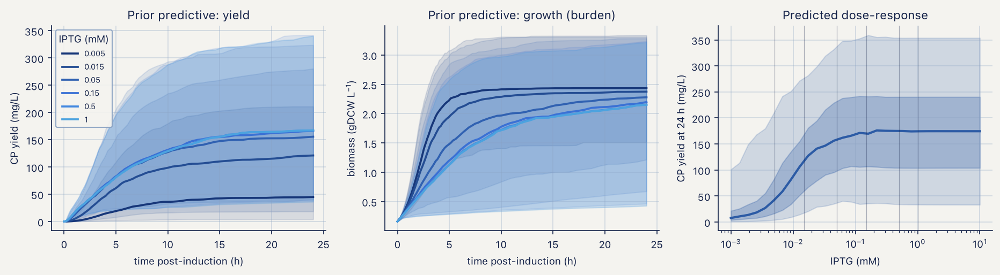

The identifiability half of that audit is the operational consequence. With all doses in the mM range the predicted protein is near-identical for any $K_I$ between 5 and 500 µM, so the posterior for $K_I$ cannot differ from its prior. A ladder that straddles the midpoint separates those same four values by factors of 3 to 30 at the low rungs. The calibration ladder must straddle $K_I$, and this is the argument for it.

The horizon audit explains why the ladder must also be read early. With proteolysis switched off, the spread across doses falls from 112.7% at 5 h to 45.7% at 24 h and 17.1% at 48 h, and the capacity ceiling $\varphi_{crit}P_{ref}$ [6] is reached by 5 of 7 doses at 24 h and 6 of 7 at 48 h. With proteolysis at its prior value the spread holds at 99.1% and no dose reaches the ceiling. Late sampling of a non-degrading protein measures the ceiling, not the dose.

Sequential Monte Carlo [7] at 2000 draws over 4 chains, as implemented in PyMC [8], converged in 781 s with $\hat{R} \le 1.01$ on the rank-normalised diagnostic [9] and bulk ESS above 200 for every sampled quantity. Ten of the eleven structural parameters were recovered inside the 94% credible interval; the exception is $\varphi_{crit}$, at 0.22 against a generating value of 0.25. One miss in eleven is what a 94% interval does.

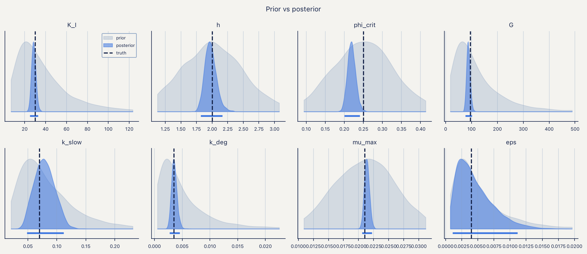
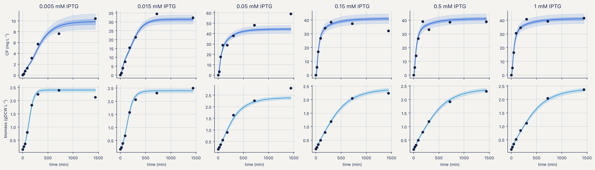

The posterior correlations are more informative than the marginals. The strongest are $k_{slow} \leftrightarrow k_{fast}$ at −0.74, $K_I \leftrightarrow h$ at −0.63, $h \leftrightarrow \varepsilon$ at +0.59, $\varphi_{crit} \leftrightarrow G$ at +0.57, and $\varphi_{crit} \leftrightarrow K_I$ and $K_I \leftrightarrow G$ both at +0.49. Hill midpoint and exponent trade off because a single sigmoid can be matched by sliding one against the other. Any forecast built from independent marginal draws of these pairs will be wrong in a way no amount of sampling will fix.

The design forecast narrows the 90% interval on 24 h yield from 314 to 33 mg L⁻¹, an 89% reduction, and places the posterior optimum at 2.81 mM with 195 mg L⁻¹ (90% CI 178–211). The same cell reports that every dose from 0.0452 to 10 mM lies within 5% of that optimum, which is why the notebook refuses to print a single optimal dose.

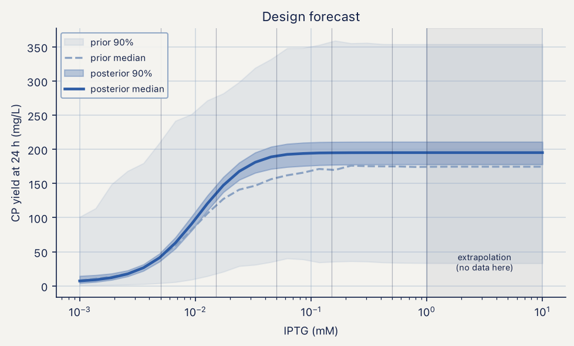

The held-out test is the one the module fails. Refitting without the 150 µM arm and predicting it puts 4 of 8 timepoints inside the 94% posterior-predictive interval — 50% against a nominal 94%. The full-length run was undertaken specifically to determine whether this was an artefact of short chains; it is not. The model interpolates among the doses it was fitted to and is overconfident on a dose it has not seen. The remedy is structural: the discrepancy term listed as M1.21 in the provenance table [10], deliberately left unimplemented, is now required.

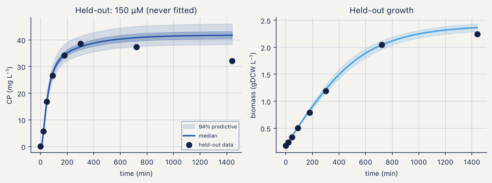

## 9.5 M1, lactose arm: the horizon was the bug

The lactose arm was originally written with a 300 min horizon inherited from the IPTG protocol. Simulating the full 24 h shows that the time to half-maximal protein is 798, 738, 696 and 684 min across the four arms and that glucose is not exhausted until 270 min. The autoinduction lag [11] is not a detail of the protocol; it is most of the experiment.

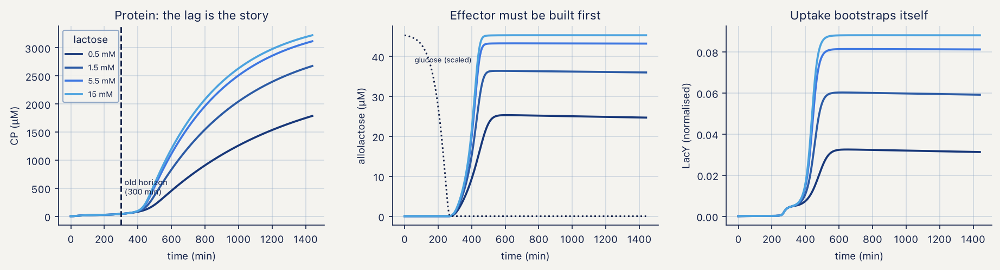

Positive feedback through LacY raises the possibility of bistability [12,13], which would make a deterministic mean meaningless. The hysteresis test runs each dose from a naive and from a pre-induced inoculum and finds a maximum relative gap of 0.11% between the two histories. At these parameters the system has one attractor.

Three degeneracy checks accompany it. Exchanging $k_{slow}$ and $k_{fast}$ moves the observable by 2.11 × 10⁻⁶ — exchangeable, hence the ordered parameterisation. Scaling $V_Y$ up by 1.6 while dividing $k_{cat}$ by the same factor moves it by 70%, and co-scaling $f_{tg}$ with $k_{cat}$ moves it by 56%: neither pair is degenerate, so $f_{tg}$ is fixed for parsimony rather than from necessity. That distinction matters when someone later asks why a parameter was not fitted.

Inference at 2000 draws over 4 chains converged in 589 s, all $\hat{R} \le 1.01$ and ESS above 200, and recovered 13 of 13 parameters. The posterior correlation structure is more severe than in the IPTG arm: $\varepsilon \leftrightarrow G$ at −0.99, $k_{cat} \leftrightarrow G$ at +0.89, $k_{cat} \leftrightarrow \varepsilon$ at −0.88 and $V_Y \leftrightarrow K_A$ at +0.73. A leak–gain correlation of −0.99 means the two are one parameter as far as these data are concerned, and the ridge propagates into every yield forecast the module produces. Breaking it requires a sub-$K_Y$ lactose arm, where leak and gain separate.

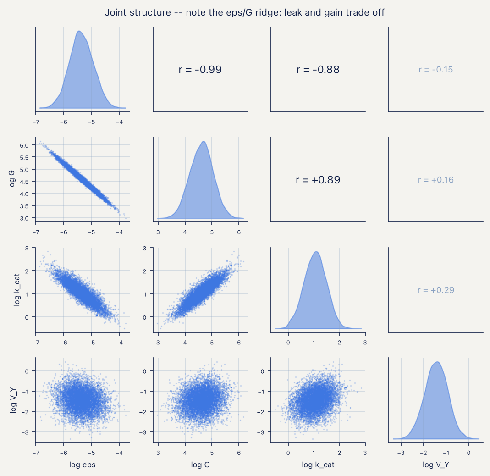
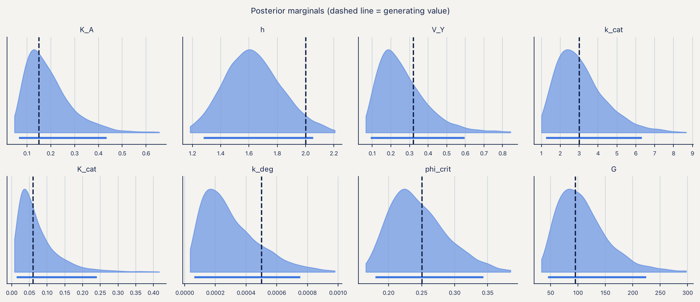

The harvest-time scan puts the optimum at the 1440 min boundary with 246 mg L⁻¹ (90% CI 225–278), against 3 mg L⁻¹ at 300 min. An optimum sitting on the edge of the search window is a statement about the window: the model cannot see the top of the curve from inside a 24 h horizon.

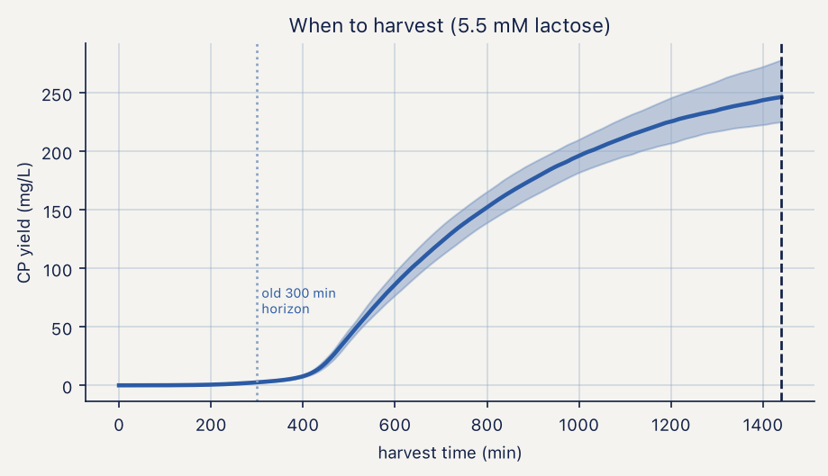

The held-out dose test fails as in the IPTG arm: 6 of 10 points inside the 94% interval, 60% against nominal 94%. The two arms share an observation model and they fail the same way.

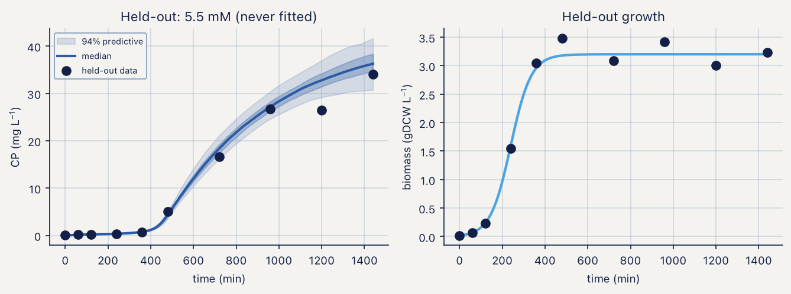

## 9.6 M2, verification: the handoff reproduces M1

Before any partition result, M2 re-implements the M1 forward model in plain SciPy and checks it against the numba implementation it consumes. The 5500 µM arm gives 2729.4 µM of coat protein at 18 h, or 37.4 mg L⁻¹ in the cytoplasm and 177.7 mg per litre of culture, against the 178 mg L⁻¹ reported by notebook 01, with growth rates at 18 h of order 10⁻⁸ min⁻¹ — growth has fully arrested and dilution no longer contributes to protein loss.

The axis-sensitivity table quantifies which knob the partition module can be calibrated on. Moving $s_{50}$ from 20 to 300 nM s⁻¹ moves the 18 h soluble fraction from 0.402 to 0.826 in the lowest arm; moving temperature from 37 to 18 °C moves it from 0.549 to 0.900. Within either row the spread across the four lactose doses is 0.07 to 0.12, because peak flux varies by only a factor of 2.6 across the whole dose panel. Temperature is the strong axis, flux the weak one, and an experiment that varies dose alone spends its replicates on the wrong variable.

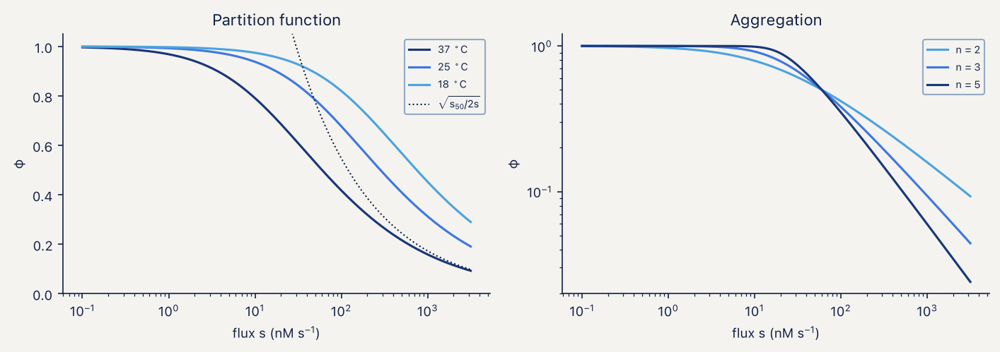
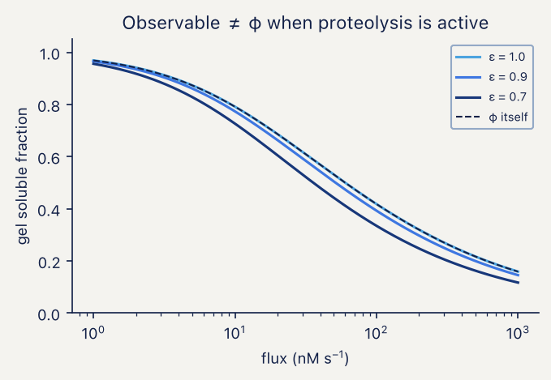

## 9.7 M2, inference: calibration as the acceptance test

This subsection replaces the result previously reported here, which recorded 3 of 4 parameters recovered and a held-out temperature predicted with 95% coverage. Both numbers were produced by an incorrect observation model and neither should be cited.

The failure was found by replacing the recovery check with a calibration check. Recovery asks whether one synthetic dataset put the truth inside the interval, which is one Bernoulli draw per parameter and cannot distinguish a biased posterior from an unlucky draw. Simulation-based calibration [14,15] draws $\theta$ from the prior, simulates a dataset, refits, and records the rank of the truth in the posterior; if prior, likelihood and sampler are mutually consistent those ranks are uniform and the 94% interval covers 94% of the time.

Over 64 replicates the 94% interval covered 0.547, 0.703, 0.531 and 0.734 for $s_{50}$, $\Delta E/R$, $n$ and $\nu$. Three controls established where the defect was not. A reference random-walk chain of 100 000 draws over 4 chains ($\hat{R} = 1.0001$) reproduced the sequential Monte Carlo posterior to three decimal places in mean and standard deviation, which rules out the sampler. Repeating the calibration with a hardened proposal [16,17] — the first version let a stalled chain adapt to a near-zero covariance and stay stalled, which affected 18 of 64 replicates — changed nothing once every replicate passed its acceptance and ESS checks. Re-running the check with three parameters pinned at their generating values and the fourth integrated exactly on a grid, with no Monte Carlo at all, still under-covered. The same grid machinery applied to a pure beta model with known probabilities returned 0.945 coverage over 400 replicates, which rules out the test itself.

The cause was in the observation model. Over prior draws, 11.8% of design points sit at a soluble fraction above 0.999 and 13.6% of simulated gels came back at exactly 1.0 in double precision. A beta density has no mass at the boundary, so the likelihood clipped those observations to $1-10^{-6}$ and evaluated a density there, which for those shape parameters is both very large and very sharply parameter-dependent. One observation in seven was fictitious high-information data, and the posterior came out roughly 1.8-fold too narrow for every parameter at once.

A gel cannot report a soluble fraction of 1; it reports that no pellet band is visible above the detection limit. The likelihood now treats boundary observations as censored — the standard remedy for a response with mass at the boundaries of its support [18] — with $y = 1$ contributing $P(Y > 1-\delta)$, $y = 0$ contributing $P(Y < \delta)$, $\delta = 0.01$ of lane intensity, and the generator and posterior-predictive replicates censoring identically. Coverage over 64 replicates is then 0.938, 0.891, 0.938 and 0.938, mean ranks are 0.538, 0.498, 0.487 and 0.466 against a nominal 0.5, and the Kolmogorov–Smirnov statistic of rank uniformity falls from 0.21–0.37 to 0.078–0.125 against a 5% critical value of 0.17. The in-notebook version of the same check, at 16 replicates, returns 0.938 for three parameters and 1.000 for $\nu$ in 154 s.

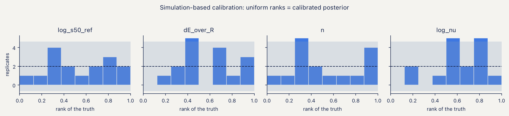

With the corrected likelihood and the data supplied as paired concentrations in mg L⁻¹, the module recovers all four parameters: $s_{50}$ = 47.2 nM s⁻¹ (94% CI 43.3–51.4) against a generating value of 50, $\Delta E/R$ = 12 310 K (11 439–13 208) against 12 000, $n$ = 2.635 (2.46–2.82) against 2.6, and $\nu$ = 66.6 (51.2–85.1) against 60. Sequential Monte Carlo took 1270 s at 2000 particles, log *Z* = 184.32.

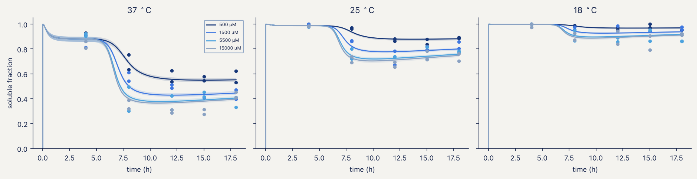

The held-out temperature test returns 98% of points inside a 95% interval. That is above nominal and the reason is worth stating: the 18 °C arm sits close to saturation, so most of its observations are censored and the predictive interval reaches the boundary. The test passes partly because the observable has little left to discriminate, and it should be rebuilt around an arm whose soluble fraction sits away from 1.

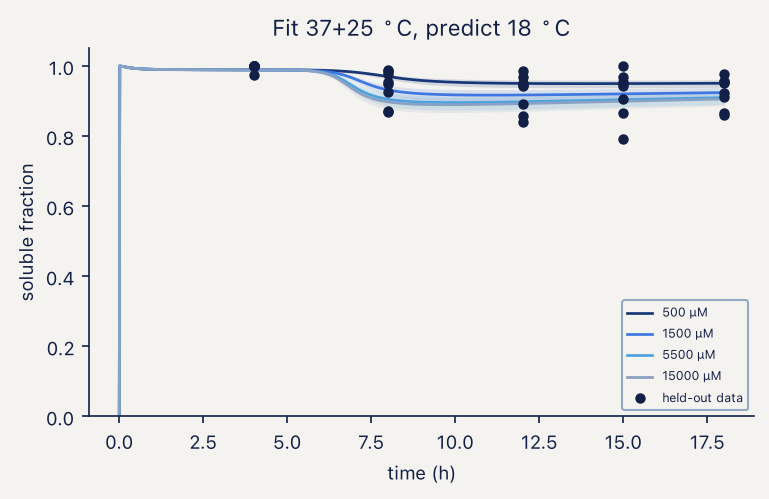

The handoff to M3 is a free-dimer pool of 393, 506, 556 and 568 µM across the four lactose arms, from total protein of 1422 to 2853 µM partitioned as 787–1135 µM soluble against 635–1718 µM aggregated.

## 9.8 M3: thermodynamics robust, kinetics not reportable, and what TEM can be asked

The contact energy is not assumed. A denaturation midpoint is a disassembly midpoint, so at *T*~m~ the assay concentration equals the critical concentration of the equilibrium assembly model [19,20] and Equation (4.8) inverts for $\Delta G_{contact}$ with no free parameters. Wild-type MS2 particles melt at approximately 66 °C in a thermal shift assay run at 5–20 µM coat protein [3], which is 2.5–10 µM dimer and therefore −4.05 to −3.59 kcal mol⁻¹; the mid-range value, −3.820 kcal mol⁻¹, is used throughout and the full band is propagated.

At that energy $c^{\star}$ = 3.60 µM, against 1.03 µM at the −4.2 kcal mol⁻¹ placeholder the framework previously carried, a 3.5-fold shift. The lowest dimer arm handed over by M2 sits 109-fold above it and the highest 158-fold. The conclusion that assembly in this system is not concentration-limited therefore survives the shift, with two orders of magnitude of margin.

Equilibrium outputs are insensitive to the remaining uncertainty: across the assay band the equilibrium capsid fraction moves from 0.9898 to 0.9970 — 0.72 percentage points — and intermediates hold below 0.2% of mass at the measured energy. Kinetic outputs are not: the capsid fraction reached in 18 h from a 500 µM bolus moves from 0.652 to 0.935 across the same band, a span of 28 percentage points, and the placeholder energy would have reported 0.937 where the measured energy reports 0.760.

Being above $c^{\star}$ is necessary but not sufficient. A 20 µM bolus is thermodynamically above the critical concentration and produces no capsid at all in 18 h. Anyone reporting a failed *in vitro* reassembly should check the lag before blaming the protein.

Feeding and bolus addition of the same total dimer give different stalled fractions and different capsid fractions at 18 h. A bolus at $t = 0$ reaches a capsid fraction of 0.884 with 0.8% stalled intermediates; a constant feed reaches 0.741 with 4.0% stalled; a ramped feed reaches 0.728 with 4.4%. Feeding therefore does not reduce the trapped fraction relative to a bolus of the same total material, and 131–137 µM of free dimer remains unconverted at harvest. "Feeding is better" is false in this model for both the intermediate fraction and the total capsid at 18 h.

The *pac* ladder spans 1.6 percentage points of capsid fraction in the fed regime (0.733 to 0.750 across 0×, 1× and 3× constructs) and produces no capsid at all in a 30 µM bolus. The construct series is readable in cells and unreadable *in vitro* at that concentration.

The sensitivity scan over nine contact schedules is the module's limiting result. The critical concentration is identical across all nine at 3.5977 µM, because it depends only on the total contact count, which the geometry fixes. The equilibrium capsid fraction spans 0.978 to 0.998. The kinetic capsid fraction at 18 h spans 0.003 to 0.930 and the stalled fraction 0.014 to 0.129. The schedule is not a nuisance parameter; it is the dominant unknown, and enumerating it from the 2MS2 [21] and 1AQ3 [22] structures is the highest-value action available that requires no bench work.

**The TEM observable.** A micrograph on its own is qualitative, and the module can be asked for something a microscope counts instead: of the objects large enough to register as particles — closed shells plus fragments past half closure — the fraction that are closed. Fixing the acceptance window at 27 ± 2 nm and the count at ≥ 200 particles across ≥ 5 fields turns that into a number with a binomial interval, and the model then says what the measurement can resolve.

The answer is instructive and partly negative. At the 200 and 500 µM bolus the predicted correctly-formed fraction is 1.000 to four decimal places: the stalled material sits in *small* oligomers, well below the size a 27 nm field registers as a particle. Counting 200 particles and seeing none malformed would bound the malformed fraction below 1.5%, and 1000 particles below 0.3% — a bound, not an estimate. Only at a 1000 µM bolus does the fraction fall to 0.929, where a 200-particle count resolves it to ±3.6 percentage points. Across the nine contact schedules the fraction spans 0.892 to 1.000, a 10.8 point range against the roughly 5 point resolution of a 200-particle count, so a TEM count discriminates between schedules only at the edge of its own error bar.

The conclusion for the experimental plan is that the kinetic trap is an SEC observable — a shoulder between the dimer and capsid peaks — and not a TEM observable. TEM is the check on shape, which no protein assay can provide, and the particle count that enters M5 comes from size-exclusion chromatography with a protein assay, at 7.7% CV against 12.7% for 200 counted particles.

## 9.9 M5: the harvest titre, and what moves it

M5 does no fitting. It propagates uncertainty through the quantification chain and asks which term dominates. The particle is 2.47 MDa of protein and 405 kDa of cargo at one copy of a 1227 nt transcript, giving 2.87 MDa loaded and 14% RNA by mass.

The primary output is the concentration of correctly formed, loaded particles at harvest: **15.0 mg of loaded VLP protein per litre of culture (95% interval 5.8–30.0)**, equivalently **3.7 × 10¹² particles per mL (1.4–7.3 × 10¹²)**, with 0.62 cargo copies per particle (0.47–0.85) and a packaging specificity of 0.47 (0.36–0.65). Dividing by an assumed 0.10 mg dose gives 154 doses per litre (52–460), 6.5 L per thousand doses and USD 0.026 per dose in media and induction alone; those are planning figures that inherit every uncertainty above and add a dose size no experiment of ours constrains, and they are reported as derived rather than predicted.

Digital PCR counting is the precise step and is not worth optimising. Counting precision is best at a mean occupancy of $\lambda$ = 1.59 copies per partition, where the coefficient of variation is 0.77%, and stays between 2.01% and 1.14% across occupancies from 0.1 to 4.

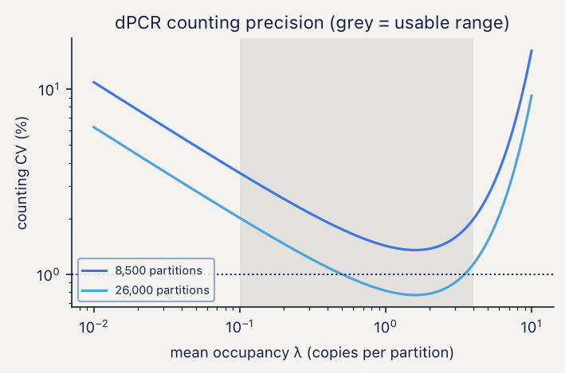

Spectrophotometric deconvolution of protein and RNA is ill-conditioned: the 2 × 2 system has a condition number of 43.8, so a 1% absorbance error becomes up to a 44% error in protein mass. At one cargo copy per particle, RNA accounts for 87.8% of $A_{260}$ and 67.2% of $A_{280}$. The ratio is a good readout for RNA per particle and a poor one for protein; the right split is $A_{260}$ for RNA with a protein assay for protein.

The error budget on cargo copies per particle is dominated by extraction recovery at 55.0% of log-variance, particle count at 25.7% and capsid disruption at 18.0%; protection carryover contributes 1.0% and dPCR counting 0.3%. The design scan makes the operational point: assuming unit efficiency instead of measuring it gives 24.7% CV, running the controls with three biological replicates gives 8.8%, six replicates 6.2%, and adding duplicate wells 5.8%. Running the recovery controls at all is worth more than any amount of replication without them.

The variance in the harvest titre itself decomposes differently, and this is the reconciliation of a discrepancy flagged in earlier versions of this section. With the capsid-fraction uncertainty taken from the contact-schedule scan of Section 9.8 rather than from a placeholder, purification recovery carries 58% of the variance in log titre, capsid fraction 24%, loaded fraction 12%, total coat protein 5%, and the soluble fraction and the TEM-correct fraction 1% each. Dose size, which carried 51% of the variance in doses per litre, contributes nothing to the titre by construction. The two decompositions previously disagreed because one varied model-predicted quantities and the other varied the measurable chain; feeding the schedule span into the capsid-fraction prior closes that gap.

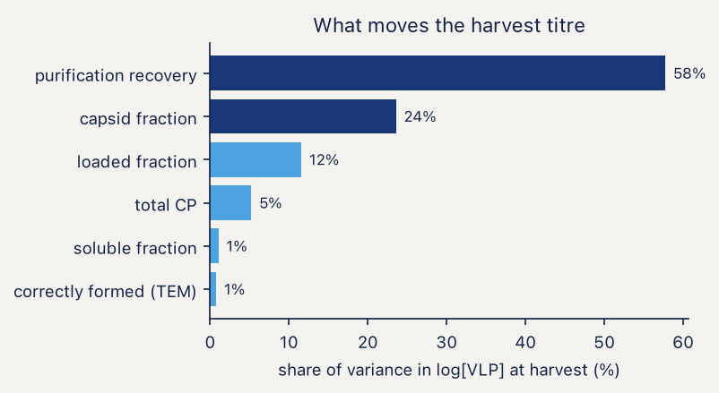

## 9.10 Confrontation with measured data

Three claims have been put to data that were not used to build the model.

The dose-saturation claim of Section 9.4 was tested against a 15-run Box–Behnken design on three unrelated proteins in BL21(DE3) [1]. Main effects divided by the standard deviation of the design's own centre-point replicates rank IPTG last for all three, averaging 1.03 times the replicate noise against 5.73 for temperature and 3.69 for induction time. The same design put through the model with 400 prior draws, normalised by the measured relative centre-point noise of 0.164, gives 0.67 for time and 0.15 for IPTG, with temperature identically zero because M1 has no temperature term. The agreement is ordinal and that is all it can be; what matters is that the ranking was not fitted.

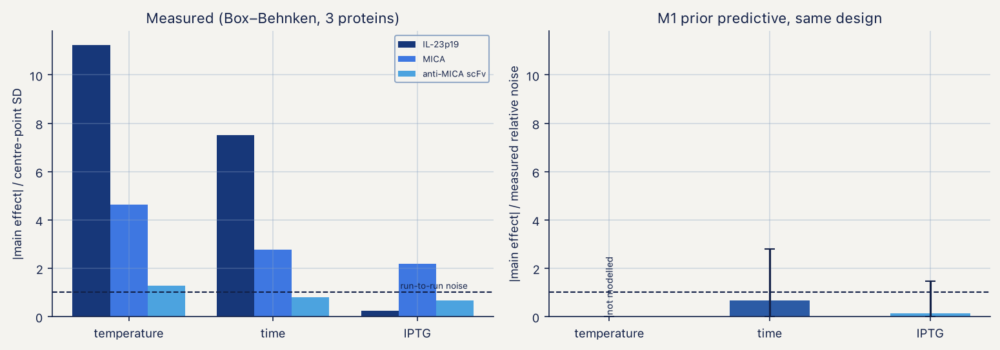

The temperature term in the partition function was tested against soluble and insoluble target protein measured at two induction temperatures [2]. If $s_{50}$ were temperature-independent, the measured 1.47-fold rise in total target protein between 30 and 37 °C would move the soluble fraction from 0.686 to 0.621; the measurement is 0.341, which is 11.6 measurement standard deviations away. The temperature dependence is not optional. Fitting both parameters returns $\Delta E/R$ = 20 000 K (94% CI 13 500–26 900) against the 12 000 K used in the synthetic runs, with residuals of +0.018 and −0.041 at the two calibration points. The ratio-based closed-form inversion, which uses the instantaneous partition function rather than the history-weighted observable, gives 23 600 K; the difference is the proteolysis weighting plus the pull of a prior still centred at 10 000 K.

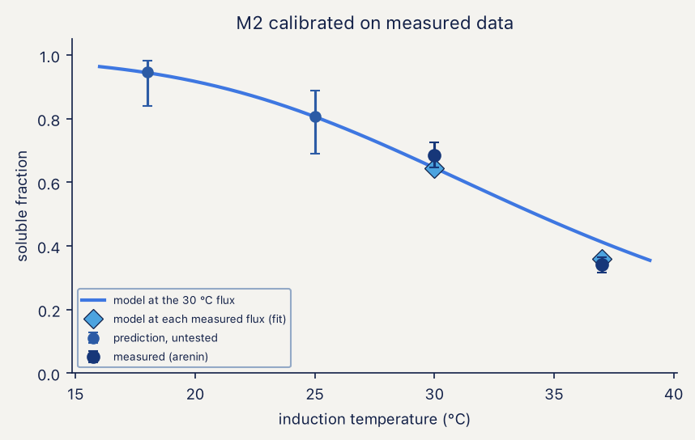

Since two temperatures and two free parameters leave nothing to hold out, the calibration is spent on a forward prediction: at the 30 °C synthesis flux the model forecasts a soluble fraction of 0.808 (95% CI 0.691–0.889) at 25 °C and 0.946 (0.839–0.983) at 18 °C. One gel at either temperature falsifies the Arrhenius closure of Equation (3.12). The censoring correction of Section 9.7 leaves those numbers bit-identical, because 0.34 and 0.69 are nowhere near a detection limit — none of the measured-data conclusions depended on the defect.

The contact energy was taken from a published melting point [3] rather than assumed, with the consequences in Section 9.8. The same publication reports engineered variants spanning *T*~m~ from 42 to 61 °C, which convert to roughly 0.3 kcal mol⁻¹ of contact energy — narrower than the uncertainty on the wild-type value itself, which comes from not knowing where in a 5–20 µM range the assay sat. A ladder built from thermal-shift mutants would calibrate nothing.

## 9.11 What the framework currently licenses

| claim | basis | status |
|---|---|---|
| IPTG above ~0.1 mM is one condition | synthetic audit + measured factorial, 3 proteins | supported |
| the calibration ladder must straddle $K_I$ | identifiability audit | supported |
| lactose runs need a 24 h horizon | forward simulation, 4 doses | supported |
| the lactose system has one attractor | hysteresis test, 0.11% gap | supported at these parameters |
| the soluble partition requires a temperature term | measured, 2 temperatures | required at 11.6 SD |
| $\Delta E/R \approx 12\,000$ K | measured | rejected; 20 000 K (13 500–26 900) |
| M2 posteriors are calibrated | 64-replicate SBC | supported after the Section 9.7 fix |
| assembly is not concentration-limited | measured $T_m$ + M2 handoff | survives; arms run 109–158× above $c^{\star}$ |
| equilibrium capsid fraction > 0.98 | measured $T_m$, full assay band | supported |
| capsid fraction at 18 h | schedule scan | not reportable; spans 0.003–0.930 |
| malformed particles are TEM-visible | model-predicted size distribution | rejected; stalled material is sub-resolution |
| dose forecasts at unseen doses | held-out, both arms | overconfident; 50% and 60% against 94% |
| recovery-corrected absolute titre | no source located | untested |

Four actions follow, in order of what they buy. Enumerate the contact schedule from the 2MS2 and 1AQ3 structures; it is the dominant unknown in M3 and the second-largest term in the harvest titre, and it requires no bench work. Implement the discrepancy term M1.21 in both expression arms; without it no predictive interval at an unseen condition can be quoted. Run one gel at 18 or 25 °C; it falsifies or confirms the only closure in the framework resting on two measurements. Run the three recovery controls of Section 7.4; they carry 55% of the variance in the only number that reaches a vial.

## 9.12 References

Every record below was retrieved from Crossref by DOI and the fields reproduced verbatim; the two structure entries were taken from the primary citation recorded by the RCSB Protein Data Bank for that accession. Items 1–3 are the measured datasets the modules were confronted with, 4–5 and 7–9 the numerical and sampling machinery, 10 and 14–18 the inference methodology, and 6, 11–13 and 19–22 the biology and the assembly theory the equations implement.

1. Gutiérrez-González M, Farías C, Tello S, *et al.* Optimization of culture conditions for the expression of three different insoluble proteins in *Escherichia coli*. *Scientific Reports* 2019;9(1). doi:10.1038/s41598-019-53200-7
2. Hidalgo-Vázquez E, Hernández-Pérez J, Antunes-Ricardo M, *et al.* Heterologous expression and functional characterization of recombinant arenin to assess its anticancer and wound-healing potential. *Bioresources and Bioprocessing* 2025;12(1). doi:10.1186/s40643-025-00986-2
3. Pistono PE, Xu J, Huang P, *et al.* Exploring the effects of intersubunit interface mutations on virus-like particle structure and stability. *Biochemistry* 2024;63(15):1913–1924. doi:10.1021/acs.biochem.4c00225
4. Virtanen P, Gommers R, Oliphant TE, *et al.* SciPy 1.0: fundamental algorithms for scientific computing in Python. *Nature Methods* 2020;17:261–272. doi:10.1038/s41592-019-0686-2
5. Harris CR, Millman KJ, van der Walt SJ, *et al.* Array programming with NumPy. *Nature* 2020;585:357–362. doi:10.1038/s41586-020-2649-2
6. Weiße AY, Oyarzún DA, Danos V, Swain PS. Mechanistic links between cellular trade-offs, gene expression, and growth. *Proceedings of the National Academy of Sciences USA* 2015;112(9). doi:10.1073/pnas.1416533112
7. Del Moral P, Doucet A, Jasra A. Sequential Monte Carlo samplers. *Journal of the Royal Statistical Society Series B* 2006;68:411–436. doi:10.1111/j.1467-9868.2006.00553.x
8. Abril-Pla O, Andreani V, Carroll C, *et al.* PyMC: a modern, and comprehensive probabilistic programming framework in Python. *PeerJ Computer Science* 2023;9:e1516. doi:10.7717/peerj-cs.1516
9. Vehtari A, Gelman A, Simpson D, Carpenter B, Bürkner P-C. Rank-normalization, folding, and localization: an improved $\hat{R}$ for assessing convergence of MCMC. *Bayesian Analysis* 2021;16:667–718. doi:10.1214/20-BA1221
10. Kennedy MC, O'Hagan A. Bayesian calibration of computer models. *Journal of the Royal Statistical Society Series B* 2001;63:425–464. doi:10.1111/1467-9868.00294
11. Studier FW. Protein production by auto-induction in high-density shaking cultures. *Protein Expression and Purification* 2005;41:207–234. doi:10.1016/j.pep.2005.01.016
12. Novick A, Weiner M. Enzyme induction as an all-or-none phenomenon. *Proceedings of the National Academy of Sciences USA* 1957;43:553–566. doi:10.1073/pnas.43.7.553
13. Ozbudak EM, Thattai M, Lim HN, Shraiman BI, van Oudenaarden A. Multistability in the lactose utilization network of *Escherichia coli*. *Nature* 2004;427:737–740. doi:10.1038/nature02298
14. Talts S, Betancourt M, Simpson D, Vehtari A, Gelman A. Validating Bayesian inference algorithms with simulation-based calibration. *arXiv* 2018; arXiv:1804.06788.
15. Cook SR, Gelman A, Rubin DB. Validation of software for Bayesian models using posterior quantiles. *Journal of Computational and Graphical Statistics* 2006;15:675–692. doi:10.1198/106186006X136976
16. Haario H, Saksman E, Tamminen J. An adaptive Metropolis algorithm. *Bernoulli* 2001;7:223. doi:10.2307/3318737
17. Roberts GO, Rosenthal JS. Optimal scaling for various Metropolis–Hastings algorithms. *Statistical Science* 2001;16:351–367. doi:10.1214/ss/1015346320
18. Ospina R, Ferrari SLP. Inflated beta distributions. *Statistical Papers* 2010;51:111–126. doi:10.1007/s00362-008-0125-4
19. Zlotnick A. To build a virus capsid: an equilibrium model of the self assembly of polyhedral protein complexes. *Journal of Molecular Biology* 1994;241:59–67. doi:10.1006/jmbi.1994.1473
20. Endres D, Zlotnick A. Model-based analysis of assembly kinetics for virus capsids or other spherical polymers. *Biophysical Journal* 2002;83:1217–1230. doi:10.1016/S0006-3495(02)75245-4
21. Golmohammadi R, Valegård K, Fridborg K, Liljas L. The refined structure of bacteriophage MS2 at 2.8 Å resolution. *Journal of Molecular Biology* 1993;234:620–639. doi:10.1006/jmbi.1993.1616 — PDB 2MS2
22. van den Worm SHE, Stonehouse NJ, Valegård K, *et al.* Crystal structures of MS2 coat protein mutants in complex with wild-type RNA operator fragments. *Nucleic Acids Research* 1998;26:1345–1351. doi:10.1093/nar/26.5.1345 — PDB 1AQ3
