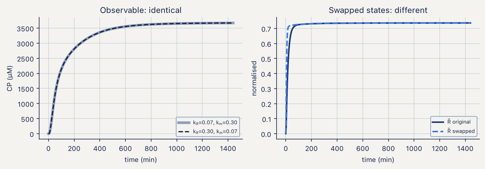
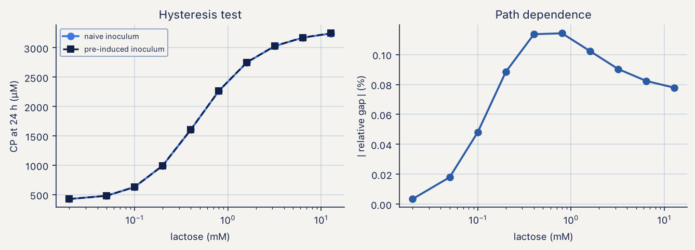

# CAPSID M1 · Coat-protein expression

Notebooks: `BruSafe_01_M1_expression_IPTG.ipynb`, `BruSafe_02_M1_expression_lactose.ipynb`,
`literature/BruSafe_01L_M1_literature_design.ipynb`

## What the module does

M1 predicts the concentration of coat protein (CP) in a culture as a function of time and inducer
dose. It is a coupled ODE system for biomass, inducer, T7 RNA polymerase, CP transcript and CP, in
which a single capacity factor ψ = 1 − (P/Pref)/φcrit limits both growth and
synthesis. This is how the metabolic burden of expression enters the model, and it allows CP to
saturate without an explicit cap.

Two induction arms are modelled:

| | IPTG arm (notebook 01) | Lactose arm (notebook 02) |
|---|---|---|
| Inducer | gratuitous, constant concentration | allolactose, made and destroyed by β-galactosidase |
| States | 5 | 10 (adds glucose, extracellular and intracellular lactose, allolactose, LacZ, LacY) |
| Fitted parameters | 11 | 13 |
| Horizon | 24 h | 24 h |
| Host assumption | *lacY*⁻ (e.g. Tuner(DE3)), or doses above ~100–200 µM | *lacY*⁺; LacY is the uptake route |

Every term of the equations is tagged and classified as *direct* (the cited work reports the form or
value), *adapted* (the mechanism is established, the functional form is ours), *assumption* (no
literature claim) or *reparametrisation*. The provenance tables are in the notebooks (§2.3 of
notebook 01 and §2.4 of notebook 02).

## Calibration

Parameters are estimated by sequential Monte Carlo (SMC) with a gradient-free sampler, because the
forward model is an ODE solve wrapped as an external operator. The observation model works on
physical quantities: biomass in gDCW L⁻¹ with a relative error plus a noise floor, and CP in mg L⁻¹
with a log-normal error and one densitometry scale per gel (gel 0 fixed at 1). The model is
calibrated on synthetic data with known truth until real V-A data are available, behind a single
marked swap point.

## Identifiability

Identifiability is audited before inference.

- **Exact symmetry.** The cascade transfer function from de-repression to CP transcript is
  symmetric under exchange of the two rate constants (kR ↔ km), so the
  sampler draws an ordered pair (a slow constant and a ratio) and the unordered pair is reported.
- **Lumped gain.** The product of polymerase level, copy number and transcription and translation
  rates cannot be separated from protein data and is a single gain, G.
- **Dose design.** IPTG doses above the Hill midpoint are a single condition for the model:
  calibrating only in the mM range returns the prior on KI and h. The calibration
  ladder therefore straddles KI (5 to 1000 µM).
- **Leak and gain (lactose arm).** After fitting, the basal leak ε and the gain G are correlated at
  r ≈ −0.98. The uninduced control arm breaks this trade-off and is required in the experiment.

*Figure 1. Exchanging the two cascade constants leaves the observable (CP, left) unchanged, whereas
the hidden states (right) differ. The two parameterisations cannot be distinguished by protein
data.*

## Why the horizon is 24 h

Over 5 h the CP equation has no loss term once growth stops, so P rises until ψ = 0 and reaches the
same ceiling for every dose. A first-order loss term, kdeg, gives a dose-dependent steady
state. It has no MS2-CP-specific literature value, and a 5 h time course cannot constrain it; the
predicted optimum dose moves down with the horizon if kdeg = 0 and up if
kdeg = 0.0035 min⁻¹. Time points at 12 and 24 h, or a translation-halted arm, turn
kdeg from an assumption into a measurement.

Under lactose, the horizon is a requirement and not a choice. At the calibrated parameters 300 min
captures only 1.3–2.3% of the protein present at 24 h, and half-maximal accumulation occurs at
650–780 min.

*Figure 2. Lactose autoinduction over 24 h. Left: CP accumulates only after a lag (the dashed line
marks the 300 min horizon used earlier). Centre: allolactose appears only after glucose is
exhausted (dotted curve). Right: LacY, and hence uptake, builds up at the same moment.*

## Results on synthetic data

| Check | IPTG arm | Lactose arm |
|---|---|---|
| Parameters recovered inside the 94% credible interval | 10 of 11 | 13 of 13 |
| Held-out dose, coverage of the predictive interval | 50% (nominal 94%) | 60% (nominal 94%) |

The held-out coverage shows that the model interpolates among the fitted doses and is overconfident
at an unseen dose. A Kennedy–O'Hagan discrepancy term is required before a forecast interval at an
unseen condition is quoted.

*Figure 3. Forecast of CP yield at 24 h against IPTG dose, before (grey) and after (blue)
calibration on synthetic data. The shaded band at the right is extrapolation beyond the largest
dose of the calibration ladder.*

## Bistability under lactose

At the nominal parameters, two initial histories (uninduced and fully pre-induced cells) converge to
the same 24 h endpoint. Allolactose is consumed by the enzyme that its own accumulation induces, and
this negative loop damps the positive feedback of LacY. The notebook repeats the test over draws
from the fitted posterior and reports the fraction of draws that show path dependence; that
fraction, and not the single-parameter result, is the quantity to report.

*Figure 4. Test for path dependence under lactose induction.*

## Comparison with a published design (notebook 01L)

The 15-run Box–Behnken design of Gutiérrez-González et al. (2019) measured yield against IPTG,
temperature and induction time for three recombinant proteins in BL21(DE3). These data cannot
calibrate the model, which has no temperature axis, but they test one qualitative prediction: that
above about 0.1 mM, IPTG dose is the weakest of the three factors. The main effect of each factor,
divided by the standard deviation of the three centre-point replicates, ranks IPTG last in all three
proteins (averaged over the proteins: temperature 5.7, time 3.7, IPTG 1.0). The model's
prior-predictive effects for time and IPTG are smaller than the measured ones and compatible with
the same ranking. The agreement is ordinal, not quantitative.

*Figure 5. Left: measured main effects in units of the centre-point standard deviation, for the three
proteins of the design. Right: the same quantity from the M1 prior predictive; temperature is not
modelled. The dashed line marks the run-to-run noise.*

## Experimental recommendations

- Sample at 12 and 24 h in addition to the early time points, so that kdeg is identified.
- Carry an uninduced arm for the whole run.
- Under lactose, measure residual glucose and lactose at three or four time points; the time of
  glucose exhaustion constrains Kcat and qGlc.
- Record the gel identity of every lane, and load equal OD-units per lane.
