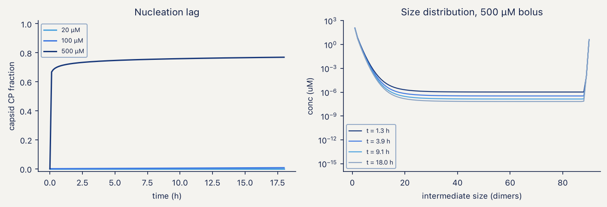
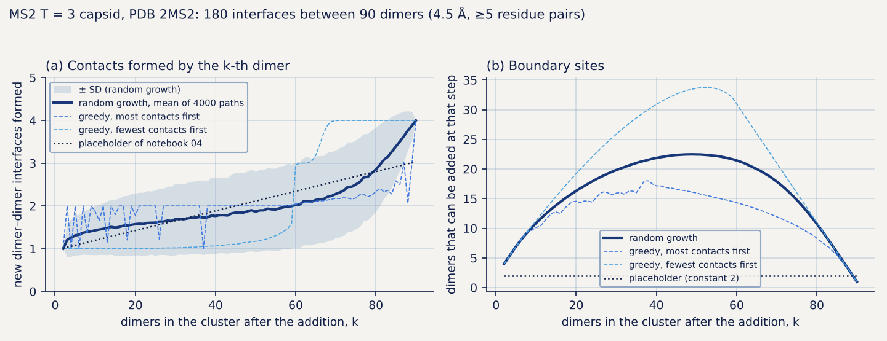
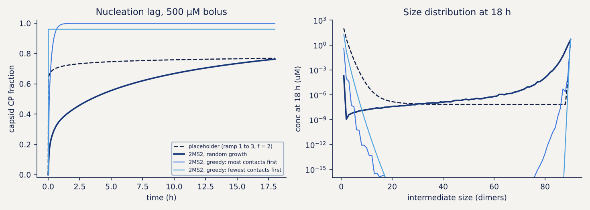
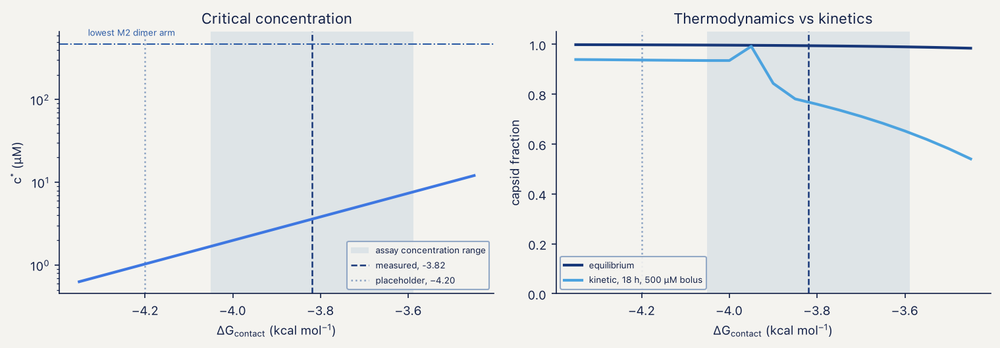

# CAPSID M3 · Capsid assembly

Notebooks: `BruSafe_04_M3_capsid_assembly.ipynb`, `literature/BruSafe_04L_M3_literature_dG.ipynb`

## Model

The *T* = 3 MS2 capsid consists of 180 coat-protein subunits, which assemble from **90 dimers**:
60 A/B dimers and 30 C/C dimers, with 180 dimer–dimer contacts in the closed shell. M3 follows every
intermediate size with a nucleation–elongation cascade over dimers,

C1 + Cj ⇌ Cj+1, j = 1 … 89,

with a closed shell at N = 90. Association is degenerate (several equivalent addition sites),
dissociation is not, and forward and reverse rates are tied by detailed balance. The kinetics and the
equilibrium distribution are therefore the same model. The equilibrium distribution follows from the
free-dimer concentration alone and is computed in logarithms, since C190
underflows double precision.

The notebook takes the soluble dimer pool (or the dimer flux) from M2 and returns `assembly_sink`
to M2, expressed in monomer units.

## Contact energy from a measured melting point

The contact energy ΔGcontact is not a free parameter. A thermal denaturation midpoint of the
VLP is a disassembly midpoint, so at the melting temperature the assay concentration equals the
critical concentration c\*, and Eq. (4.8) of the framework document can be inverted for
ΔGcontact. Pistono et al. (2024) report Tm ≈ 66 °C for wild-type MS2 in a thermal
shift assay run at 5–20 µM monomer (2.5–10 µM dimer). The inversion gives

| Assay concentration (dimer) | ΔGcontact (kcal mol⁻¹) |
|---|---|
| 2.5 µM | −4.05 |
| 5 µM (used in notebook 04) | −3.82 |
| 10 µM | −3.59 |

An earlier placeholder of −4.2 kcal mol⁻¹ had no source and is retained only as a comparison line in
the figures. The values for the mutant ladder are in `capsid/data/litdata/derived_M3_dG_from_Tm.csv`.

## Results

**Equilibrium.** At every contact energy considered, intermediates stay below about 1% of the mass at
equilibrium, so an assembly assay measures essentially a two-species mixture of free dimer and
capsid. c\* and the equilibrium capsid fraction (0.98–0.998 across the sensitivity scan) depend only
on the total contact count and are robust.

**Assembly is limited by kinetics and not by thermodynamics.** Every expression arm of M2 lies two to
four orders of magnitude above c\*, so a titration designed to bracket c\* would spend its whole range
on one side of it. Being above c\* is necessary but not sufficient: at 20 µM dimer, which is above
c\*, the cascade produces essentially no capsid in 18 h because of the nucleation lag.

*Figure 1. Left: capsid fraction against time at three dimer concentrations; only the 500 µM bolus
nucleates within 18 h. Right: size distribution of intermediates at 500 µM at four times; the
distribution is bimodal, with free dimer and closed shells and very little in between.*

**The kinetic trap saturates.** In this cascade, stalled intermediates plateau at a few percent
and do not grow with concentration (with the placeholder schedule; see "What depends on the schedule"). A yield that is non-monotonic in concentration would require an
off-pathway or malformed species, which the cascade does not contain.

**Bolus and feed.** An in vitro reassembly is a bolus, whereas in the cell dimer arrives continuously
at the rate supplied by M2. At the contact energy of −3.82 kcal mol⁻¹, a constant feed of the same total
dimer gives a higher stalled fraction than a bolus (0.040 against 0.008) and a lower capsid fraction at
18 h (0.741 against 0.884). The reaction has not finished at harvest: 131 µM of free dimer remains
unconverted. A slow feed therefore does not reduce the stalled fraction in this model, with the placeholder schedule; with the schedule from 2MS2 this depends on the growth rule (see "What depends on the schedule").

## Coupling to packaging

In MS2, the TR/*pac* hairpin binds the A/B dimer and stabilises the bent FG-loop conformer, so it
could lower the nucleation barrier. This was modelled as extra contact energy on the first addition
only, which is a qualitative coupling and not a calibrated one. In the fed, in vivo regime, the
free-dimer pool is far above what nucleation requires, and the capsid fraction at 18 h changes by
only 1.6 percentage points between 0×, 1× and 3× *pac* constructs. Comparing harvested VLP yield
between *pac* constructs would therefore not test the allosteric coupling. The coupling would be
visible only where nucleation is limiting, that is, in vitro at 20–50 µM purified dimer with and
without the TR hairpin, followed by SEC or light scattering.

## Contact schedule from the structure

The contact schedule (the number of new dimer–dimer interfaces formed when the k-th dimer joins the
cluster) and the number of sites at which the next dimer can be added were enumerated from the
asymmetric unit of PDB 2MS2 by `capsid/tools/enumerate_contacts.py`, and the results are shipped in
`capsid/data/structure/` (`contact_schedule.csv`, `contact_schedule.json`). The procedure is:

1. The 60 icosahedral operators (REMARK 350) are applied to chains A, B and C, giving 180 chains.
2. The chains are grouped into the 90 dimers of the model: 60 A/B dimers (each A chain with the B chain
   it shares the largest interface with) and 30 C/C dimers.
3. Two dimers are in contact if at least 5 pairs of residues have heavy atoms closer than 4.5 Å. This
   gives **180 interfaces**, 60 between two A/B dimers and 120 between an A/B and a C/C dimer; no
   interface joins two C/C dimers. The mean interface has 53 residue pairs (A/B–A/B) and 49 (A/B–C/C).
4. Growth paths on this graph of 90 dimers are generated 4000 times for each of three rules (the next
   dimer chosen at random, or greedily with the most or the fewest contacts), and the contacts formed
   at each step are recorded. Every path closes with exactly 180 interfaces.

| Step k | Contacts formed (random growth, mean) | Sites where the next dimer can be added (mean) |
|---|---|---|
| 2 | 1.00 | 4.0 |
| 10 | 1.43 | 10.9 |
| 30 | 1.69 | 19.8 |
| 50 | 1.87 | 22.5 |
| 70 | 2.28 | 17.9 |
| 80 | 2.85 | 10.8 |
| 90 | 4.00 | 1.0 |

The first addition forms one interface and the last forms four. Contacts per addition rise slowly,
from 1.0 to about 2.0 over the first 60 steps, and then steeply as the shell closes (mean 1.66 for steps 2–59
and 2.70 for steps 60–90). The number of sites where the next dimer can be added is 4 for the first
addition, peaks at 22.5 near k = 49 and falls to 1 for the last dimer. The placeholder of notebook 04 has
contacts rising linearly from 1 to 3 and a constant number of sites equal to 2, so the structure
changes the degeneracy by up to an order of magnitude and the contacts of the final steps by one.

*Figure 2. Contact schedule and boundary sites of the T = 3 capsid enumerated from PDB 2MS2 (4.5 Å,
at least 5 residue pairs per interface), for random growth (mean ± SD over 4000 paths) and for two greedy
rules, compared with the placeholder of notebook 04. The greedy curves are not bounds of all possible
paths.*

The schedule is geometric: it counts residue pairs in contact in the crystal lattice, treats every
interface as equivalent, and does not say how the dimers actually assemble. The edge threshold (5
residue pairs) is a choice, and `enumerate_contacts.py` prints the number of interfaces for thresholds of
3, 5, 10 and 20 residue pairs.

## What depends on the schedule

Notebook 04 uses the placeholder schedule and degeneracy by default, and every number on this page above this
section was computed with them. With `SCHEDULE_SOURCE = "structure"` (§2 of the notebook) it reads the schedule
enumerated from 2MS2 for every section, and §9b repeats the outputs with the placeholder and with each of the three
growth rules (the run is `capsid/results/logs/log_nb04s.txt`; mass is conserved to better than 10⁻⁶ in the runs of §9b).
Varying the placeholder over nine combinations gives:

| Output | Range over the nine combinations | Status |
|---|---|---|
| c\* | identical | robust |
| equilibrium capsid fraction | 0.978 – 0.998 | robust |
| kinetic capsid fraction at 18 h | 0.003 – 0.930 | **not robust** |
| stalled fraction | 0.014 – 0.129 | **not robust** |

The schedule from the structure gives (500 µM bolus unless stated):

| Output | Placeholder (default) | 2MS2, random growth | 2MS2, greedy: most contacts first | 2MS2, greedy: fewest contacts first |
|---|---|---|---|---|
| c\* (µM) | 3.6 | 3.6 | 3.6 | 3.6 |
| equilibrium capsid fraction | 0.9945 | 0.9994 | 0.9993 | 0.9995 |
| kinetic capsid fraction at 18 h | 0.768 | 0.763 | 0.999 | 0.961 |
| stalled fraction | 0.027 | 0.237 | 0.000 | 0.001 |
| half-time of the capsid fraction | 1 min | 73 min | 6 min | 1 min |
| stalled fraction, 600 µM bolus and constant feed | 0.008 and 0.040 | 0.237 and 0.0004 | 0.000 and 0.0005 | 0.0001 and 0.018 |
| closed shells among the counted particles | 1.000 | 0.760 | 1.000 | 1.000 |

*Figure 3. Capsid fraction against time (left) and size distribution of the intermediates at 18 h (right) for a
500 µM bolus, with the placeholder of notebook 04 and with the schedule enumerated from 2MS2 under three growth
rules.*

The equilibrium quantities do not move, which confirms that they depend only on the total contact count. The
kinetic ones do, and the structure does not make them robust: the stalled fraction is 0.000–0.237 across the three
growth rules, a range wider than the 0.014–0.129 of the placeholder grid, and the half-time of the capsid fraction
goes from 1 to 73 min. Three statements made above depend on the rule:

- **The trap saturates at a few percent.** This holds for the placeholder. With random growth the stalled fraction
  still saturates with concentration, at 0.24, and not at a few percent.
- **A slow feed does not reduce the stalled fraction.** This holds for the placeholder and for the two greedy
  rules. With random growth the constant feed gives a stalled fraction of 0.0004 against 0.237 for a 600 µM bolus,
  and a capsid fraction of 0.979 against 0.763.
- **The kinetic trap is not a TEM observable.** With the placeholder the stalled material is in small oligomers.
  With random growth it is in shells that lack a few dimers: 99.7% of it is in clusters of 85 to 89 dimers. The
  notebook counts any cluster of 45 dimers or more as a malformed particle (0.760 of the counted particles are
  closed shells), but a shell that lacks a few of 90 dimers may not be told apart from a closed one by its
  diameter, so this fraction is a lower bound on the fraction that a count would classify as correct.

The nucleation lag, the stalled fraction and the intermediate size distribution should therefore be quoted only as
a range over growth rules, or after the growth rule has been constrained, for instance by SEC or DLS of the
intermediates. Three things limit the comparison. The schedule is the mean over 4000 paths and not the distribution of
outputs over paths, and at −3.82 kcal mol⁻¹ one contact changes a dissociation rate by a factor of about 500, so the
variation between paths is not small. The two greedy rules are not bounds of all possible paths. And every interface
is treated as equivalent, although the A/B–A/B and A/B–C/C interfaces differ in size (53 and 49 residue pairs on
average) and, as §2 of the notebook notes, in the energy they should carry. The first association keeps the
convention of the notebook (one site, f₁ = 1); the four sites of the graph would multiply that rate by four, and this
was not tested in the notebook.

## Sensitivity to the contact energy (notebook 04L)

Across the range of ΔGcontact allowed by the assay concentration (−4.05 to −3.59
kcal mol⁻¹), the equilibrium capsid fraction changes by under 1 percentage point, whereas the kinetic
capsid fraction at 18 h changes by about 28 percentage points. Equilibrium quantities are therefore
insensitive to the uncertainty of the assay, and kinetic ones are not.

*Figure 4. M3 outputs across the contact energies obtained from the published melting point.*

## What a TEM count can establish

Closed shells and fragments past half closure (45 dimers or more) are counted as particles by TEM,
with a 27 ± 2 nm acceptance window. At the measured contact energy the model predicts that the
stalled material sits in small oligomers, below the size that a 27 nm field registers as a particle,
so TEM would see essentially no malformed particles (counting 200 particles with none malformed
would bound the fraction below 1.5%, and 1000 particles below 0.3%, at 95%). The kinetic trap is
therefore an SEC observable, a shoulder between the dimer and capsid peaks, and not a TEM
observable (with the placeholder schedule; see "What depends on the schedule"). The particle number that enters M5 comes from SEC with a protein assay (7.7% CV, against
12.7% for 200 counted particles).

## Experiments supported by the module

- Disassembly midpoint by urea or thermal ramp with SEC, which constrains ΔGcontact
  directly and is independent of the dPCR arm.
- SEC or DLS on the induction titration, looking for a shoulder between the dimer and capsid peaks.
- In vitro reassembly at 20–50 µM dimer ± TR hairpin.
- TEM reported as the fraction of correct particles (at least 200 particles across at least five
  fields), with its binomial 95% interval, and not as a representative image.
